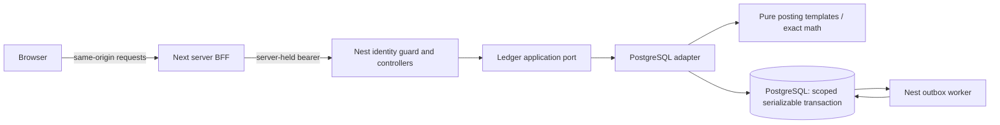
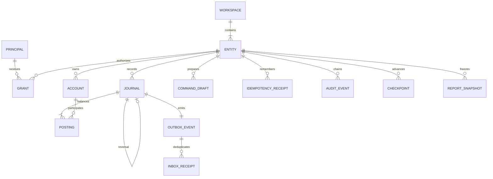

# Kernel contracts 0.1.0

The financial book is the consistency boundary. It belongs to one workspace, has one functional currency and an optimistic integer version. Membership permission is independent from account balances or beneficial ownership. This slice provisions personal books through synthetic bootstrap; workspace creation/invitations and economic ownership are future domains.

Only `modules/ledger/src/domain/` decides posting semantics. The adapter enforces ownership, state/version, transactional effects and evidence. Shared contracts validate input and output. There are no authoritative Redis balance projections. Future bounded contexts must own their aggregates and reconcile subledgers rather than bypass journal contracts.

Database keys include workspace/entity through accounts, journals, postings, drafts, receipts, events and snapshots. Migration 001 establishes the schema; 002 enforces semantic templates and restore-safe sealing; 003 adds private drafts; 004 scopes consumer deduplication and restricts workers; 005 supports durable account/reversal recovery; 006 limits runtime book updates to the version column. Applied migration checksums cannot be silently changed.

## Commands and state

| Operation | Preconditions | Atomic effect | Recovery |
|---|---|---|---|
| Preview transaction | Current owner, current version, valid exact amount/account/date/template | Freeze exact private draft; no journal | Draft UUID retrieves immutable inputs and preview. |
| Post reviewed transaction | Draft matches exact input hash; current owner/version unless replay | Journal+lines+audit+outbox+receipt+version | Same key returns same journal, including after refresh. |
| Prepare account/reversal | Current owner/version; valid opening amount or original/date | Freeze operation type and exact inputs | No economic effect until submitted. |
| Create account | Prepared exact inputs, valid name/type/date/opening | Account, nonzero opening-equity journal, audit/receipt/version | Original key resolves account/journal receipt. |
| Reverse journal | Prepared exact original/reason/date; owner; current version; original eligible | Exact opposite linked journal, audit/outbox/receipt/version | Permanent reversal uniqueness plus original key. |
| Generate report | Current read permission, valid dates/definition, ≤10,000 source journals | Immutable creator-private snapshot | Retrieve by snapshot UUID; source identity/hash preserved. |

Journal states: immutable posted original → posted with a linked reversal. A reversal is another immutable posted journal. Private command drafts do not count as posted facts. Reconciled/disputed/pending-import states and controlled restatements remain future obligations. Snapshot state is issued/immutable; retrieval always rechecks creator and current grant.

HTTP contracts are in [OpenAPI](openapi.json) and `packages/contracts/src/index.ts`. Mutating financial endpoints require a UUID `Idempotency-Key` returned by preparation. Keys are scoped to actor, operation, workspace and entity. Changed payloads conflict; exact retries return receipts before stale-version rejection. Service-level seed/test commands also have idempotency but do not require browser preparation.

Errors use `code`, `detail`, `status`: validation400, authentication401, hidden unauthorized resource404, concurrency/duplicate409, financial/state422, unavailable upstream503. A failure never returns a partial successful journal. An uncertain response is resolved by the original operation key, not a new economic event.

`journal.posted.v1` outbox envelopes contain event UUID, workspace/book/journal identity and creation time, without amounts or descriptions. A worker claims bounded batches using `FOR UPDATE SKIP LOCKED`, inserts tenant-scoped consumer inbox records, updates checkpoints and marks delivery in one transaction. Repeated delivery is harmless to that consumer. This is not a general broker/lease/dead-letter or full projection implementation.

Canonical SHA-256 snapshot hashing recursively sorts object keys and preserves array order. Audit hashes chain previous hash/sequence/actor/action/resource; they do not yet authenticate every financial value or provide an independently protected checkpoint. No schema artifact is a substitute for a security assessment.

Input commands retain the 26-integer-digit contract; calculated stock/flow totals have a 38-digit contract. The real database boundary and controlled presentation fixture are separately tested. Runtime can update only a book version, keeping currency/identity outside ordinary command privileges.
