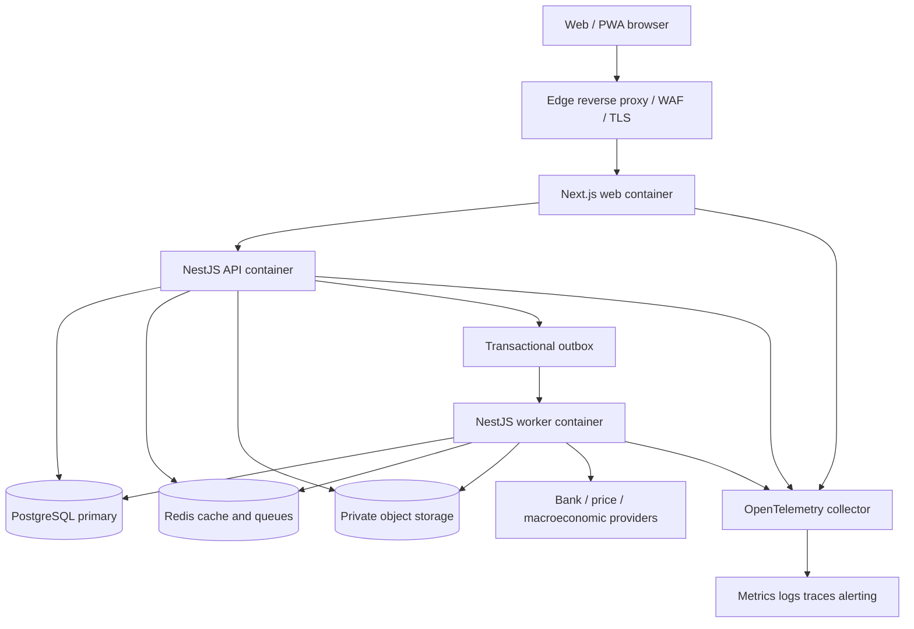
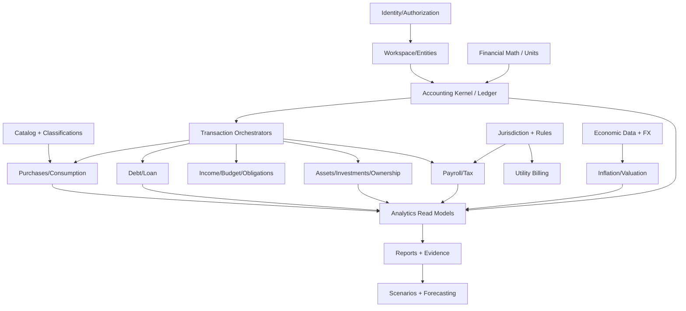
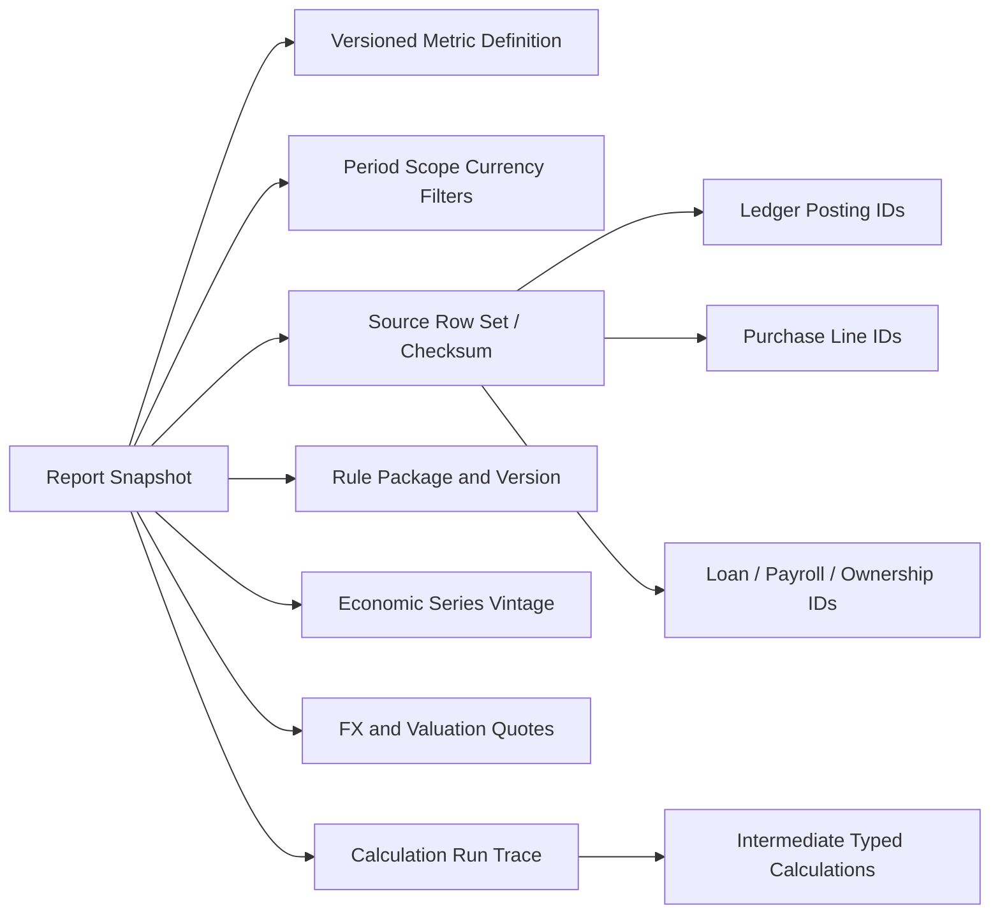

# Global Financial Operating System (GFOS)

## Super-Mega Implementation Architecture and Engineering Handbook

**Architecture document:** `GFOS-ARCH-001`  
**Document version:** 1.0.0  
**Prepared:** 2026-10-08  
**Status:** Proposed, implementation-ready architectural baseline; **not deployed or certified**  
**Companion document:** [`GFOS_Super_Mega_Product_Specification.md`](./GFOS_Super_Mega_Product_Specification.md)  
**Language:** English  
**Implementation target:** Next.js + NestJS + TypeScript + PostgreSQL + Redis + Docker  
**Architecture style:** Domain-driven modular monolith with asynchronous projections and verifiable financial computation  
**Primary users:** Individuals, families, joint-asset owners, freelancers, expatriates, small employers, and their authorized advisers

> **Read this first.** This is an engineering *design specification*, not evidence that GFOS exists as working software. Illustrative SQL and TypeScript show the intended contracts; they require integration, migration review, security testing, and jurisdiction-specific validation before production. No architecture alone guarantees compliance in every country. The default product records, calculates, and analyzes financial information; it does not custody assets, move money, file taxes, or provide regulated investment advice without explicitly scoped, authorized implementations.

> **Document precedence.** The companion product specification defines *what* the product must support. This document defines *how* to build and validate it. If requirements conflict, log a decision in an Architecture Decision Record (ADR), obtain product/accounting/compliance sign-off, and update both documents. Do not silently interpret conflicting financial rules.

---

# Table of Contents

## Main chapters

- [1. Architectural mission, invariants, and success criteria](#1-architectural-mission-invariants-and-success-criteria)
- [2. Scope, assumptions, and explicit exclusions](#2-scope-assumptions-and-explicit-exclusions)
- [3. Architecture style and system boundaries](#3-architecture-style-and-system-boundaries)
- [4. Technology choices and version governance](#4-technology-choices-and-version-governance)
- [5. Repository and package layout](#5-repository-and-package-layout)
- [6. Domain dependency graph and allowed communication](#6-domain-dependency-graph-and-allowed-communication)
- [7. Identity, workspace, ownership, and authorization model](#7-identity-workspace-ownership-and-authorization-model)
- [8. Physical PostgreSQL data architecture](#8-physical-postgresql-data-architecture)
- [9. Canonical financial event and journal state machines](#9-canonical-financial-event-and-journal-state-machines)
- [10. Exact financial calculation contracts](#10-exact-financial-calculation-contracts)
- [11. Catalog, itemized purchases, and household inventory](#11-catalog-itemized-purchases-and-household-inventory)
- [12. Comprehensive living-expense implementations](#12-comprehensive-living-expense-implementations)
- [13. Income, receivables, budgets, and goals](#13-income-receivables-budgets-and-goals)
- [14. Loans, amortization, and creditor/debtor workflows](#14-loans-amortization-and-creditordebtor-workflows)
- [15. Assets, investment lots, cryptocurrency, and valuations](#15-assets-investment-lots-cryptocurrency-and-valuations)
- [16. Joint finances, ownership, and consolidation](#16-joint-finances-ownership-and-consolidation)
- [17. Payroll, workers, and local employment rules](#17-payroll-workers-and-local-employment-rules)
- [18. Recurring obligations, calendar, and reminders](#18-recurring-obligations-calendar-and-reminders)
- [19. Jurisdiction registry and legal rules engine](#19-jurisdiction-registry-and-legal-rules-engine)
- [20. Official economic data, vintages, and exchange-rate feeds](#20-official-economic-data-vintages-and-exchange-rate-feeds)
- [21. Inflation, purchasing power, and cost-of-living algorithms](#21-inflation-purchasing-power-and-cost-of-living-algorithms)
- [22. Analytics semantic layer and financial metric registry](#22-analytics-semantic-layer-and-financial-metric-registry)
- [23. Scenario modeling and financial forecasting](#23-scenario-modeling-and-financial-forecasting)
- [24. REST API architecture and contract rules](#24-rest-api-architecture-and-contract-rules)
- [25. Idempotency, outbox, durable messaging, and consistency](#25-idempotency-outbox-durable-messaging-and-consistency)
- [26. Integration architecture and reconciliation](#26-integration-architecture-and-reconciliation)
- [27. Document, receipt, and file architecture](#27-document-receipt-and-file-architecture)
- [28. Frontend architecture: Next.js, UI/UX, and PWA](#28-frontend-architecture-nextjs-uiux-and-pwa)
- [29. Multilingual, regional, date, currency, and unit architecture](#29-multilingual-regional-date-currency-and-unit-architecture)
- [30. Security architecture and threat model](#30-security-architecture-and-threat-model)
- [31. Privacy, data classification, and compliance operating model](#31-privacy-data-classification-and-compliance-operating-model)
- [32. Docker, infrastructure and configuration](#32-docker-infrastructure-and-configuration)
- [33. CI/CD, migrations, and release engineering](#33-cicd-migrations-and-release-engineering)
- [34. Observability, SLOs, and operational runbooks](#34-observability-slos-and-operational-runbooks)
- [35. Performance, capacity, and scaling](#35-performance-capacity-and-scaling)
- [36. Test strategy and verification pyramid](#36-test-strategy-and-verification-pyramid)
- [37. Worked end-to-end architectural scenarios](#37-worked-end-to-end-architectural-scenarios)
- [38. Implementation epics, deliverables, and dependencies](#38-implementation-epics-deliverables-and-dependencies)
- [39. Engineering work items and feature acceptance inventory](#39-engineering-work-items-and-feature-acceptance-inventory)
- [40. Requirements traceability and definition of done](#40-requirements-traceability-and-definition-of-done)
- [41. Roles and approval responsibility matrix](#41-roles-and-approval-responsibility-matrix)
- [42. Architecture Decision Records (ADRs)](#42-architecture-decision-records-adrs)
- [43. Known risks and mitigation plans](#43-known-risks-and-mitigation-plans)
- [44. Unresolved decisions and implementation checkpoints](#44-unresolved-decisions-and-implementation-checkpoints)

## Appendices

- [Appendix A. Complete cross-referenced analytical report catalog](#appendix-a-complete-cross-referenced-analytical-report-catalog)
- [Appendix B. Detailed implementation contracts, validation rules, and examples](#appendix-b-detailed-implementation-contracts-validation-rules-and-examples)
- [Appendix C. Reference standards, documentation, and supporting design sources](#appendix-c-reference-standards-documentation-and-supporting-design-sources)
- [Appendix D. Financial and architectural glossary](#appendix-d-financial-and-architectural-glossary)
- [Appendix E. Final engineering handoff checklist](#appendix-e-final-engineering-handoff-checklist)

---

# 1. Architectural mission, invariants, and success criteria

## 1.1 Mission

Deliver one financially consistent system for private money, expenses down to individual products, income, debt, assets, payroll, inflation, taxes, and shared ownership. The system must produce explainable reports from authoritative facts under explicitly selected jurisdictions, rule versions, economic data vintages, valuation bases, and reporting periods.

GFOS is not simply a list of services. It is a set of **financial invariants** surrounded by domain modules, interactive workflows, data ingestion, calculated read models, and jurisdiction-specific rule packs. Engineering decisions prioritize correctness and privacy over feature count, and traceability over visually impressive but unverified charts.

## 1.2 Non-negotiable invariants (`INV-*`)

| ID | Invariant | Enforcement point |
|---|---|---|
| INV-001 | Every posted journal is balanced in the accounting entity's functional currency. | Domain validator + deferred database validation |
| INV-002 | Posted journals/postings are immutable; corrections are linked reversals and new entries. | Database privileges/triggers + service policy |
| INV-003 | The same external financial event cannot post twice in the same defined scope. | Unique idempotency/source keys + transactional lock |
| INV-004 | Money amounts use exact arithmetic; no JavaScript `number` for authoritative decimal finance. | Type/contracts, domain library, lint/tests |
| INV-005 | Every amount has currency/asset unit, scale, date, and accounting context. | Typed domain objects + database constraints |
| INV-006 | A transfer between own accounts is not earned income or consumption expense. | Transaction classification + golden tests |
| INV-007 | A loan disbursement is not earnings; loan principal repayment is not interest expense. | Loan and posting orchestration |
| INV-008 | Joint beneficial ownership and application permission are independent. | Ownership + authorization boundaries |
| INV-009 | Access is scoped to financial entity/tenant/record and independently checked server-side. | Policy engine + row security/queries |
| INV-010 | Regulatory calculations use eligible effective-dated, reviewed rule packages or return `requires_review`/`unavailable`. | Rules resolver |
| INV-011 | Historical reports preserve source-record identity, formula, rates, rule version, and data vintage. | Evidence/snapshot service |
| INV-012 | Forecast/scenario values cannot mutate the historical accounting ledger. | Separate scenario storage and service ACL |
| INV-013 | Economic series retain publication/revision timestamps and quality metadata. | Ingestion schema |
| INV-014 | Imported and manually recorded events reconcile; unmatched/duplicate input is visible. | Import/reconciliation state machines |
| INV-015 | Every report reconciles to its defined source scope and discloses missing input coverage. | Reporting validator |
| INV-016 | Ordinary application logs, metrics, and domain events exclude unnecessary financial PII. | Data-classification and observability policies |
| INV-017 | Account consolidation eliminates internal transfers and allocates partial ownership correctly. | Consolidation engine |
| INV-018 | No financial external action (payment, trade, payroll payout) occurs without authorized connector and explicit permissions. | Capability gates and consent |

## 1.3 Measurable release gates

- Zero unexplained imbalances in approved production journals; documented and resolved reconciliation exceptions.
- Full pass of agreed independent golden calculation vectors before every release involving financial code.
- No critical security findings, no unreviewed high-impact authorization defects, and no unauthorized cross-workspace access in testing.
- Historical report snapshots reproducible against their frozen calculation context.
- Verified localization of all money-critical workflows in all 12 required language families, with separate RTL tests for Persian and Arabic.
- Each released jurisdiction capability has public/internal coverage metadata: scope, source, effective dates, reviewer, supported calculations, known gaps.
- Defined SLOs, backup/restore tests, disaster recovery evidence, and observed performance meeting load-profile gates.

# 2. Scope, assumptions, and explicit exclusions

## 2.1 Supported business capabilities

The companion product requirements include personal/household/workspace management; bank, card, cash, crypto, metals and investment accounts; wages and other income; itemized grocery and goods receipts; living expenses, utilities, housing, fuel, childcare, healthcare; loan and credit amortization; recurring obligations and charitable payments; budgeting and goals; assets and investment cost bases; partial ownership and shared capital; employee/contractor payroll; dynamic regional taxes and subsidies; official/personal inflation, real wages, purchasing-power parity; insurance, pensions and retirement; forecasting, notifications, AI-assisted explanation; multi-currency reporting and 122 proposed report definitions. **All are within the architectural target**, but not all ship in Release 1.

## 2.2 Initial product mode

Manual-first financial management with optional **read-only** aggregation; no custody of user assets or recovery phrases; no assumption of ability to debit bank accounts, execute payroll disbursements, act as tax agent, issue securities, broker crypto, or provide individualized regulated advice. Add such services only through ADR, security/compliance review, localized licenses as needed, provider contracts, and separate feature gates.

## 2.3 Working design assumptions

- Stateless application/API processes; PostgreSQL is the authoritative durable system of record.
- Every user may be a member of multiple workspaces; a workspace can contain multiple accounting entities and books.
- Default functional currency belongs to an accounting entity; each transaction preserves its original denomination.
- Global default mode can record manual facts even when there is no automated local payroll/tax/tariff pack.
- The official economic data may be sparse, delayed, revised, or unavailable. No fake confidence or synthesized official figures.
- Native apps are optional future clients of the same API; responsive Next.js + PWA is the baseline.

# 3. Architecture style and system boundaries

## 3.1 Choice: modular monolith

Start as a single deployable NestJS application grouped by independently testable domains. A separate Next.js web app and a worker deployment reuse versioned domain packages and contracts. This avoids distributed ACID coordination between loans, receipts, and accounting while retaining clean seams for future extraction.

Do **not** let every module inject any other module's ORM repository. Modules own their write tables and publish narrow interfaces. Prefer command/event contracts, read interfaces, and explicit orchestration at the application layer. Read-only materialized projections may join across contexts with documented provenance, not become sources of truth.

## 3.2 Runtime topology



There are **three application runtime roles**: web, API, worker. Use independently scalable container replicas if workload demands, with only the database's elected primary accepting writes. A read replica may service suitable reports after explicit consistency controls; never silently use lagging reads to confirm a just-posted payment.

## 3.3 Synchronous versus asynchronous processing

| Synchronous ACID write | Asynchronous after commit |
|---|---|
| Posting a balanced journal + source event + outbox | Dashboard aggregation and searchable projections |
| Finalizing loan payment allocation | Reminder rescheduling, repayment charts |
| Locking finalized payroll liability postings | Payslip delivery, optional payment provider sync |
| Saving purchase and its authoritative settlement relation | OCR enhancement, basket prices, inventory suggestion |
| Persisting authorized ownership agreement version | Consolidated net-worth recomputation |
| Approving/publishing a rule package | Cache invalidation and affected estimate recomputation |

No critical money movement is acknowledged until its authoritative database transaction commits. A downstream queue message is not evidence of a posted payment.

## 3.4 Architectural fitness functions

Continuously test: forbidden dependency imports; prohibited `number` use in financial domain; API schemas and database constraints; permission isolation; event payload PII; p95 latency; invariant-preserving property tests; backward compatibility; report trace completeness; and applicable regulatory rule coverage. Reject a build that fails a financial invariant even if normal UI tests pass.

# 4. Technology choices and version governance

## 4.1 Baseline choices

| Concern | Choice | Implementation guidance |
|---|---|---|
| Language | TypeScript, strict mode | No `any` in domain boundaries; type-safe parsing at external boundaries |
| Frontend | Next.js App Router | Server rendering and streamed data where appropriate; client islands for charts/forms |
| Backend | NestJS | Transport/application/domain/infrastructure layered by bounded context |
| Package manager | pnpm workspaces | Lockfile required; pin versions at implementation kickoff |
| Build orchestration | Turborepo or Nx | Choose one via ADR; cache only deterministic tasks |
| DB | PostgreSQL supported stable release | Constraints, partitioning when justified, RLS defense in depth |
| ORM | Drizzle or Prisma for routine models | Pick one; use reviewed parameterized SQL where ORM cannot enforce ledger constraints |
| Migrations | Versioned SQL migrations | Schema-review gates; forward-compatible deployments; no blind auto-sync |
| Exact math | Arbitrary-precision decimal library | Branded quantities; documented rounding policies |
| Cache/job transport | Redis | Cache never authoritative; durable queue with idempotent consumers |
| Files | S3-compatible private storage | Signed links, object scan/quarantine, per-object permission enforcement |
| Validation | Zod/Standard Schema or class DTOs | Share DTO schemas or generated OpenAPI contracts; never rely on TS alone |
| Auth | OIDC provider + WebAuthn/passkeys | Rotate keys, sessions, and refresh tokens; step-up for high-risk actions |
| Telemetry | OpenTelemetry | Trace/correlation IDs, structured logs, privacy-safe metrics |
| Tests | Vitest/Jest, Testcontainers, Playwright | Golden/property/contract/e2e/security matrix |
| Deployment | Docker / Compose initially | Hardened production manifests; orchestrator later if needed |

Do not freeze unverified package-major versions in this living document. At implementation kickoff create an ADR recording mutually compatible *actual* stable versions, runtime requirements, and vulnerability scans. Framework and database references are in Appendix C.

## 4.2 Repository bootstrap decisions

- One source repository with branch protection, signed commits where practicable, CODEOWNERS, conventional changelog, versioned contracts, and automatic dependency update review.
- Package compilation boundaries mirror bounded contexts, not UI pages.
- Database migrations are peer-reviewed and tested against sanitized realistic datasets.
- Never use `prisma db push`, schema synchronize, or ad hoc DDL as a production migration process.
- Pin a supported Node LTS line approved for the chosen Next/Nest releases; confirm at kickoff.
- Generate SBOM, track dependency license constraints, sign images, and scan artifacts in CI.

# 5. Repository and package layout

```text
GFOS/
├── apps/
│   ├── web/                          # Next.js App Router + PWA
│   │   ├── app/[locale]/(public)/
│   │   ├── app/[locale]/(authenticated)/
│   │   ├── components/{forms,finance,charts,layouts}/
│   │   ├── features/{ledger,expenses,loans,reports,...}/
│   │   ├── lib/{api,auth,i18n,formatting}/
│   │   ├── messages/{en,fa,tr,fr,hi,zh-Hans,zh-Hant,ja,es,pt,de,hy,ar}/
│   │   └── tests/
│   ├── api/                          # NestJS HTTP application/composition root
│   │   ├── src/bootstrap/
│   │   ├── src/modules/
│   │   ├── src/security/
│   │   └── src/health/
│   └── worker/                       # Outbox, imports, analytics, notifications
│       ├── src/processors/
│       └── src/schedulers/
├── modules/
│   ├── identity/                     # Each module uses standard DDD layout
│   ├── workspaces/                   # membership, entity, sharing
│   ├── ledger/                       # accounting authority
│   ├── transactions/
│   ├── catalog/
│   ├── purchases/
│   ├── inventory/
│   ├── households/
│   ├── income/
│   ├── budgets/
│   ├── obligations/
│   ├── loans/
│   ├── assets/
│   ├── investments/
│   ├── crypto/
│   ├── ownership/
│   ├── payroll/
│   ├── tax/
│   ├── jurisdictions/
│   ├── rules/
│   ├── utilities/
│   ├── economic-data/
│   ├── inflation/
│   ├── analytics/
│   ├── reporting/
│   ├── forecasting/
│   ├── integrations/
│   ├── documents/
│   ├── notifications/
│   └── audit/
├── packages/
│   ├── contracts/                    # OpenAPI-derived/shared DTO contracts
│   ├── financial-math/               # exact decimal, interest, IRR, rounding
│   ├── accounting-kernel/            # posting types, invariant validators
│   ├── rules-dsl/                    # restricted expression AST
│   ├── economic-methods/            # index methodologies / deflators
│   ├── authorization/              # policy interfaces and decision types
│   ├── units/                      # dimensions, UCUM/reference conversions
│   ├── i18n/                       # formatting, CLDR helpers
│   ├── ui/                         # accessible primitives and themes
│   └── test-vectors/               # immutable golden vectors
├── rule-packs/                        # reviewed country/region/utility packages
│   ├── schemas/
│   ├── countries/
│   └── providers/
├── classifications/                   # COICOP and custom mapping version sets
├── database/
│   ├── migrations/
│   ├── constraints/
│   ├── indexes/
│   ├── policies/
│   └── fixtures/
├── infra/
│   ├── compose/
│   ├── docker/
│   ├── observability/
│   ├── terraform/                   # optional cloud later
│   └── runbooks/
├── docs/
│   ├── adr/
│   ├── architecture/
│   ├── api/
│   ├── calculations/
│   ├── jurisdiction-coverage/
│   ├── compliance/
│   └── operations/
├── tests/{integration,e2e,security,performance,property,acceptance}/
├── scripts/{lint-architecture,check-ledger,seed-demo}/
├── .github/workflows/
├── docker-compose.yml
├── pnpm-workspace.yaml
├── turbo.json
├── package.json
└── README.md
```

## 5.1 Template for a bounded context

```text
modules/loans/
├── src/domain/
│   ├── entities/LoanContract.ts
│   ├── value-objects/InterestConvention.ts
│   ├── policies/PaymentAllocationPolicy.ts
│   ├── events/LoanPaymentRecorded.ts
│   └── services/AmortizationCalculator.ts
├── src/application/
│   ├── commands/{CreateLoan,RecordPayment,RefinanceLoan}/
│   ├── queries/{GetLoan,GetSchedule}/
│   ├── ports/{LoanRepository,LedgerPostingPort,Clock}/
│   └── dto/
├── src/infrastructure/
│   ├── persistence/PostgresLoanRepository.ts
│   ├── mappers/
│   └── consumers/
├── src/presentation/http/
├── src/loans.module.ts
└── test/{unit,integration,fixtures}/
```

Domain code must not import Nest controllers, ORM entities, Redis clients, or Next.js. Application handlers depend on ports. Infrastructure implements ports. Transport converts validated requests to application commands. Cross-module references use identifiers and stable interfaces, not arbitrary ORM relationships.

# 6. Domain dependency graph and allowed communication



**Diagram edges describe allowed dependencies or read/event feeds, not direct infrastructure coupling.** Transaction orchestrators invoke the Ledger posting port; Ledger must *not* call back into purchase, loan, or payroll modules. The accounting kernel is foundational. An event consumer failing must not roll back a committed posted journal.

## 6.1 Cross-context integration patterns

- **Synchronous service port:** Use where a command needs a validated answer before commit (loan payment allocation, exchange valuation, policy decision).
- **Transactional outbox:** Publish durable domain changes after authoritative commit.
- **Inbox/dedup:** Consumers store processed event IDs and offsets/checkpoints.
- **Projection:** Rebuildable read views for dashboards and search.
- **Snapshot:** Persist a report with exact versions; never rely on nonreproducible live joins for legally consequential historical figures.
- **Anti-corruption layer:** Map bank/provider-specific concepts to GFOS canonical event types; never expose raw external semantics throughout the domain.

## 6.2 Event envelope

```typescript
export interface DomainEventEnvelope<TPayload> {
  eventId: string;                  // UUIDv7/UUID
  eventType: string;                // e.g. loan.payment.posted.v1
  schemaVersion: number;
  aggregateType: string;
  aggregateId: string;
  aggregateVersion: number;
  tenantId: string;
  accountingEntityId?: string;
  occurredAt: string;               // UTC event timestamp
  recordedAt: string;               // UTC committed timestamp
  correlationId: string;
  causationId?: string;
  payload: TPayload;                // minimum necessary, not PII dump
}
```

Event versions are immutable. Add new versions with explicit upcasters for consumers if necessary. Include source event/sequence numbers for order-sensitive consumers. At-least-once transport with idempotent effects is the contract; do not claim globally exactly-once delivery.

# 7. Identity, workspace, ownership, and authorization model

## 7.1 Financial identity versus login identity

`User` is an authentication principal, not automatically an economic owner. `FinancialParty` represents a person, household, organization, lender, employer, merchant, beneficiary, or institution. `AccountingEntity` represents a ledger book for a legal/economic reporting subject. `Workspace` is the collaboration boundary. `Membership` and `Delegation` determine visibility and allowed actions. `OwnershipInterest` records *economic rights* and is not derived from membership.

Example: two users collaborate on a joint savings workspace; the joint capital belongs 60/40 to parties A and B, but their bookkeeper may have write access to transactions without owning anything. Personal expense histories remain private even when their users share an investment account.

## 7.2 Core access tables

| Table | Important columns | Indexes and rules |
|---|---|---|
| `identity.users` | `id`, `preferred_locale`, `status`, `created_at` | unique user ID; no passwords in ordinary profile |
| `identity.external_identities` | `user_id`, `issuer`, `subject`, `verified_at` | unique `(issuer,subject)` |
| `workspace.workspaces` | `id`, `kind`, `display_name`, `status`, `created_at` | `kind` enum + owner bootstrap flow |
| `workspace.memberships` | `workspace_id`, `user_id`, `status`, `effective_from/to` | no overlapping active memberships under chosen policy |
| `workspace.roles` | `id`, `workspace_id`, `label`, `version` | system or custom role |
| `workspace.role_assignments` | `membership_id`, `role_id`, `valid_range` | effective-dated assignment |
| `workspace.accounting_entities` | `id`, `workspace_id`, `party_id`, `functional_currency`, `fiscal_calendar` | separate book and consolidation group |
| `workspace.delegations` | `grantor`, `grantee`, `scope`, `expiry`, `revoked_at` | never imply ownership |
| `workspace.consent_records` | `subject`, `purpose`, `data_scope`, `version`, `granted/revoked` | immutable consent history |
| `ownership.parties` | `id`, `type`, `legal_name_ref`, `jurisdictions` | protected PII, minimal event payload |
| `ownership.interests` | `asset_id`, `party_id`, `share_fraction`, `valid_range`, `agreement_id` | percentage checks and overlap resolution |

## 7.3 Policy evaluation contract

`allow(subject, action, resource, context) -> {decision, reasonCode, obligations}`. Evaluate authentication, workspace membership, accounting-entity scope, record confidentiality level, ownership-dependent privileges (only if explicitly granted), task delegation, time-limited grants, purpose of use, consent constraints, and step-up authentication requirements.

- Deny by default. Resolve all business-object IDs on the server; never trust client-supplied `workspace_id` as authorization.
- Role policies: viewer, contributor, manager, owner, payroll administrator, accountant/adviser; custom roles are composed from narrow capabilities.
- `payroll.read_payslip` requires employee-specific or payroll-admin authorization, never generic workspace membership.
- For `joint_asset.edit_ownership`, require agreement role, an approval workflow, and strong authentication.
- Permission audits: who accessed which record, action, decision, and non-sensitive reason.
- All list queries and exports must apply the same authorization filters as individual GET requests; guards are not sufficient if bulk export queries bypass them.

## 7.4 Row security as defense in depth

Use application authorization as the primary policy implementation and PostgreSQL RLS selectively for critical tenant-bound tables. Ensure DB connections have a restricted role and transaction-local tenant/entity context; never allow an application runtime role to be the table owner or have `BYPASSRLS`. Account for policies applying differently to table owners and privileged roles. Test connection pool reuse and session-context reset thoroughly.

```sql
-- Illustrative defense-in-depth template. Apply only with vetted tenant context.
ALTER TABLE ledger.journal_entries ENABLE ROW LEVEL SECURITY;
ALTER TABLE ledger.journal_entries FORCE ROW LEVEL SECURITY;
CREATE POLICY journal_tenant_policy ON ledger.journal_entries
  FOR ALL TO gfos_app
  USING (tenant_id = nullif(current_setting('app.tenant_id', true), '')::uuid)
  WITH CHECK (tenant_id = nullif(current_setting('app.tenant_id', true), '')::uuid);
-- SET LOCAL app.tenant_id = '<validated tenant ID>' inside each transaction.
```

`SET LOCAL` is applied by backend code after *verified* membership, not from raw request headers. Test that missing context denies reads/writes. Composite foreign keys (tenant/entity + record ID) prevent cross-tenant relations even if application code is defective. Use narrow security-definer functions only when justified and independently reviewed.

# 8. Physical PostgreSQL data architecture

## 8.1 Schemas and ownership

Use PostgreSQL schemas such as `identity`, `workspace`, `ledger`, `catalog`, `consumption`, `income`, `debt`, `obligations`, `asset`, `investment`, `ownership`, `payroll`, `tax`, `geo`, `rules`, `economic`, `reporting`, `integration`, `document`, `notification`, `audit`. Schemas organize ownership and privileges; they do not, by themselves, isolate tenant data.

Each write-owning module has dedicated migrations, repository ports, indexes, and reconciliation checks. Public IDs are UUIDs (version choice documented). Created and recorded timestamps are `timestamptz`; civil dates and periods are `date` or a documented period type; a local billing hour requires an IANA time zone and an ambiguity policy.

## 8.2 Canonical data type policy

| Value | PostgreSQL representation | Notes |
|---|---|---|
| Fiat money | `numeric(38, 12)` as a general storage convention | Domain-specific scale and currency-rounding policy apply; review capacity |
| Rate/percentage | `numeric(30, 18)` or exact numerator/denominator | Represent units explicitly; never infer % versus decimal |
| Crypto atomic unit | `numeric(78, 0)` or lossless validated integer text | Large token supplies/scales; asset metadata determines conversion |
| Generic physical quantities | `numeric(38, 18)` plus dimension/unit | Validate dimension-compatible conversions |
| FX price | `numeric(38, 20)` or higher reviewed scale | Bid/ask/mid/transaction rate, quote convention and valid time |
| Ownership fraction | `numeric(24, 20)` | Enforce 0..1; effective-dated rights and tolerance policies |
| Identifiers | `uuid` | Domain-specific composite keys for tenant isolation |
| Calendar date | `date` | Financial event effective date, local period |
| Instant | `timestamptz` | Published, recorded, synchronized, authorized at |
| Legal effective window | `daterange` / `tstzrange` | Use exclusion constraints where non-overlap truly required |
| Monetary JSON | **Avoid** for authoritative values | Typed columns and validated normalized structures |
| Extensible attributes | `jsonb` with versioned schema | Additional detail, never authoritative balances |

Do **not** assume all fiat currencies have two decimal places. Do not use `money` PostgreSQL type to represent general multi-currency monetary amounts. Do not normalize all asset quantities through one currency table.

## 8.3 Recommended logical table families

The following catalog maps domains to persistent tables. Each table has `id`, tenant/workspace context as applicable, state, create/update audit context, and immutable source references where relevant; those repeated fields are omitted for brevity.

| Domain | Tables | Principal relationship or invariant |
|---|---|---|
| Ledger | `accounting_entities`, `accounting_periods`, `ledger_accounts`, `journal_entries`, `postings`, `entry_reversals`, `account_balance_projections` | Journal 1:n postings; all posted entries balance |
| Transaction | `financial_events`, `event_classifications`, `transfers`, `matching_rules`, `transaction_links` | One source event → defined journals; classification immutable after posting except versioned correction |
| Workspace | `users`, `memberships`, `roles`, `capabilities`, `delegations`, `parties`, `entity_groups`, `consolidation_maps` | Access ≠ ownership; no implicit cross-book access |
| Currency/units | `currencies`, `currency_history`, `units`, `unit_conversions`, `asset_denominations`, `fx_observations`, `valuation_policies` | Every conversion has date and source |
| Catalog | `product_categories`, `product_definitions`, `product_variants`, `products`, `merchant_product_aliases`, `brands`, `unit_packages`, `item_attributes` | Versioned products and category schemas |
| Purchasing | `merchants`, `merchant_locations`, `purchases`, `purchase_lines`, `purchase_taxes`, `line_discounts`, `purchase_settlements`, `purchase_returns`, `receipts`, `price_observations` | Line sums match purchase total; settlement reconciles |
| Inventory | `stock_locations`, `inventory_lots`, `stock_movements`, `consumption_events`, `waste_events`, `reorder_profiles` | Movements preserve stock balances by product/lot |
| Income | `income_agreements`, `earnings`, `income_schedules`, `invoices`, `receivables`, `income_allocations` | Earned ≠ accrued ≠ received |
| Budgets | `budget_plans`, `budget_periods`, `budget_lines`, `goal_definitions`, `goal_contributions`, `sinking_funds` | Plan changes don't rewrite ledger |
| Obligations | `recurrence_definitions`, `obligations`, `bill_instances`, `payment_applications`, `recipient_directory`, `subscription_contracts`, `donation_pledges` | Due and settlement events distinct |
| Debt | `loan_contracts`, `loan_terms_versions`, `loan_disbursements`, `loan_rate_history`, `amortization_schedules`, `installments`, `payment_allocations`, `collateral`, `loan_restructures` | Terms effective-dated; allocations reconcile ledger |
| Asset | `assets`, `asset_classifications`, `asset_locations`, `asset_valuations`, `asset_ownership`, `asset_lien_links`, `asset_disposals`, `insurance_links` | Valuation vs acquisition vs disposal separate |
| Investments | `instruments`, `instrument_identifiers`, `brokers`, `portfolios`, `trades`, `trade_settlements`, `positions`, `tax_lots`, `lot_disposals`, `corporate_actions`, `distributions`, `portfolio_prices` | Trades reconcile lots/cash; avoid fake returns |
| Crypto | `networks`, `token_contracts`, `wallet_addresses`, `chain_transactions`, `chain_transfer_legs`, `crypto_positions`, `defi_positions`, `crypto_cost_lots` | Chain and contract identity mandatory |
| Ownership | `ownership_agreements`, `ownership_interests`, `contributions`, `distributions`, `ownership_settlements`, `disputes` | Economic shares dated, not inferred from app role |
| Payroll | `employers`, `workers`, `employment_agreements`, `time_entries`, `leave_balances`, `pay_periods`, `payroll_runs`, `payslips`, `pay_items`, `payroll_liabilities`, `payroll_adjustments` | Restricted employee data; net pay reconciles |
| Tax | `tax_persona`, `tax_residency_intervals`, `tax_events`, `tax_calculations`, `tax_liabilities`, `tax_payments`, `filing_obligations`, `benefit_eligibility` | No assumed global rules |
| Jurisdiction | `jurisdictions`, `administrative_divisions`, `service_areas`, `addresses`, `residency_intervals`, `holidays`, `fiscal_calendars` | Geographic location != legal applicability |
| Rules | `rule_packages`, `rule_parameters`, `rule_expressions`, `rule_reviews`, `rule_sources`, `rule_tests`, `rule_activations`, `rule_conflicts` | Immutable approved revisions |
| Economic data | `data_providers`, `series`, `observations`, `observation_revisions`, `index_weights`, `economic_provenance`, `price_baskets` | Data vintage and quality preserved |
| Utilities | `properties`, `service_accounts`, `meters`, `meter_readings`, `tariff_contracts`, `tariff_steps`, `utility_bill_estimates`, `utility_bill_lines` | Marginal tiers and tax base explicit |
| Reporting | `metric_definitions`, `report_definitions`, `report_runs`, `report_snapshots`, `calculation_evidence`, `report_permissions`, `projection_checkpoints` | Every result traceable |
| Forecasting | `scenario_definitions`, `scenario_assumptions`, `scenario_runs`, `forecast_series`, `model_versions`, `model_validation_results` | Forecasts can't post journals |
| Integration | `connections`, `connector_credentials_ref`, `import_batches`, `raw_imports`, `normalized_imports`, `matching_decisions`, `sync_cursors`, `webhook_deliveries`, `idempotency_keys` | Source provenance and dedup |
| Documents | `documents`, `document_versions`, `document_links`, `scan_results`, `retention_holds`, `access_grants` | Private encrypted object IDs |
| Messaging | `notification_templates`, `notification_preferences`, `scheduled_notifications`, `deliveries`, `inbox_messages` | Private safe previews, dedup |
| Audit | `audit_events`, `security_events`, `outbox_events`, `inbox_receipts`, `system_change_approvals` | Append-only auditable history |

## 8.4 Core journal schema (representative executable-style SQL)

The following establishes *part* of the ledger schema. It intentionally omits some production migrations and authorization glue. Design review must add transactional posting procedure, deferred balance validation trigger, immutable-row triggers, grants, and all composite foreign keys. Individual `CHECK` constraints cannot verify an aggregate across all postings; **an aggregate balance check needs a deferred constraint trigger or a privileged posting function under a suitable lock**.

```sql
CREATE SCHEMA IF NOT EXISTS ledger;

CREATE TABLE ledger.ledger_accounts (
  tenant_id uuid NOT NULL,
  accounting_entity_id uuid NOT NULL,
  id uuid NOT NULL,
  account_code text NOT NULL,
  account_class text NOT NULL CHECK
    (account_class IN ('asset','liability','equity','income','expense','memo')),
  default_currency char(3),
  name text NOT NULL,
  is_active boolean NOT NULL DEFAULT true,
  opened_on date NOT NULL,
  closed_on date,
  PRIMARY KEY (tenant_id, accounting_entity_id, id),
  UNIQUE (tenant_id, accounting_entity_id, account_code)
);

CREATE TABLE ledger.journal_entries (
  tenant_id uuid NOT NULL,
  accounting_entity_id uuid NOT NULL,
  id uuid NOT NULL,
  source_event_id uuid NOT NULL,
  effective_date date NOT NULL,
  recorded_at timestamptz NOT NULL DEFAULT now(),
  functional_currency char(3) NOT NULL,
  status text NOT NULL CHECK (status = 'posted'),
  reversal_of uuid,
  correlation_id uuid NOT NULL,
  posting_version integer NOT NULL DEFAULT 1,
  PRIMARY KEY (tenant_id, accounting_entity_id, id),
  UNIQUE (tenant_id, accounting_entity_id, source_event_id, posting_version),
  FOREIGN KEY (tenant_id, accounting_entity_id, reversal_of)
    REFERENCES ledger.journal_entries (tenant_id, accounting_entity_id, id)
);

CREATE TABLE ledger.postings (
  tenant_id uuid NOT NULL,
  accounting_entity_id uuid NOT NULL,
  id uuid NOT NULL,
  journal_id uuid NOT NULL,
  account_id uuid NOT NULL,
  side text NOT NULL CHECK (side IN ('debit','credit')),
  functional_amount numeric(38,12) NOT NULL CHECK (functional_amount > 0),
  source_amount numeric(38,12) NOT NULL CHECK (source_amount > 0),
  source_currency char(3) NOT NULL,
  functional_currency char(3) NOT NULL,
  fx_rate_id uuid,
  line_no integer NOT NULL CHECK (line_no > 0),
  PRIMARY KEY (tenant_id, accounting_entity_id, id),
  UNIQUE (tenant_id, accounting_entity_id, journal_id, line_no),
  FOREIGN KEY (tenant_id, accounting_entity_id, journal_id)
    REFERENCES ledger.journal_entries (tenant_id, accounting_entity_id, id),
  FOREIGN KEY (tenant_id, accounting_entity_id, account_id)
    REFERENCES ledger.ledger_accounts (tenant_id, accounting_entity_id, id)
);

CREATE INDEX postings_by_account ON ledger.postings
  (tenant_id, accounting_entity_id, account_id, journal_id);
CREATE INDEX journals_by_period ON ledger.journal_entries
  (tenant_id, accounting_entity_id, effective_date, id);
```

An actual implementation must additionally enforce `functional_currency` consistency with the accounting entity and journal; source amount/functional amount equivalence for same currency as appropriate; period close locks; journal write authorization; transactional balance proof; and explicitly documented reversal rules. Note that `reversal_of` is optional with a foreign key and may be null.

## 8.5 Balance enforcement algorithm

```text
BEGIN (serializable transaction, or an explicit verified per-entity concurrency lock)
  verify actor, entity, account accessibility and open period
  reserve idempotency scope (tenant + source + operation)
  build canonical journal lines using exact decimal arithmetic
  validate >= 2 lines, no zero amount, typed currencies and accounts
  map each line to functional currency with retained FX evidence
  sum debit/credit functional values at prescribed precision
  reject if not exactly balanced (or apply explicit approved rounding line)
  INSERT journal, postings, source-event metadata, outbox rows
  validate end-of-transaction deferred database constraints
COMMIT
return immutable journal ID and resulting account projection state
```

A database-stored transaction-level function may further constrain direct writes. Application DB role must not bypass it. Test two writers posting concurrently on the same account and source-event key, and behavior after worker crashes/retries.

## 8.6 Referential integrity across tenants

All foreign keys between tenant-owned tables should include the correct tenant/accounting entity keys or be mediated by an explicitly authorized global reference. The database should reject cross-tenant `account_id`, `journal_id`, `purchase_id`, or asset ownership links independently of HTTP authorization checks.

## 8.7 Partitioning and indexing plan

Start unpartitioned; measure before partitioning. Partition large append-only tables (`postings`, `audit_events`, `economic.observations`, integration raw events) by an appropriate date or tenant strategy only after query patterns, pruning, uniqueness constraints, and operational migration costs are understood. PostgreSQL declarative partitioning has specific primary-key/partition-key limitations: test unique constraints and tenant identity carefully before changing table layout.

Default indexes: leading tenant/entity scope for user workloads, effective date for time-series queries, `(source_type, source_id)` dedup, `(provider, external_id)` imports, `(status, next_due_at)` scheduling, `(series_id, period, vintage)` economics. Avoid indexing sensitive free text by default. Use EXPLAIN ANALYZE and realistic fixtures; do not index every `jsonb` field automatically.

# 9. Canonical financial event and journal state machines

## 9.1 Financial event taxonomy

- Income: gross earning, salary net receipt, bonus, earned interest, distribution, reimbursement, gift, capital return.
- Outflow: household purchase, bill payment, donation, fee, tax payment, investment acquisition, prepaid service.
- Internal movements: own-account transfer, cash withdrawal/deposit, currency conversion, wallet migration.
- Debt: disbursement, interest accrual, scheduled installment, early repayment, penalty, refinance, charge-off, receivable loan issued.
- Wealth: acquisition, sale, revaluation, depreciation, realized/unrealized FX, corporate action, asset transfer, ownership change.
- Employer: payroll accrual, withheld liabilities, payroll settlement, employer contributions, correction.
- Noncash: pledged donation, planned expense, scheduled obligation, expected reimbursement, budget allocation, unrealized forecast.

Each event type defines: mandatory inputs, permissible accounts, classification, currency handling, associated subledger, posting template, reversal policy, validation vectors, security capability, evidence fields, and report effects.

## 9.2 State models

| Object | Typical transition | Safeguards |
|---|---|---|
| Event draft | `draft → validated → posted` | Reject invalid data; only posted is authoritative |
| Posted event | `posted → reversed` | Reversal is a new linked event; original immutable |
| Purchase | `draft → confirmed → partially/fully settled → returned` | Return/refund independent events |
| Loan | `proposed → active → restructured/paid_off/defaulted/closed` | Terms versioning and reconciled balance |
| Bill | `scheduled → issued → due → paid/partial/overdue/void` | Payment application ledger links |
| Payroll | `draft → calculated → reviewed → approved → finalized → paid/reconciled` | Maker/checker approval; adjustment run after finalization |
| Rule pack | `draft → researched → tested → legal_review → approved → activated → superseded/withdrawn` | Source/legal approvals tracked |
| Report | `queued → running → validating → published`, with `failed/superseded` | Snapshot only after checks pass |

Do not store contradictory statuses (e.g., `paid` as a boolean plus unrelated `status=overdue`). Prefer a canonical lifecycle and derived views; ensure state transitions are atomic and conditioned on current version to prevent lost updates.

## 9.3 Golden posting templates

| Financial event | Debit | Credit | Caveats |
|---|---|---|---|
| Salary received (net) | Bank asset | Salary income **if directly recognizing only net receipt** | For gross/payroll context use receivable/withholding subledger so gross and taxes reconcile |
| Grocery purchase via cash | Consumption expense | Cash asset | Inventory tracking may add separate non-ledger consumption view |
| Grocery purchase via card | Consumption expense | Card liability | Card repayment is not grocery spending again |
| Credit-card repayment | Card liability | Bank asset | Card interest/fees separate |
| Borrowed loan disbursement | Bank asset | Loan liability | Borrowing not income |
| Loan installment (€300 principal, €100 interest) | Loan liability 300 + interest expense 100 | Bank 400 | Any pre-accrued interest liability replaces direct interest-expense debit |
| Own-account transfer | Destination cash/bank | Origin cash/bank | No ordinary income/expense |
| Cash FX purchase | Acquired currency asset + explicit fee/loss/gain postings | Disposed currency asset and balancing FX components | Functional currency equivalence must reconcile |
| Employer payroll accrual | Wage expense + employer contribution expense | Net wages payable + withholding payable + employer contribution payable | Distinguish employee vs employer taxes |
| Employer payroll settlement | Net wages payable | Bank asset | No repeat wage expense |
| Security purchase | Investment asset | Bank/settlement payable | Fees and basis according to adopted accounting and tax methods |
| Account fee | Bank fee expense | Bank asset | Classify separately from investment acquisition |
| Tax payment | Tax liability or tax expense based on accrual | Bank asset | No duplicate recognition |
| Refunded expense | Bank/card settlement and expense reversal/contra | Original relevant accounts | Respect original tax and purchase treatment |

The table is conceptual: exact journals vary by accrual treatment, capitalization policies, financial reporting scope, and jurisdiction. Posting templates require signed accounting-review golden examples.

# 10. Exact financial calculation contracts

## 10.1 Fundamental value types

```typescript
export type CurrencyCode = string & { readonly __brand: 'CurrencyCode' };
export type DecimalString = string & { readonly __brand: 'DecimalString' };
export type EntityId = string & { readonly __brand: 'EntityId' };
export type LocalDate = string & { readonly __brand: 'LocalDate' };

export interface Money {
  amount: DecimalString;             // canonical sign and exponent policy
  currency: CurrencyCode;
}
export interface AssetQuantity {
  amount: DecimalString;
  assetId: string;
  unitCode: string;
}
export interface Rate {
  amount: DecimalString;
  unit: 'fraction' | 'percent' | 'basis_point';
  basis: 'annual_nominal' | 'annual_effective' | 'per_period' | 'spot';
}
export interface CalculationResult<T> {
  status: 'verified' | 'recorded' | 'estimated' | 'scenario' |
          'requires_review' | 'unavailable';
  value: T | null;
  evidenceId: string;
  warnings: string[];
}
```

The branded types are illustrative. Runtime schemas validate numeric grammar (no NaN/Infinity, bounded precision/scale, canonical zero/sign, explicit currency/units), legal ranges, date validity, and source authority. All monetary addition requires compatible currency; otherwise call a conversion function with an explicit FX observation. Never accept unvalidated arbitrary JavaScript decimal strings as money.

## 10.2 Rounding convention registry

Represent rounding as `{mode, scale, stage, unit, jurisdictionOrContract, effectiveRange, source}`. Supported modes may include half-even, half-up, toward-zero, floor, ceiling, and jurisdiction-specific cash rounding. Stages: unit price, line net, line tax, invoice total, amortization period interest, settlement, currency conversion. Avoid double-rounding; persist residual allocation or designated rounding posting.

## 10.3 Currency conversion

For `A` units of currency X and a quoted X→Y rate `R` (units Y per X), calculate `B = round(A × R, targetPolicy)` and record `{original, converted, rate, quoteSide, observedAt, source, fees, roundingDifference}`. Handle bid/ask quote direction explicitly. If only Y→X is available, inversion requires precision policy and an explicit source flag. Conversions for valuation do not post income or expenses unless actual exchange/disposal occurs.

## 10.4 Loan installment

For level annuity only, principal `P`, periodic rate `r`, `N` equal periods, no fees:

\[
A = \begin{cases} Pr/(1-(1+r)^{-N}), & r\ne0 \\ P/N, & r=0. \end{cases}
\]

Production loan engines accept contract version, accrual basis, day count (ACT/365, ACT/360, 30/360 variants where relevant), compounding, date schedule/calendar, rate index/fixing, extra payment handling, fees, late charges, tax treatment, payment allocation priority, rounding, deferral and refinancing conditions.

**Sample algorithm:** at each due date, determine opening principal; accrue interest based on contract convention and prior effective events; apply fees; calculate required scheduled payment; allocate confirmed payment against contractual priority; carry unpaid/overpaid balances; update principal; reconcile opening-to-closing; record evidence. Rerun/replace an unposted forecast after changes; preserve approved posted obligations and their adjustment history.

## 10.5 Loan golden case

Example: opening principal 1,000.00 USD; interest accrued 10.00 USD; confirmed installment 110.00 USD; no fees or previous interest payable. Debit loan liability 100.00, interest expense 10.00, credit bank 110.00. Ending loan principal = 900.00. If interest had *already* been accrued into an interest-payable liability, the payment must reduce that liability instead of expensing the same interest again.

## 10.6 Credit cards

Model purchases as credit-card liability increases. Model payment as liability reduction; statement cycles, minimum due, promotional APR, interest on carried balance, cash advance, fees, grace-period eligibility, and chargebacks are separate. Credit utilization denominator is issuer's effective credit limit and may differ by currency or card. Merchant-purchase returns can change obligations after the statement closes and must preserve chronology.

## 10.7 Budget and cash-flow functions

- Budget variance = selected actual recognized category expenditure − period budget, with explicit cash/accrual mode and category hierarchy mapping version.
- Available cash = cleared liquid account balances less defined restricted amounts, not simply total asset market value.
- Cash forecast = opening cash + timestamped expected receipts − timestamped expected settlements; schedule uncertainty reported distinctly.
- Emergency months = eligible immediately accessible reserve ÷ representative monthly essential expenses; define averaging window, currency, household scope, and exclusions.
- Savings rate = a separately versioned savings-flow measure ÷ an explicitly selected income measure; no universal denominator assumption.

## 10.8 Invoice and purchase reconciliation

Under a selected inclusive/exclusive tax rule:

`invoice_total = sum(item net after allocated discounts) + line taxes + document fees + tips + other invoice adjustments - refundable credits`.

Use exact calculations. `confirmed tender paid + outstanding payable = invoice total - recognized returns/credits`, respecting sign/timing. Split tenders are multiple settlements. Coupons, quantity promotions, delivery charges, VAT exemption, withholding, tips, foreign-currency settlement, and loyalty points have documented accounting and statistical treatment.

## 10.9 Units and conversion

Define dimensional quantities and unit conversions (kg/g, L/mL, m³, kWh, troy ounce/gram, km/mile, count/package, and user-defined units). Package `12 diapers` is not 12 kg; a standardized unit price must use a meaningful denominator. `price per usable unit` should account for pack counts and returns/waste only under declared analysis mode.

## 10.10 Payroll gross-to-net

Per worker, contract and payroll period, compute gross eligible earning components, taxable bases (which vary by tax system), employee statutory deductions, employer obligations, permitted benefits, advances, reimbursements, net payable, taxes/remittances payable. The identity `net_pay = gross_pay + nontaxable_additions - authorized_employee_deductions` applies **only when every component is properly defined**, with contributions and reimbursement handled per local law. Record employer burdens separately from worker deductions. Unknown verified rule → no automated certified result.

## 10.11 Tax calculation

A rule-specific pipeline collects taxable event set, tax residency, source jurisdictions, fiscal years, taxable base adjustments, allowable losses/deductions, brackets, credits, treaty considerations, prior payments and rounding. All steps produce evidence. Multi-jurisdiction cases may require manual professional review rather than combining tax rates mechanically.

## 10.12 Investment performance

- Lot-level acquisitions, fees, adjustments, corporate actions and disposals support appropriate cost basis and tax methods.
- Time-weighted return chains subperiod returns and neutralizes external portfolio cash flows using a defined valuation policy.
- Money-weighted return uses dated cash flows and may have multiple/no IRR roots; disclose solver constraints and fallback.
- Separate capital appreciation, distributed cash income, fees, taxes, and FX translation effects.
- Unrealized gain ≠ realized profit; market quote ≠ realizable liquidation price; stablecoin ≠ fiat deposit.

# 11. Catalog, itemized purchases, and household inventory

## 11.1 Data structure

`ProductDefinition` identifies a comparable good/service family; `ProductVariant` captures brand, model, size, pack, formula, and locale-specific identifiers; `MerchantProductAlias` maps receipt descriptions to variants; `PurchaseLine` captures the actual item/date/quantity/tax/discount/merchant; `PriceObservation` is derived with provenance; `StockLot` represents optional physically available inventory. All category mapping versions are retained.

Use standard classification references (e.g., COICOP 2018 for household consumption) and separate user-defined categories. Taxes, asset purchases, debt principal, and internal transfers must retain their accounting classification, not be forced into consumer-spending categories.

## 11.2 Product schema registry

Schema definition: `{categoryCode, schemaVersion, attributes[{name,type,unit,required,enum,privacy,validation}], localization, effectiveFrom, migrationPolicy}`. Examples:

- Bread: grams/kg, whole-grain type, package count, bakery/brand, expiry.
- Meat: species, cut, fresh/frozen, kilograms, weight price.
- Fruit/vegetables: variety, grade/organic claim when recorded, kilograms, origin if known.
- Diapers: size, pieces per pack, pack count, brand, price/piece, beneficiary.
- Formula: mass, nutritional product variant, pack size, price/100g; do not infer medical/feeding advice.
- Clothes/shoes: size system, season, user, condition, intended replacement cycle.
- Medication: product pack, units, payer, reimbursement status; keep diagnoses out of ordinary transaction metadata.
- Fuel: type, liters/kg/kWh, odometer, vehicle, price per standard unit.
- Utility: service-area meter, billing interval, readings, tiers, credits, tax base.

A category schema is only a data-capture contract. Legally sensitive classifications require qualified rule packages and user consent as appropriate.

## 11.3 Purchase command lifecycle

1. Accept manual form, receipt extraction, CSV import, or provider event into a **draft**.
2. Parse merchant/date/currency/lines with confidence per field, preserving raw source.
3. Normalize product names with locale-aware matching, never silently invent quantities or tax amounts.
4. Resolve measurement units and product variants; require review for non-equivalent items.
5. Calculate lines, discounts, tax, fees, tips, and grand total using exact arithmetic.
6. Compare purchase total to source receipt and any existing bank/card event.
7. Select settlement model: immediate cash, card, split tender, receivable/payable, partial payment.
8. Confirm classification and accounting event; post through accounting kernel.
9. Emit `purchase.confirmed.v1`; inventory, price-history and reporting projections follow asynchronously.
10. If a return happens, create linked return and refund events, preserving acquisition evidence.

## 11.4 Product-level price calculations

- Unit price = eligible final item price ÷ normalized comparable purchased quantity.
- Maintain raw shelf price, discount-adjusted paid price, and tax basis separately; distinguish advertising versus final receipt values.
- Avoid comparing premium and budget goods as equivalent by default; substitution and quality drift require explicit mappings.
- Detect shrinkflation when package size decreases while displayed package price is stable; compute standardized unit-price difference.
- Multi-buy offers allocate discounts by documented relative-price or policy-based rules; don't erase original shelf prices.
- Category price observations cannot be made official CPI without adequate basket/weight methodology.

## 11.5 Inventory movement model

`movement = {type: acquire, consume, waste, transfer, return, correct; lotId; signedQuantity; unit; effectiveDate; sourceRef}`. Rebuild stock from opening balance and subsequent signed movements. Prevent negative stock when inventory mode requires it; otherwise permit explicitly flagged uncertainty, missing inventory, and retrospective corrections. Stock is optionally nonfinancial household inventory (not automatically a separately capitalized business inventory asset).

Household features: pantry/medicine/cleaning/baby supply inventory, expiry alerts, replenishment suggestions, shopping list, per-person consumption, waste, FIFO suggestions where appropriate, multi-location inventory, shared household access, barcode scanning where permitted, unit-based bulk purchase comparison.

# 12. Comprehensive living-expense implementations

## 12.1 Expense taxonomy packages

Create hierarchical taxonomies with `canonicalCode`, localized name, parent, `classificationMappings[]`, allowed field schema, default budget dimension, legal sensitivity, and version validity. Shipping country- or persona-specific templates must not alter canonical ledger classifications or create duplicate spending.

Required coverage includes:

| Household area | Representative required subdomains | Specialized model |
|---|---|---|
| Food | Bread, meat, fish, fruit, vegetables, dairy, cereal, pantry, beverages, takeaway | Product weights, price/standard unit, basket analysis |
| Personal & clothing | Clothing, footwear, tailoring, laundry, hygiene, cosmetics | Member, item lifecycle, seasonal spend |
| Home/housing | Rent, deposits, association fees, maintenance, renovations | Contract, address, tenant/owner, recoverable deposit |
| Water & waste | Supply, sewer, waste collection, recycling | Meter, service area, tariff, volume, fixed fees |
| Energy | Electricity, natural gas, district heat, LPG, generator, solar | Meter, energy unit, tiers, time-of-use, seasonal demand |
| Communication | Landline, mobile, internet, roaming, data, devices | Contract, allowances, overage, equipment installment |
| Transport | Public transit, taxi, commuting, parking, road toll, fuel, EV charge | Vehicle, route, km, energy and running cost |
| Children | Diapers, formula, nursery, childcare, clothes, supplies | Dependent, package units, age-related historical demand |
| Education | School, tuition, books, uniforms, tutoring, transport | Enrollment, term, student, scholarship |
| Healthcare | Medication, GP/specialist, dental, operations, imaging, premiums | Coverage, claim, deductible, out-of-pocket |
| Insurance | Health, vehicle, life, property, disability, travel | Policy, coverage, premium, exclusions, renewal |
| Taxes & government | Income/property taxes, municipal/vehicle fees, permits | Jurisdiction, applicable period, tax-versus-fee treatment |
| Financial | Banking fees, FX fees, investment costs, loan interest | Fee subtype, linked account, accrual period |
| Lifestyle | Hospitality, entertainment, travel, sport, pets, gifts | Vendor, occasion, discretionary flag |
| Dependents & family | Family support, elder care, recurring remittances | Beneficiary, agreement, remittance channel |
| Charity | NGO, nonprofit, pledge, recurring donation | Beneficiary, receipt, deduction treatment |
| Digital | SaaS, hosting, streaming, domains, cloud, subscriptions | Vendor, seats, renewal, currency, usage |

Unlimited custom subcategories are possible, but administrative and user-defined schemas must pass validation and retain mapping history. Changing category hierarchy retroactively should offer a **reclassification event** or a report-time alternate grouping, not destructive rewriting of originals.

## 12.2 Housing contracts

Tables: `properties`, `tenancies`, `leases`, `deposit_escrow/receivable`, `rent_schedule`, `rent_indexation_terms`, `property_bills`, `property_maintenance`, `capital_improvements`. Important flows: deposit is recoverable asset until forfeiture/settlement; rent expense accrues over occupancy; rent payments settle payable when applicable; service charges tracked separately; changing residences preserves historical economic and jurisdiction context.

The indexation engine takes contract-specific index series and publication lag, caps/floors, effective dates, review cycle, rounding, permitted increase rules where verified, and notices. Unknown legal constraints → show potential contractual estimate and `requires_review`, not automatic legally valid charge.

## 12.3 Electricity and heating

- Meter readings support actual/estimated, start/end time, rollover/replacement, multiplier, multiple registers.
- Tariffs support block/stepped marginal rates; flat unit rates; time-of-use; peak/off-peak; indexed wholesale plans; fixed connection/service fees; demand charges; taxes; discounts; social rates; capacity fees; feed-in and net-metering credits.
- Billing period split across tariff revisions or calendar boundaries; prorate only when provider convention requires it.
- Calculate units, priced intervals, fixed fees, tariff subtotals, tax base, tax amount, credits, previous balance and final due separately.
- Account for VAT-inclusive tariffs and government subsidies with explicit source version; compare actual invoice to estimate and flag divergence.

For marginal tiers with bounds `b_0=0 < b_1 ...` and rates `r_k`:

\[
C(q)=\sum_k r_k\max(0,\min(q,b_k)-b_{k-1}).
\]

For non-marginal block tariffs, minimum charges, demand fees, or taxable discounts, use the **selected provider's verified calculation method**, not this generic equation.

## 12.4 Water, sewerage, natural gas

Water: billed m³ by tier, fixed connection, wastewater proportion, sewerage, leak adjustments, concessions. Natural gas: quantity in m³/therms/kWh according to provider, heating value/calorific conversion where required, delivery/network fees, variable energy rates, seasonal changes. Never convert gas volume to energy without declared heat-value assumptions.

## 12.5 Transport economics

`Vehicle`, `OdometerReading`, `FuelFill`, `ChargingSession`, `Trip`, `TransitPass`, `ParkingCharge`, `Toll`, `VehicleMaintenance`, `InsurancePolicy`, `DepreciationAssumption`. Costs available per vehicle, trip, km, commuting route, household member, fuel type and ownership period. Distinguish fuel-purchase cash expense from consumed fuel; classify business miles separately where tax law requires.

Fuel types include gasoline grades, diesel, ethanol/alcohol blends, methanol where applicable, LPG, CNG, hydrogen, EV energy. Each fuel uses correct measurement dimensions; avoid incomparable price-per-liter versus price-per-kWh comparisons without an explicit energy/effectiveness model.

## 12.6 Babies, dependents, and education

`DependentFinancialProfile` stores minimal details necessary for costs (age band, enrollment, financial responsibility), not a comprehensive medical/identity dossier. Supplies track packages and quantities, optional consumption forecasting. Tuition contracts use academic terms; transport may bill per ride/month; scholarships may be credits or third-party payments. Joint parent/guardian allocations use ownership/obligation agreements and explicit permission grants.

## 12.7 Healthcare and coverage

Distinguish provider invoice amount, contractual insurer adjustment, insurer-paid portion, patient co-pay, deductible accumulation, reimbursement receivable, reimbursement actually received, and ultimate out-of-pocket cost. Insurance claim status and financial settlement remain independent. Support multiple plans, limits, exclusions, co-insurance, partial approvals and deductible resets on effective date. Protect medication/health details with data minimization and separate access policy. Do not infer coverage terms or legal entitlements.

## 12.8 Municipal taxes, permits, parking

Model charge as `{authority, jurisdiction, basis, liableParty, taxablePeriod, dueSchedule, ruleVersion, paymentAllocations}`. Distinguish recurring municipal service fee, statutory tax, penalty, refundable deposit, and prepaid license. Parking event supports time interval, tariff zone, discounts, enforcement fines, and appeals as separate statuses.

# 13. Income, receivables, budgets, and goals

## 13.1 Income lifecycle

`Agreement → accrued earning/recognized income → invoice or pay statement → receivable → receipt/settlement → reconciliation`. Simple-mode users may record immediate income directly; advanced mode maintains gross-to-net, tax withholding, employer contributions, and reimbursements without counting each twice.

Income source submodels: salary/wages (daily/weekly/monthly, overtime, tips); freelance contracts (hours, milestones, commissions); rent/property (lease, tenants, arrears); dividends/interest; royalties and licensing; business profit distributions; government benefits; cryptocurrency income; gifts, inheritance, pensions, remittances. A sale of an asset is not automatically wholly income: proceeds, basis, gains and fees differ.

## 13.2 Receivables

Invoice ID, customer, currency, billed/earned date, due date, tax treatment, line items, discounts, amount paid, outstanding, disputed, written off. Partial payment creates allocations. Treat prepayments and security deposits according to accounting policy. Avoid revenue recognition based solely on cash receipt in accrual mode.

## 13.3 Budget architecture

`BudgetPlan` contains period granularity, target accounting entity, currency, category mapping version, allocations by category and beneficiary, rollover policy, essentiality, funding source, alerts, effective version. Support zero-based/envelope, rolling, fixed, percentage-based, category, household, and joint budgets. Budget movement is a planning event and **not** inherently a bank transfer.

## 13.4 Savings goals

`Goal` = target amount/currency, deadline, type, linked eligible assets, reserved amounts, funding schedule, assumptions, permission scope, inflation-adjusted target policy. Distinguish pledged contributions from actual earmarked assets and economic ownership. Allocate shared contributions without changing legal ownership unless explicitly agreed.

# 14. Loans, amortization, and creditor/debtor workflows

## 14.1 Contract data model

`LoanContract` links lender/borrower/co-borrowers, currency, original principal, drawdown schedule, rate type, margin, reference index, fixing conventions, compounding, grace, maturity, collateral, amortization method, day count, fees, early-payment policy, payment priorities, holidays, default interest, jurisdiction, and contract sources. Terms change through an immutable `LoanTermsVersion`.

## 14.2 Schedule generation pipeline

```text
validate contract and jurisdiction/contract-specific conventions
build effective dated disbursement and rate timeline
expand business-day adjusted installment dates
compute accrual boundaries with chosen day-count method
project payment amount (level/equal-principal/balloon/interest-only/custom)
allocate projected interest, principal, fees; round according to policy
maintain accrued-interest and principal balances separately
validate terminal principal within contract rounding tolerance
persist schedule version + input hash, warnings, evidence
```

Regenerate **projections** after early payments, rates, deferred installments, or refinances. Do not edit posted payment history. For fixed-payment variable-rate loans define whether payment size, term, or balloon adjusts under the actual contract.

## 14.3 Repayment settlement

Payment event includes clearing date, gross amount, currency, creditor account, original bank transaction, installment association, principal allocation, interest allocation, fees/penalties, unallocated remainder, overpayment instructions. Validate against currently accrued amounts and agreed allocation priority. Post journal + subledger payment allocations in one transaction. Installments remain payable until the *allocated* amount satisfies obligations; bank withdrawal alone is insufficient for final confirmed creditor receipt.

## 14.4 Credit and risk analytics

Per loan: current balance, accrued unpaid interest, interest paid to date, remaining projected interest, rate timeline, principal schedule, maturity, late state, cost of refinancing, early-repayment savings, debt-service ratio, currency risk, payment-to-income sensitivity. Debt avalanche/snowball plans are simulations and never autonomously execute payments.

# 15. Assets, investment lots, cryptocurrency, and valuations

## 15.1 Asset registry

Asset type hierarchy: fiat balances, bank deposits, securities, fund units, bonds, private equity, precious metals, jewelry, property, vehicles, equipment, intellectual property, crypto tokens, receivables, collectibles, and other legally supported assets. `Asset` is identity/metadata; `Holding` is quantity at a time; `Valuation` is price/value with basis and evidence; `OwnershipInterest` is share; `Lien` links encumbrance; `Disposal` records transfer out.

## 15.2 Valuation policy

Every valuation has `basis` (`transaction_cost`, `quoted_market`, `appraisal`, `estimated_liquidation`, `tax_assessed`, etc.), observation time, provider, currency, staleness threshold, fees/spreads assumptions, quality grade, and optional confidence interval if method supports it. Missing values are never automatically zero. Show valuation coverage and staleness in net-worth reports.

## 15.3 Securities lots

Record orders separately from executions, executions separately from settlements. Store security ID (ISIN or venue/local ID where valid), brokerage account, quantity, price, commissions, tax, trade/settlement timestamps, acquisition basis, lots, corporate actions, distributions and proceeds. Available lot-rotation methodologies (FIFO, average cost, specific identification and others) are permitted only under chosen accounting/tax rule and must be immutable once used for a reported disposed lot, subject to correction workflows.

Corporate actions: split/reverse split, merger, spin-off, rights issue, reinvestment, return of capital, symbol or identifier change, dividend, interest, tender, delisting. Each action changes quantity/basis/cash according to its verified definition and preserves chain of evidence.

## 15.4 Crypto token identity and safety

Identify fungible token by network + verified contract/address + token version (not ticker alone); distinguish native coins from wrapped/bridged representations. Read-only wallet imports should use public addresses with opt-in and clear privacy implications. Never request seed phrases or private keys. Reconcile exchange imports and on-chain transfers to prevent duplicate cost-basis records. Blockchain reorganization/finality statuses and ingestion delays must be represented. DeFi valuations and tax treatment may be uncertain; mark as estimated or requires review.

## 15.5 Precious metals

Represent weight in normalized physical units and fineness; fine-metal quantity = gross weight × purity fraction when applicable. Distinguish spot metal value from dealer bid/resale and premiums, hallmark/appraisal, storage costs, insurance, acquisition taxes, jewelry workmanship. A gold ornament and pure bullion bar need different value assumptions.

## 15.6 Portfolio analytics

Returns: realized/unrealized gains; time-weighted/money-weighted; dividend/coupon yield; fees; FX translation; concentration by currency, instrument, market, geography, issuer; liquidity; drawdown and volatility where there are enough comparable observations. Compare benchmark series only for compatible periods and return bases. Forecasts are separate, assumption-labeled data.

# 16. Joint finances, ownership, and consolidation

## 16.1 Ownership agreement model

`OwnershipAgreement` declares parties, assets/entities covered, effective date, capital accounts, beneficial share, distribution policy, withdrawal restrictions, liability allocation, dispute mechanism, amendment requirements, governing law where relevant, and signed/evidence references. `OwnershipInterest` is effective-dated; historical reports choose the interest in effect at the valuation date.

Contribution share **does not necessarily equal** ownership share. Permission to approve spending is not an ownership interest. Debt responsibility can differ from asset ownership percentages.

## 16.2 Consolidation algorithm

1. Resolve reporting subject and authorized accounting entities.
2. Select consistent reporting currency, date, valuation policies and ownership interests.
3. Compute each entity's book balances and valued assets/liabilities.
4. Eliminate transfers and internal inter-entity balances within the selected consolidation perimeter.
5. Apply effective beneficial-interest allocations, contractual debt responsibility and minority interest presentation as defined.
6. Identify missing valuations, disputed interests, guarantees, off-book obligations and constraints.
7. Produce consolidated statement with eliminations ledger and provenance; never sum raw balances from linked personal and shared books without elimination.

## 16.3 Collaborative workflows

Invitation → identity validation → permission grant → visibility review; contribution pledge → settled transfer → contributed capital → optional ownership change approved under agreement; distribution proposal → approval → accounting event → settlement → ownership/equity records updated. Member removal revokes access but does not delete their historical beneficial ownership or settlement rights.

# 17. Payroll, workers, and local employment rules

## 17.1 Isolation

Payroll lives in employer accounting entities, with employee records restricted by row/object policy. A worker can access only their own authorized payslip portal if enabled; household members cannot read it by virtue of joining a household workspace. Confidential payroll inputs use encrypted fields and minimal retention.

## 17.2 Core payroll schema and pipeline

`Worker → EmploymentAgreement → Timesheet/Leave/Benefits → PayPeriod → PayrollRunDraft → RuleCalculation → Review → Approval → FinalizedLiabilities → Payments → Reconciliation`.

Support hourly, daily, weekly, biweekly, semimonthly, monthly, piecework, milestone, commission, salary + bonus; shifts/overtime; sick/parental/unpaid leave; pension/social contributions; employer costs; tax withholding; contractor invoices; reimbursements; advances; retroactive adjustments; termination settlement.

### Payroll execution control

1. Lock pay period and relevant timesheet versions.
2. Resolve worker's effective employer, work jurisdiction, contract, legal status, benefit choices.
3. Resolve verified local payroll package for period; if unavailable, offer *manual tracking only* or unverified preview.
4. Calculate per pay item; retain rule parameter and intermediate taxable base trace.
5. Review exceptions: missing identity, missing wages, holidays, deductions, negative net, outlier overtime.
6. Require maker/checker approval for material payroll operations.
7. Finalize immutable payroll run; post wages/payable/tax and contribution liabilities through Ledger.
8. Settle payouts separately through recorded bank payments or explicitly authorized provider integration.
9. Distribute privacy-safe payslips; produce employer/employee reporting within verified coverage.
10. Correct finalized runs using designated adjustment/off-cycle run; never edit published payslips silently.

## 17.3 Country pack payroll parameters

Minimum compensation rules, tax thresholds, employee/employer contributions, overtime multipliers, holiday treatment, statutory leave, pay frequency constraints, rounding, filing requirements, social insurance ceiling, residency and worker classification. Each parameter has effective window and legal/source references. Payroll engine should not claim universal compliance without such pack coverage.

# 18. Recurring obligations, calendar, and reminders

## 18.1 Recurrence DSL

Use reviewed recurrence semantics compatible with iCalendar RRULE concepts where possible plus explicit billing conventions. Store local timezone, business-day behavior, holidays, first/last-day-of-month policy, pause windows, escalation amount/index, variable usage estimator, and next occurrence cursor. Avoid treating every monthly bill as 30 days. Prevent DST from producing duplicate debit effects.

Obligation is distinct from payment. An upcoming reminder or bill template must not automatically create a posted expense/payment unless the accounting event actually occurs or the appropriate accrual is explicitly recognized.

## 18.2 Obligation state

`template → occurrence scheduled → invoice/charge due → partially paid/paid/overdue/waived/contested`, with an append-only adjustment history. Charitable pledge vs donation payment, insurance premium vs claim, loan schedule vs settlement are distinct domains linked through common financial events.

## 18.3 Notification design

`NotificationRule`, `Schedule`, `RecipientPreference`, `RenderedTemplate`, `DeliveryAttempt`, `DeliveryStatus`. Support in-app, push, email, optional SMS. Limit content on public notification previews. Dedup by `(user, event, rule, occurrence)`. Quiet hours resolved by user time zone. A delivery failure must not change financial status. User can acknowledge/snooze a reminder without incorrectly marking the bill as paid.

# 19. Jurisdiction registry and legal rules engine

## 19.1 Applicability resolver

**Inputs:** economic subject, tax resident intervals, employer/work locations, income source, property situs, place of supply, asset custody, service area, relevant event date, treaty flags, household/dependent circumstances, regulatory domain. **Outputs:** ranked applicable rule package IDs, decisive facts, unresolved conflicts, eligibility and fallback status. Simple geographic containment is insufficient for tax/payroll cases.

## 19.2 Rule package manifest

```yaml
id: example/utility/electricity/2026-01
kind: provider_tariff
jurisdiction: EXAMPLE-CITY
service_area: EXAMPLE-AREA
provider: EXAMPLE-UTILITY
version: 1.0.0
effective_from: 2026-01-01
effective_to: null
published_at: 2025-12-15T12:00:00Z
calculation_module: marginal_tier_v1
status: draft  # never self-assert approved/verified
currency: USD
inputs:
  - consumption_kwh
  - billing_start
  - billing_end
parameters:
  fixed_charge: '8.00'
  tiers:
    - { upper_bound_kwh: '100', rate_per_kwh: '0.12' }
    - { upper_bound_kwh: '200', rate_per_kwh: '0.18' }
    - { upper_bound_kwh: null, rate_per_kwh: '0.25' }
references:
  - { source_id: 'EXAMPLE-ONLY', legal_authority: false }
```

This is **synthetic, not a real tariff**. Source attachments and approval signatures are separate persisted records. Status transitions are enforced by authorization and workflow, not editable text alone.

## 19.3 Evaluation process

`resolve applicable scopes → select valid rule version(s) → validate required facts → detect conflicts → calculate with restricted DSL/reviewed functions → return typed amount + trace + warnings → store evidence`.

Supported statuses: `verified`, `recorded`, `estimated`, `scenario`, `requires_review`, `unavailable`. `verified` applies only to an appropriately reviewed rule/data result under its defined coverage, not as a general promise of legal certification.

## 19.4 Restricted rule language

Allow typed arithmetic, comparison, conditional, sum, min/max, range/tier lookup, indexing, date period operations and policy-specific deterministic library functions. Prohibit filesystem, environment/network, clock randomness, arbitrary JS eval, dynamic native code, DB side effects, infinite loops. Limit AST depth, operations, memory and execution duration. Validate graph acyclicity, dimensional compatibility and declared tax base. Provide human-readable explanation trees.

## 19.5 Rule precedence, overlap, and revisions

Source hierarchy must reflect applicable law and contracts; no generic "city beats nation" algorithm. Detect overlapping intervals for identical parameter/scope sets where overlap is illegal; permit intentional layered taxation under an explicit composition strategy. Rule updates create new immutable versions and impact-analysis jobs; previously published reports remain intact. Retroactive amendments produce revised calculations and delta reports, not rewriting of source transactions.

## 19.6 Rule pack certification checklist

Legal source and publication authenticity; applicability scope; effective/tax years; parameter complete; example cases; independent numeric reproduction; complexity/time limits; conflict tests; reviewer identity; sign-off; activation environment; regression tests; fallback behavior; expiration review; known exclusions; provider credentials/licensing. A pack without a verified source and review can remain draft/simulation but cannot be presented as approved compliance logic.

# 20. Official economic data, vintages, and exchange-rate feeds

## 20.1 Data connector interfaces

```typescript
export interface DataProviderAdapter {
  providerCode: string;
  discoverSeries(criteria: SeriesCriteria): Promise<SeriesMetadata[]>;
  fetchObservations(request: ObservationWindow): Promise<RawObservationBatch>;
  normalize(raw: RawObservationBatch): Promise<NormalizedObservation[]>;
  validate(batch: NormalizedObservation[]): Promise<DataQualityResult>;
}
```

Adapters must preserve the raw provider payload in controlled immutable staging (subject to retention/licensing), API source URL or dataset ID, retrieval time, publication time, series metadata, units, seasonality, base period, methodology revision and valid geography. Never silently overwrite a revised CPI time series observation.

## 20.2 Data model and publication vintage

`Series` = indicator type + geography + frequency + unit + adjustment + source + methodology. `Observation` = reference period, exact value, preliminary/final/revised state. `ObservationRevision`/vintage = when that value became available. A report explicitly chooses "as-known-on" or latest-vintage semantics.

Indicative providers: official country statistical agencies and central banks, international statistical datasets, appropriately licensed market data, utility regulator publications. Source priority depends on indicator and country; no single universal economic data feed.

## 20.3 Sync process

1. Adapter permission/licensing validation and window selection.
2. Retrieve with provider cursor, rate limits, retries and timeout.
3. Canonicalize units, frequency, geography, precision and reference periods.
4. Validate outliers, duplicates, gaps, revisions and base-year changes.
5. Persist raw staging + canonical observation + version in a transaction.
6. Emit `economic.observation.published/revised` event with non-sensitive IDs.
7. Recompute derived indices and mark affected report materializations stale; never overwrite issued snapshots.
8. Display latest trusted timestamp and coverage in UI.

Provider outage should retain last known values with an explicit staleness flag; it must not fabricate current exchange rates or pretend the market is open.

# 21. Inflation, purchasing power, and cost-of-living algorithms

## 21.1 Index definitions

Official CPI is an externally published series under its statistical methodology. Personal household inflation is a *separate, explicitly constructed statistical estimate*. Price-level index and inflation rate are different objects; do not conflate year-over-year growth with a monthly index level.

Fixed basket (Laspeyres-style illustrative):

\[
I_t=100\times\frac{\sum_i p_{i,t} q_{i,0}}{\sum_i p_{i,0}q_{i,0}}, \quad
\pi_{0,t}=I_t/100-1.
\]

Record reference quantities, product comparability, period, price type (shelf/paid/tax inclusive), missing-data treatment, category weights, quality adjustments and index formula. `p` includes only comparable, normalized price observations.

## 21.2 Expenditure decomposition

For directly comparable item, `E_0 = p_0 q_0`, `E_1 = p_1 q_1`. An exact base-quantity price/current-price quantity decomposition is

\[
E_1-E_0=(p_1-p_0)q_0+p_1(q_1-q_0).
\]

The decomposition's attribution depends on ordering; support symmetric/Shapley alternatives for more advanced reporting and label methodology. A reduction of spending caused by buying less food is **not** evidence that food prices fell.

## 21.3 Real purchasing power

`real_growth = (1 + nominal_growth)/(1 + suitable inflation_rate) - 1` if time intervals and baskets are consistent. Deflated amount in a reference period = nominal amount × reference index/current index. Distinguish source CPI from personal index; use FX translation and CPI adjustments in a defined sequence with clear rationale. Do not use PPP indices as spot FX rates.

## 21.4 Missing prices and substitutes

Price observations may be unmatched, missing, out-of-stock, seasonally absent, or quality-changed. Algorithms must choose transparent strategies (carry-forward for limited periods, similar product, imputation, exclusion/reweighting) under method-specific constraints and produce per-index coverage/quality. No method shall invent an "official" value. Maintain chosen product comparability mapping version.

## 21.5 Chaining and series revisions

Link compatible short-period indices using exact decimal factors; preserve linking periods and original observations. Basket update produces a new index methodology version. Economic data revisions produce alternative vintages, not a silent rewrite of prior issued snapshots. Seasonal adjustment claims require actually seasonally adjusted source data or validated internal adjustment methodology.

## 21.6 Inflation-exposure analytics

Outputs: personal vs published inflation; price contribution by category; groceries and baby-supply unit price trajectories; utility/fuel/rent component inflation; nominal vs real salary; real net worth using compatible valuation assumptions; cost-of-living future scenarios with indexed obligations. Show observational uncertainty and missing data, not unsupported confidence scores.

# 22. Analytics semantic layer and financial metric registry

## 22.1 Central metric model

Each measure has `metric_id`, immutable version, label translations, financial definition, data sources, allowed dimensions, unit, grain, calculation expression, aggregability type, data quality rules, denominator-zero policy, accounting basis, valuation basis, required permissions and evidence renderer.

Example:

```yaml
metric_id: household.essential_expense_ratio
version: 1.0.0
numerator: household.essential_recognized_expenses_v1
denominator: household.disposable_income_v1
unit: fraction
aggregation: recompute_from_components
zero_denominator: undefined
allowed_dimensions: [time_period, workspace, accounting_entity, currency]
required_capability: report.household.read
```

A percentage or rate cannot be combined by unweighted summation. Return `undefined` for invalid denominator, not 0%.

## 22.2 Semantic grains

Ledger posting grain = one account posting; financial event grain = one conceptual event; purchase-line grain = one purchased product line; meter reading grain = one observed reading per meter/time/register; valuation grain = one asset/time/method; economic observation grain = series/period/vintage; payroll line grain = payrun/worker/component; loan payment allocation grain = payment/obligation/component. Joining several one-to-many grains directly can multiply amounts. Use controlled preaggregation and bridge relations before joining.

## 22.3 Read model pipeline

`source posting / specialized subledger → durable outbox → projection worker → versioned read model/materialized view → metric query → trace/reconciliation → report snapshot`. For posted receipt that changes dashboard amounts, UI may show authoritative API balance until projection checkpoint passes source event sequence. Report cache keys include tenant, permission scope, entity, metric versions, filters, currency/valuation date, rule pack ID, economic vintage and data quality state.

## 22.4 Coverage and data quality

Metrics may emit `{value, unit, methodVersion, dataQuality, coverage, missingSources, staleSources, warnings, evidenceId}`. Data-quality classes: verified/reconciled; recorded/unreconciled; estimated; scenario; requires-review; unavailable. Incomplete investment valuation shouldn't turn into a false $0 holding. Cash account missing statements should warn that transactions may be incomplete.

## 22.5 122-report implementation approach

Use the companion product specification's 122-report catalog as traceable feature requirements. Do **not** create 122 independent arithmetic code paths. Map each report to metric registry entries, tested transformations, reusable dimensions, authorization policies and report layouts.

Families: cash/income, consumption, prices/inflation, purchasing power, budget, liquidity, debt, asset/net worth, investments/crypto/metals, housing/utilities, transport, children/education, healthcare, shared capital, payroll, tax/benefits, financial risk, scenario comparisons, compliance/audit and regional analysis. For each report add: title, target persona, filter contract, allowed grains, formula dependencies, tables, rendering spec, export format, coverage thresholds, golden tests, implementation priority.

## 22.6 Report materialization and invalidation

High-volume reports run as durable jobs; preserve progress, cancellation, permission revalidation, resumability, and deterministic job ID. Snapshots are immutable with a checksum and evidence graph; later corrected source data produces a new snapshot connected to the previous one. Report exports include metric and version references, data cutoff, valuation date, assumptions and warnings.

# 23. Scenario modeling and financial forecasting

## 23.1 Isolation and reproducibility

`ScenarioDefinition` holds selected baseline snapshot, reporting entity, horizon, cash flow assumptions, CPI path, FX path, interest rate path, income/employment path, household composition changes, asset return assumptions and model version. `ScenarioRun` holds results and seeds (for stochastic models), compute environment version, input hash, validation status and uncertainty limits. Neither object can write actual journals.

## 23.2 Forecast types

- **Deterministic scheduled:** known salary dates, rent, loan installments, insurance renewals.
- **Historical pattern:** recurring but irregular expenses with uncertainty and seasonality.
- **Econometric/statistical:** time-series inflation, cost categories, income scenario modeling under calibrated assumptions.
- **Stochastic:** Monte Carlo for investment/retirement and liquidity risk with justified distributions; report parameter sensitivity and backtesting.
- **What-if:** user changes salary, number of dependents, interest rate, utility tariff, relocation, fuel price, rent, healthcare costs or FX.

Keep separate observed history, confirmed commitments, model forecasts and user-defined scenarios in exports and charts.

## 23.3 Forecast outputs

Cash balance trajectory; probability/possibility of payment shortfall under specified model; funding needed for goals; inflation-adjusted future household basket; stress test for job loss; debt/interest sensitivity; currency exposure; retirement funding; emergency coverage; relocation affordability; confidence or quantile bands only when mathematically supported and calibrated.

## 23.4 Model governance

Store training/reference data periods, feature definitions, model approval, version, backtesting scores, known instability, drift alerts, explainability and retirement plan. Do not label a heuristic alert as a statistically calibrated probability. Do not use forecasts to automatically recommend or execute regulated financial transactions.

# 24. REST API architecture and contract rules

## 24.1 API design choices

Use `/api/v1` REST/JSON as primary application interface, OpenAPI-generated type-safe clients, versioned command schemas, and asynchronous job endpoints for imports/reports. Authentication via secure OIDC-managed session or token (choose consistent web architecture via ADR). Never place privileged financial logic in Next.js client code; the NestJS service remains the authorization and calculation authority.

Common request headers: `Authorization` or same-site secure session cookie, `Idempotency-Key` on mutations, `X-Correlation-ID` optional/generated server-side, `If-Match` for optimistic concurrency on editable aggregates. Date and locale explicitly specified when necessary. Support UTC instants and local civil dates as different types.

Responses: `data`, optional pagination cursor, `warnings`, `status`, and `meta{requestId,asOf,calculationVersion}` where needed. Structured errors conform to RFC 9457 Problem Details or an explicitly specified compatible envelope; include stable codes and safe messages.

## 24.2 Endpoint directory

| Resource | Example endpoints | Scope and correctness constraints |
|---|---|---|
| Workspaces | `GET/POST /workspaces`, `/workspaces/{id}/members` | Member and invite policy, clear privilege change auditing |
| Entities/accounts | `/entities`, `/accounts`, `/accounts/{id}/balances` | Accounting entity and RLS checks |
| Journals | `/journals`, `/journals/validate`, `/journals/{id}/reverse` | Privileged manual journal workflow; append-only posted entries |
| Transactions | `/transactions`, `/transfers`, `/transactions/{id}/post` | Idempotency, account compatibility |
| Purchases | `/purchases`, `/purchases/{id}/lines`, `/returns` | Item arithmetic and settlement linking |
| Products | `/catalog/products`, `/categories`, `/unit-conversions` | Schema/normalization history |
| Inventory | `/inventory/lots`, `/movements`, `/replenishment` | Stock location/quantity checks |
| Income | `/income/contracts`, `/earnings`, `/receivables` | Recognition and receipt separate |
| Budgets/goals | `/budgets`, `/goals`, `/goal-contributions` | Planning vs cash distinction |
| Bills/subscriptions | `/obligations`, `/bill-instances`, `/payment-applications` | Recurrence and partial settlement state |
| Loans | `/loans`, `/loans/{id}/schedule`, `/loans/{id}/payments` | Terms version and deterministic amortization |
| Assets | `/assets`, `/assets/{id}/valuations`, `/asset-disposals` | Ownership and valuation basis |
| Investments | `/portfolios`, `/trades`, `/tax-lots`, `/distributions` | Lot/broker reconciliation |
| Crypto | `/crypto/networks`, `/wallets`, `/transfers` | Read-only connector and network identity |
| Joint | `/ownership/agreements`, `/interests`, `/settlements` | Strong auth for contract amendment |
| Payroll | `/employees`, `/payruns`, `/payslips` | Payroll-specific restricted capabilities |
| Tax | `/tax-events`, `/tax-estimates`, `/tax-obligations` | Verified jurisdiction calculation gate |
| Jurisdiction | `/jurisdictions`, `/residencies`, `/service-areas` | Date-specific resolution |
| Rules | `/rules/evaluate`, `/rules/packages`, `/rules/reviews` | Admin publish only; immutable approved versions |
| Economics | `/economic-series`, `/observations`, `/fx-quotes` | Vintage/freshness and provider source |
| Inflation | `/price-baskets`, `/indices/personal`, `/purchasing-power` | Method version and basket coverage |
| Reports | `/reports`, `/report-definitions`, `/report-runs`, `/evidence` | All source/row permissions rechecked |
| Scenarios | `/scenarios`, `/scenario-runs`, `/comparisons` | Read-only on actual books |
| Imports | `/integrations`, `/import-batches`, `/reconciliation` | Staged import, dedup, user confirmation |
| Documents | `/documents`, `/documents/{id}/download` | Short-lived signed access, scan result |
| Notifications | `/notification-rules`, `/calendar`, `/deliveries` | Privacy-conscious content and dedup |

## 24.3 Pagination, filtering, and query safety

Use opaque stable cursor pagination sorted by `(effective_date, id)` or other explicitly indexed keys. Reject unlimited page sizes and arbitrary nested SQL-like filters. Require explicit date bounds for high-volume reports. Filter/sort paths must be allow-listed per resource; consistent locale-independent numeric sorting. Export jobs must re-evaluate access at execution and download time.

## 24.4 Example post-loan-payment command

```http
POST /api/v1/loans/loan_123/payments
Idempotency-Key: 6a53a10c-a280-4af3-8c45-1b96220a44ca
If-Match: "loan-terms-v4"
Content-Type: application/json

{
  "paymentDate": "2026-10-08",
  "paymentAccountId": "account_uuid",
  "paymentAmount": {"amount":"110.00","currency":"USD"},
  "externalTransactionId": "bank_tx_789",
  "targetInstallmentId": "installment_uuid"
}
```

The server computes allocations using active contract terms and source payment state. It does not trust a client-supplied principal/interest split. Result includes immutable financial event and journal IDs, schedule version, allocation, and trace reference. If the same idempotency key is reused with a **different payload**, return an explicit conflict rather than silently performing a new operation.

## 24.5 Error taxonomy

| HTTP class | Example code | Recovery |
|---|---|---|
| 400 | `INVALID_DECIMAL_FORMAT` | Fix input grammar |
| 401 | `AUTHENTICATION_REQUIRED` | Reauthenticate |
| 403 | `FINANCIAL_ENTITY_ACCESS_DENIED` | Do not reveal protected object details |
| 404 | `RESOURCE_NOT_FOUND` | Hide existence for unauthorized resources where appropriate |
| 409 | `IDEMPOTENCY_PAYLOAD_CONFLICT` | Use original payload/key or new operation key |
| 409 | `AGGREGATE_VERSION_CONFLICT` | Reload and re-review changes |
| 422 | `UNBALANCED_JOURNAL` | Correct posting lines |
| 422 | `INCOMPLETE_COST_BASIS` | Provide missing lot information or restrict report |
| 422 | `RULE_COVERAGE_UNAVAILABLE` | Manual review/no certified computation |
| 429 | `REQUEST_RATE_LIMITED` | Retry after policy-compliant interval |
| 503 | `DATA_PROVIDER_STALE` | Report old as stale; defer external-data-dependent action |

Avoid leaking raw SQL exceptions or secret provider response bodies to clients.

# 25. Idempotency, outbox, durable messaging, and consistency

## 25.1 Idempotency record

`idempotency_keys(tenant_id, actor_id, operation, key, request_hash, response_ref, status, created_at, expires_at)`. Operation scopes are explicit and financial-effect keys have a long enough retention/uniqueness strategy to prevent late duplicated transactions even after transport retries. External webhook dedup keys are unique by `(provider, connection, provider_event_id)` with verified signatures where applicable.

## 25.2 Transactional outbox table and publisher

```sql
CREATE TABLE audit.outbox_events (
  id uuid PRIMARY KEY,
  tenant_id uuid NOT NULL,
  event_type text NOT NULL,
  aggregate_type text NOT NULL,
  aggregate_id uuid NOT NULL,
  aggregate_version bigint NOT NULL,
  occurred_at timestamptz NOT NULL,
  payload jsonb NOT NULL,
  published_at timestamptz,
  retry_count integer NOT NULL DEFAULT 0,
  created_at timestamptz NOT NULL DEFAULT now()
);
CREATE INDEX outbox_unpublished ON audit.outbox_events (created_at, id)
  WHERE published_at IS NULL;
```

Worker polls pending events using a safe row-claim mechanism such as `FOR UPDATE SKIP LOCKED`, publishes/dispatches, and marks sent according to delivery contract. Crash after dispatch before mark can duplicate delivery: every consumer must dedup by event ID and version. Retain error/dead-letter records and alert on backlog. Add consumer inbox uniqueness and projection checkpoints.

## 25.3 Cross-module workflow failures

- Posting succeeds but reporting fails: authoritative journal remains committed; projection retry; UI reports projection staleness.
- Loan payment fails before ledger commit: no partial authoritative payment; idempotency outcome resolves safely.
- Provider webhook arrives twice: provider event accepted once, the duplicate is acknowledged without new posting.
- Account reconciliation mismatches: produce an exception queue, not silent artificial balancing.
- Approval granted then revoked before execution: revalidate permission at execution time.
- External payment request timed out: query provider status before retrying to avoid duplicate payment; do not use blind retry semantics.

## 25.4 Eventual consistency and user experience

Return post-commit authoritative transaction ID immediately. Expose `projectionStatus` (`up_to_date`, `catching_up`, `stale`) and event watermark to indicate downstream report catchup. Critical balances use source-of-truth read path or an explicitly validated projection with known monotonic offset. Display pending/unsettled/confirmed state separately.

# 26. Integration architecture and reconciliation

## 26.1 Connector interface

```typescript
interface FinancialConnector {
  capabilities(): Promise<ConnectorCapability[]>;
  initiateConsent(context: ConsentContext): Promise<AuthorizationUrl>;
  listAccounts(connectionId: string): Promise<ExternalAccount[]>;
  fetchTransactions(request: SyncWindow): Promise<ExternalTransactionPage>;
  fetchBalances(request: BalanceQuery): Promise<ExternalBalance[]>;
  revoke(connectionId: string): Promise<void>;
}
```

Not every connector supports every method. Define capabilities per provider, region, and institution. OAuth credentials live in secret manager/encrypted credential references, not in user-visible workspace settings or log payloads. No passwords/OTP collection beyond authorized provider flows. Revoke and expire connections by provider policy.

## 26.2 Staging and imports

`raw source → quarantine/virus scan if file → parse → normalize → data-quality validation → dedup/match → review → approved mapping → canonical events → ledger commit → reconciliation`. Preserve original file/row number and mapping decisions. Refuse ambiguous auto-posting. CSV, OFX/QFX/QIF, bank APIs, brokers and crypto exchanges use adapter-specific normalizers.

## 26.3 Reconciliation algorithms

Match on provider transaction ID first, then canonical transaction fingerprint with date/currency/amount/merchant/reference tolerances defined by provider. Consider pending-to-cleared transitions, identical repeated subscriptions, split and aggregated settlements, reversals, fees, FX and card authorization differences. Confidence-based suggestions are nonauthoritative until policy/user approval.

Reconciliation state: `unmatched`, `suggested`, `matched`, `confirmed`, `disputed`, `ignored_with_reason`. Store original and corrected match events; backfill after imports must be idempotent.

## 26.4 Bank balance reconciliation

A statement period has opening amount, closing amount, provider reported balance type (ledger/available/pending), currency and timestamp. The system independently aggregates GFOS postings over the same scope and compares differences; explain pending transactions, fees, timing, duplicates or missing events. Distinguish balance mismatch from missing transaction detail.

## 26.5 Secure webhook intake

Signature/authentication verified using provider-specific algorithm; enforce timestamp/replay window; save raw payload securely; respond rapidly after durable intake; asynchronous normalization; schema version negotiation; exact provider event dedup and explicit poison-message queue. Webhook payloads may be untrusted and malicious.

# 27. Document, receipt, and file architecture

## 27.1 Storage model

Metadata in PostgreSQL; file bytes in private S3-compatible object storage; random opaque object keys; envelope encryption through a managed key hierarchy; object checksum, content type, size, allowed extension, scan status, tenant, owner, retention and legal hold metadata.

Do not expose predictable object paths; download requires fresh authorization and short-lived signed URLs or authenticated proxy. Scanned documents should be marked available only after validation. Original and derivative (thumbnail/OCR extraction) are versioned and linked.

## 27.2 Receipt extraction

OCR/AI output must be a **suggested draft**, not an authoritative ledger transaction. Store model/provider version, extracted text, field-level confidence, and human corrections. Parsed line totals must reconcile with receipt subtotal/tax/total before automatic confirmation under a narrowly approved policy. For mixed Persian/English/Arabic numbers, normalize Unicode digits before numeric validation while preserving original presentation.

## 27.3 Data retention

Retention by data class, legal jurisdiction, user agreement and purpose; privacy deletion requests can conflict with legitimate financial/audit retention obligations, so distinguish immediate access revocation, pseudonymization, eventual deletion and legally held records. Never guarantee deletion of immutable backups before the designed retention window. Maintain record-level access/deletion evidence without revealing deleted content.

# 28. Frontend architecture: Next.js, UI/UX, and PWA

## 28.1 Route design

App Router segments should separate marketing, onboarding, authenticated workspace selection, and capability-specific screens. Example:

```text
app/[locale]/
├── (public)/{home,help,legal}/
├── (auth)/{login,callback,passkeys,account-recovery}/
└── (workspace)/w/[workspaceId]/
    ├── overview/
    ├── accounts/[accountId]/
    ├── income/
    ├── expenses/
    ├── purchases/{new,[purchaseId],returns}/
    ├── inventory/
    ├── bills/calendar/
    ├── loans/[loanId]/schedule/
    ├── budgets-and-goals/
    ├── household/
    ├── wealth/{assets,investments,crypto,metals}/
    ├── joint-capital/
    ├── payroll/
    ├── tax-and-benefits/
    ├── inflation-and-prices/
    ├── reports/{catalog,builder,[reportId]}/
    ├── scenarios/
    ├── documents/
    ├── integrations/
    └── settings/{localization,permissions,notifications}/
```

The actual route names should be localized through navigation labels without relying on translated internal database IDs.

## 28.2 Data fetching and caching

Use Server Components for secure initial data fetching and page shells when beneficial. Interactive forms, allocation editors, calendar and dynamic charts are Client Components. Keep session secrets and protected backend tokens server-side. Default financial response caching to `no-store` or narrowly scoped, user/tenant-bound cache; never reuse cached private responses across sessions/workspaces. Disable speculative caching of especially sensitive resources and test logout/workspace switching cache invalidation.

## 28.3 Form and transaction UX

Quick entry must capture minimum meaningful fields; expandable advanced panel covers tax breakdown, split lines, source IDs, ownership, jurisdiction and contract links. Validate both client and server; preserve unsaved drafts safely and protect against accidental double submit. For irreversible posting, show final preview of accounts/amounts/period and require explicit confirmation/step-up when policy demands.

For financial corrections use *Reverse / Correct* actions, not misleading "delete" on posted journal. Display effective date and recorded date when they differ. Do not hide negative values by formatting them without minus signs or parentheses.

## 28.4 Dashboards and charts

- Every chart has accessible equivalent table, axis units, number formatting, period, currency, methodology and data status.
- Report components display drill-through links to contributing events with permission checks.
- Use loading skeleton and empty/error/data-stale states; do not display zero for missing records.
- Chart comparisons cannot use dual axes that imply causality without explicit labeling; real/nominal currencies should be visibly differentiated.
- Shared-workspace screens indicate whether totals represent joint gross values or user's allocated ownership.

## 28.5 PWA architecture

Service worker caches only public/static assets and safely chosen non-sensitive shell elements. No broad offline cache of bank/payroll/medical financial data by default. If optional offline drafts are implemented, they require user opt-in, encrypted client storage with threat-model limitations, conflict reconciliation, expiry and reliable purge at logout. Never queue an offline payment or irreversible journal posting as if it already succeeded.

## 28.6 Financial accessibility

Target WCAG 2.2 AA. Keyboard access, visible focus, semantic tables, non-color-only status, screen-reader announcements for debits/credits/currency, responsive zoom, touch target sizes, high-contrast modes, accessible error summary, locale-aware number and bidirectional isolation for mixed-script fields. Test significant workflows in both RTL and LTR.

# 29. Multilingual, regional, date, currency, and unit architecture

## 29.1 Language matrix

| Language family | Locale defaults | Direction |
|---|---|---|
| English | `en`, `en-US`, `en-GB` | LTR |
| Persian | `fa`, `fa-IR` | RTL |
| Turkish | `tr`, `tr-TR` | LTR |
| French | `fr`, `fr-FR` | LTR |
| Hindi | `hi`, `hi-IN` | LTR |
| Chinese | `zh-Hans`, `zh-Hant` | LTR |
| Japanese | `ja`, `ja-JP` | LTR |
| Spanish | `es`, variants | LTR |
| Portuguese | `pt-BR`, `pt-PT` | LTR |
| German | `de`, `de-DE` | LTR |
| Armenian | `hy`, `hy-AM` | LTR |
| Arabic | `ar`, variants | RTL |

Exactly 12 requested language families, with Chinese and Portuguese regional variants additional localization deliverables. Language, nationality, time zone, fiscal/calendar system, tax residency and currency are separate settings.

## 29.2 Message catalogs and financial wording

Use ICU messages with explicit plural rules and parameter formatting. Translator-facing message keys should include finance-specific context to avoid ambiguous translations (`principal`, `interest`, `liability`, `gross`, `net`, `real`, `estimated`, `assessed`). No string concatenation for financial labels; handle Arabic/Persian bidirectional isolation around Latin account IDs, currency codes and numbers. Test localized report exports as well as UI.

## 29.3 Calendar design

Store canonical civil date/time separately from locale display. Gregorian computation baseline; provide adapters for Solar Hijri and Islamic where supported. Financial contracts may specify billing by Gregorian dates even if UI displays another calendar. DST ambiguities resolved with explicit policy (`earlier`, `later`, `next_valid`, provider convention) and disclosed for affected events. Recurrence due date should not move merely because user's display language changes.

## 29.4 Iran-specific examples without global hardcoding

IRR is the fiat code; toman presentation must declare a conversion unit and must not turn into an undisclosed alternative currency. Persian RTL and Solar Hijri display are independent. Inflation/FX feeds and bank integration coverage for Iran may be limited; manual data and explicit source quality must remain usable. Jurisdiction packs must not assume sanctions/payment-provider availability.

# 30. Security architecture and threat model

## 30.1 Assets and adversaries

High-value assets: personal balances, debts, salary, tax IDs, employee records, medical-expense documents, bank tokens, private receipts, ownership agreements, signed reports, authorization grants, calculation rule packages. Threat actors: stolen session user, rogue collaborator, compromised provider, malicious uploaded receipt, credential-stuffing bot, malicious insider, poisoned economic data feed, tenant-crossing query defect and supply-chain compromise.

## 30.2 Trust boundaries

Browser ↔ edge ↔ frontend server ↔ API ↔ database; worker ↔ provider; API ↔ object store; application ↔ OIDC provider; administrative rule publication ↔ approval process; tenant A ↔ tenant B. Threat model each boundary with STRIDE or equivalent; review after significant architecture changes.

## 30.3 Identity and sessions

Use OIDC standards, passkeys/WebAuthn where appropriate, MFA, secure HttpOnly/SameSite cookies for web sessions if chosen, CSRF protection for cookie-authenticated mutations, OAuth state/PKCE, session rotation, refresh-token replay detection, short-lived access, logout revocation, recovery cooldown and step-up authentication for ownership, provider connection, bulk export and payroll finalization.

## 30.4 Application security controls

- Parameterized DB queries; no unreviewed raw query concatenation.
- Strict DTO validation and server authorization for every resource (including nested IDs and exports).
- Restrict SSRF from user-supplied import URLs; outbound egress allowlists and hostname/IP checks.
- CSRF for session-authenticated state changes; robust CORS policy.
- Strong CSP, escaping, upload content disarm/scan, MIME/type checks, size limits.
- Rate limits by user/IP/action; brute force and high-risk action anomaly alerts.
- Cryptographic secrets in secrets manager, rotating where feasible; never ship private signing keys in client bundles.
- Field-level encryption for sensitive PII and credentials where threat model requires; managed key hierarchy.
- Controlled data residency and retention rules where applicable; avoid blanket claims of GDPR/worldwide legal compliance.
- Dependency scans, code review, SAST/DAST, IaC/container scans, regular independent penetration testing.
- Administrative rule and payroll approval actions use maker/checker or multi-party approvals based on risk.

Use OWASP ASVS 5.0.0 as a security requirements catalog, and map test evidence by exact requirement ID; certification claims require actual assessment.

## 30.5 Audit versus logs

Security/audit event: immutable purpose-specific record (who, what, when, authorized scope, outcome, change reference). Ordinary application logs: operation IDs, timing and safe error codes, without account numbers, balances, receipt OCR text, tax IDs or payroll values. If recording access to sensitive records, audit metadata itself is sensitive and must be access-controlled.

## 30.6 Encryption and backup

Encrypt TLS ingress/provider traffic, encrypted DB disks, private object store, backups, credential references. Field crypto key rotation procedures and searchable-index tradeoffs documented. Backups encrypted with separately managed keys, immutable/offsite copies as risk warrants; periodic restore drills verify not just file restoration but ledger integrity and report reproducibility.

# 31. Privacy, data classification, and compliance operating model

## 31.1 Classification levels

`public`, `internal`, `confidential_financial`, `restricted_identity`, `restricted_payroll`, `restricted_health_related`, `secret_credentials`. Attach classification to database columns/documents/events where meaningful and enforce minimization, access policy, retention and logging policy by class.

## 31.2 Data protection workflows

Consent issuance, notice/version history, DSAR export, access review, correction, deletion/de-identification subject to lawful retention, portability in machine-readable standard files, provider consent revocation, document retention hold, secure research/analytics anonymization. Distinguish household permission from personal consent; one family member cannot unilaterally consent for all others.

## 31.3 Compliance coverage model

`CoverageRecord` has jurisdiction, product activity, obligation class, applicability analysis, status (`not_applicable`, `supported_verified`, `partially_supported`, `unknown`, `unsupported`), responsible reviewer, evidence and review due date. Coverage can change with law; compliance and product release approvals must be re-evaluated after major feature changes (custody, payment initiation, cross-border employment).

# 32. Docker, infrastructure and configuration

## 32.1 Local development services

Docker Compose: `postgres`, `redis`, private S3-compatible object storage for development, `api`, `worker`, `web`, telemetry optional, and mail catcher. Fixed local ports and development-only secrets documented; database migrations are an explicit one-shot task. No real financial credentials or production data in local compose files.

```yaml
# Simplified reference only: add health checks, volumes, secrets, backups and hardening.
services:
  postgres:
    image: postgres:18
    environment:
      POSTGRES_DB: gfos
      POSTGRES_USER: gfos_dev
      POSTGRES_PASSWORD: ${POSTGRES_PASSWORD:?required}
    volumes: ["pgdata:/var/lib/postgresql"]
  redis:
    image: redis:8
  api:
    build: {context: ., dockerfile: infra/docker/api.Dockerfile}
    environment:
      DATABASE_URL: ${DATABASE_URL:?required}
      REDIS_URL: redis://redis:6379
    depends_on: [postgres, redis]
  worker:
    build: {context: ., dockerfile: infra/docker/worker.Dockerfile}
    environment:
      DATABASE_URL: ${DATABASE_URL:?required}
      REDIS_URL: redis://redis:6379
    depends_on: [postgres, redis]
  web:
    build: {context: ., dockerfile: infra/docker/web.Dockerfile}
    environment:
      API_INTERNAL_URL: http://api:3000
    depends_on: [api]
volumes:
  pgdata: {}
```

The chosen PostgreSQL image major version, data-directory behavior, Redis variant and secret syntax must be verified at actual bootstrap. This is **not a hardened production compose file**, nor a guarantee that the corresponding app Dockerfiles exist.

## 32.2 Production service topology

At minimum: managed or HA PostgreSQL with WAL archiving and PITR; separate app and worker deployments; Redis with durability policy matching job queue needs; private S3 with versioning; edge TLS; WAF/rate limits; OIDC provider; secret manager; metrics/log/trace stack; encrypted backup targets; controlled admin access/bastion; automated update deployment with rollback strategy.

## 32.3 Environment contract

Variables grouped as `APP`, `HTTP`, `AUTH`, `DATABASE`, `REDIS`, `STORAGE`, `NOTIFICATIONS`, `ECONOMIC_PROVIDERS`, `INTEGRATIONS`, `OTEL`, `FEATURE_FLAGS`. Validate at startup, reject missing production secrets, never print secrets, and disallow silent fallback to dev settings. Provide `.env.example` with fake placeholders only.

## 32.4 Infrastructure security

Run nonroot containers, minimal images, read-only root FS where compatible, pinned digest for production, no Docker daemon socket mounting, least-privilege service accounts, network segmentation, restricted outbound egress, safe resource/cgroup limits, image signing, supply-chain scans. Database is not publicly reachable. Admin rule activation is a privileged operation with audit and peer approval.

# 33. CI/CD, migrations, and release engineering

## 33.1 CI pipeline

```mermaid
flowchart LR
  A[PR opened] --> B[Lint types architecture]
  B --> C[Unit + property math]
  C --> D[DB migration integration]
  D --> E[Financial golden vectors]
  E --> F[Auth + security tests]
  F --> G[UI E2E + RTL]
  G --> H[Build SBOM scan image]
  H --> I[Protected review and merge]
  I --> J[Staging deployment]
  J --> K[Smoke + synthetic check]
  K --> L[Authorized production promotion]
```



Run tests against a real PostgreSQL instance using Testcontainers or isolated CI services. Financial golden tests run deterministically independent of external providers.

## 33.2 Migration strategy

Expand/migrate/contract. First introduce compatible nullable/new tables and dual-reading if needed; backfill with progress/reconciliation; switch readers/writers under feature gate; only then remove old columns in a later release. Huge migrations use online index creation and bounded jobs; avoid unreviewed lock-heavy DDL during business hours. Maintain forward and rollback *operational* plans; a destructive DB rollback can be unsafe even if code rollback is simple.

## 33.3 Deployment procedure

Preflight migrations in staging; verify backup/PITR; run readonly migration assessment; deploy API compatible with previous/new schema; run migrations controlled by an exclusive lock; deploy workers/web; monitor ledger posting, job backlog, errors, p95, auth denials and reconciliation; verify sample read/write flows using synthetic tenant; roll back code/disable feature if needed without deleting posted financial data.

## 33.4 Feature flags

Flags must not override accounting invariants. Scope by environment/jurisdiction/workspace/actor; keep evaluation server-side for regulated functions; audit rule pack activation; retain flag version in calculation evidence when behavior changes. Kill switches may stop a provider or automated calculation while preserving manual recording.

# 34. Observability, SLOs, and operational runbooks

## 34.1 Service-level objectives (initial proposals)

| Service indicator | Target (to load-test) | Notes |
|---|---|---|
| Transaction POST p95 | < 500 ms | Internal normal-case, excludes unavailable external sync |
| Interactive account summary p95 | < 300 ms on validated projection | Authoritative fallback if projection stale |
| Standard monthly report p95 | < 3 seconds | Predefined data volume and hardware in benchmark |
| Posting integrity | 0 unexplained unbalanced commits | Database/domain invariant, not probabilistic SLO |
| Job delivery | 99.9% within defined scheduled tolerance | Due date vs exact clock semantics documented |
| Read model lag | Instrument and alert by stream | Threshold depends on use case |
| Recovery | Defined RPO/RTO per environment | Must be validated via drills |

SLO values are proposed acceptance targets, not measured results. Do not conceal low data quality under a fast dashboard.

## 34.2 Observability metrics

HTTP error/latency by route family, queue depth/lag, outbox oldest pending, dead-letter count, reconciliation exceptions, failed journal attempts, rounding adjustment frequency, bank sync freshness, FX/CPI source staleness, rule conflict count, report generation time, missing-data coverage, authorization anomaly rates, backup/PITR health, database long-running transactions and index contention.

## 34.3 Essential runbooks

- **Unbalanced attempted journal:** reject, retain sanitized diagnostic, page financial engineering if repeated; never auto-correct with silent plug entry.
- **Reconciliation drift:** pause affected auto-import, preserve raw records, investigate matching/FX/date/duplicate issue.
- **Provider outage:** mark data stale, disable dependent authoritative calculations, preserve manual mode.
- **Rule pack defect:** deactivate affected pack, halt automated claims, identify impacted calculations, issue corrected pack and delta reports.
- **Payroll error:** lock payout workflow, notify authorized payroll admin, calculate adjustment; do not overwrite finalized payslip.
- **Data breach:** revoke tokens, isolate, preserve forensic evidence, follow jurisdictional incident obligations.
- **Database failover:** verify leader, replay recovery, reconciliation and idempotency before resuming posting.
- **Report discrepancy:** trace measure → source projections → journals; invalidate affected snapshot and issue corrected version with evidence.
- **Queue corruption/backlog:** inspect outbox checkpoint and inbox dedup; rebuild projections without duplicating financial facts.

# 35. Performance, capacity, and scaling

## 35.1 Read/write profiles

Posting workload is write-critical and relatively small per event, but reports can scan large cross-domain histories. Isolate heavy analytical jobs in worker pools and use projection tables/materialized views. Do not push unbounded report SQL through interactive API request handlers.

## 35.2 Database techniques

Composite tenant/entity/time indexes, prepared parameterized queries, minimal row locks, transaction durations bounded, optimistic aggregate versions, deferred checks, judicious partitioning, tested archive strategy and explicit read-replica lag. Large sources use streaming/batch import with stable checkpoint. Avoid N+1 per-item receipt lookups; fetch purchase lines in bounded batches.

## 35.3 Cache semantics

Redis caches are disposable; cache keys include tenant/entity, permission scope, data revision and methodology version. Invalidate through outbox with an eventual-consistency watermark; TTL alone is not enough for recent payment screens. Recompute from PostgreSQL after cache loss. Never cache raw secrets. Encrypt/remove sensitive cache contents under explicit policy.

## 35.4 Growth architecture

Scale API replicas and worker concurrency independently. Partition queues by operation priority and provider rate limits. Build a dedicated analytical warehouse only if requirements justify it; design extract/CDC with authorization, provenance, PII controls and replay safety. A future microservice extraction must be backed by observed autonomy/scaling needs and explicit reconciliation of cross-service financial effects.

# 36. Test strategy and verification pyramid

## 36.1 Test taxonomy

| Test level | Focus | Run gate |
|---|---|---|
| Pure domain unit | Exact math, classification, state machines, no I/O | Every PR |
| Property-based | Ledger balancing, serialization, allocation, conversion identities | Every PR touching financial core |
| Golden vectors | Independent expected finance/payroll/tax/inflation examples | Every financial calculation change |
| Database integration | Constraints, transactions, RLS, concurrent posting, migrations | Every PR touching persistence |
| Module contract | Ports, adapters, command response, event schemas | Every PR touching modules |
| API integration | Auth, validation, idempotency, concurrency, errors | Every API change |
| Worker/replay | Outbox at-least-once, inbox dedup, checkpoint rebuild | Worker/queue changes |
| Provider contract | Fixture and sandbox external API behavior | Connector releases |
| UI E2E | Financial flows, accessibility, localized input | Release gate |
| Security | AuthZ, injection, XSS, SSRF, CSRF, rate limit, tenant escape | CI + independent review |
| Performance | Production-size normalized tenants, high-volume records | Major/release gate |
| Disaster recovery | Restore/PITR/backup integrity, replay projections | Scheduled operational gate |
| Regulatory | Source review, official worked examples, effective date boundaries | Every country pack release |
| Statistical | CPI methodology, basket matching, data-vintage reproducibility | Economic engine changes |

## 36.2 Test data rules

Use fabricated or properly licensed anonymized fixtures, never personal production finance. Seed several contrasting personas: one person single-currency, household with infant, immigrant with USD salary and local spend, two-user joint capital, freelancer with irregular income, employer with daily/weekly/monthly payroll, property owner, investor with crypto/metals and incomplete cost basis. Include RTL Persian and Arabic merchants and scripts, unusual currencies, rate changes, revised economic data and historical corrected entries.

## 36.3 Financial property tests

Examples:

- For every posted journal, `sum(debits) - sum(credits) = 0` at exact functional currency scale.
- A double execution of identical idempotency key produces one committed financial effect.
- Correction journal plus original equals intended net adjustment, with history intact.
- Transfer between cash accounts preserves consolidated cash before fees/FX.
- Allocated loan principal cannot exceed applicable outstanding principal without contract-approved overpayment handling.
- Successful settlement application amounts sum to confirmed settled amount and do not exceed eligible bill/loan obligations except explicit credit balances.
- Inventory closing stock equals opening + acquire − consume − waste ± documented adjustments.
- Disposed investment lot quantity never exceeds available eligible quantity.
- Ownership allocations sum to defined full interest (unless partial/unknown and flagged), not necessarily 100% of an asset if only a partial interest is recorded.
- Price normalized from pack units is dimensionally correct and stable under compatible unit conversion.
- For complete inflation basket, reference period index equals 100 by definition.
- Authorized scope for report ≤ union of data the actor may read; exports cannot broaden it.

## 36.4 Deterministic golden cases

| ID | Case | Expected outcome |
|---|---|---|
| GOLD-LED-001 | Salary +€3,000 bank, matching income | Balanced €3,000 debit/credit; single income recognition |
| GOLD-LED-002 | Card purchase €80 then card payment €80 | €80 consumption once, liability ultimately zero |
| GOLD-LED-003 | Transfer own USD $500 with no fee | Two cash assets change; income/expense unchanged |
| GOLD-DEBT-001 | Principal 1,000, accrued interest 10, pay 110 | Closing principal 900, interest expense 10 (if not preaccrued) |
| GOLD-DEBT-002 | Zero-interest loan 1,200 over 12 equal installments | Scheduled principal 100 per installment before extras |
| GOLD-DEBT-003 | Extra loan prepayment | Reproject future schedule; old paid installments immutable |
| GOLD-PRICE-001 | 10 bread units €2; then 12 units €2.50 | Spending +€10; price effect €5; volume effect €5 under selected decomposition |
| GOLD-PRICE-002 | 500g €2 vs 400g €2 | Unit price €4/kg vs €5/kg; 25% price/kg increase |
| GOLD-UTILITY-001 | First 100kWh $0.12, next 100 $0.18, next 60 $0.25 | Variable subtotal $45.00; add fee/tax separately |
| GOLD-INF-001 | Salary +10%, basket inflation +15% | Real growth approx −4.347826% before display rounding |
| GOLD-OWN-001 | Joint asset $50k, 60/40, no liabilities | Allocation $30k/$20k; authorized guest owns $0 |
| GOLD-FX-001 | Internal FX transfer with spread and explicit fee | Currency legs and functional-currency balance reconcile |
| GOLD-PAY-001 | Gross wages + withheld taxes/employer contributions | Net payable reconciles, employer contributions separate |
| GOLD-RULE-001 | Rule effective on cutoff date | Day before uses old revision; cutoff/new period uses new revision |
| GOLD-RULE-002 | Unknown jurisdictional tax rule | `requires_review` or `unavailable`, no fabricated amount |
| GOLD-REP-001 | Source economic observation revised | Old issued report unchanged; regenerated report links new vintage |
| GOLD-AUTH-001 | Partner has joint read, no payroll scope | Joint statements accessible; payslips forbidden |
| GOLD-IDEMP-001 | Concurrent identical bank webhook | One post; second identified duplicate |
| GOLD-HEALTH-001 | Patient bill with insurer paid + pending reimbursement | Actual out-of-pocket and receivables distinguished |
| GOLD-PERIOD-001 | Monthly recurrence on Jan 31 | Documented end-of-month behavior for February; no drift by 30-day assumption |

Any expected value derived from a local regulation requires signed local reference test vectors; these synthetic cases test architecture, not real tax-law compliance.

## 36.5 Concurrency and fault tests

Random kill/crash at (a) before DB begin; (b) after inserts before commit; (c) after commit before HTTP response; (d) after event delivered before ack; (e) during report refresh. Check no duplicate financial effect, no orphaned postings, replayable outbox and restored consistent balances. Test concurrent attempts to close a period and post within it; optimistic contract version conflicts; concurrent joint ownership edits; bulk import while bank sync updates pending state.

## 36.6 Internationalization QA

Coverage for English, Persian, Turkish, French, Hindi, Chinese Simplified/Traditional, Japanese, Spanish, Portuguese Brazil/Portugal, German, Armenian, Arabic. Test translated finance terms, pluralization, formatted negative amounts, localized calendar entry, RTL chart labels, mixed Arabic/Persian names and Latin currency codes, CSV export encoding, PDF right-to-left layout, native-digit parsing and round-trip losslessness.

# 37. Worked end-to-end architectural scenarios

## 37.1 Scenario A: full grocery receipt with split payment

**Given:** a €61.40 receipt, five item lines; €30 cash and €31.40 credit card; detailed quantity/brand data; receipt dated at merchant location in local timezone.

**Flow:**

1. UI uploads/enters receipt as draft; document service stores original.
2. Catalog normalizer maps names to comparable variants; unknown items remain explicit provisional variants.
3. Purchase calculator validates line totals, discounts, tax and grand total.
4. Transaction command identifies two valid settlement accounts, checks actual allocation = €61.40.
5. Accounting service posts debit expense/other applicable recognized accounts €61.40, credits cash €30 and card liability €31.40, respecting full subledger policy.
6. Purchase + settlement links + journal + outbox commit atomically.
7. Inventory/price/budget projections update with item quantities, merchant, location and effective date.
8. User sees source receipt and original monetary totals; subsequent credit-card payment will not duplicate groceries.
9. A later €5 item refund creates linked return and correct accounting and price series treatment, never deleting original lines.

**Acceptance:** Journal balances; cash and card change by correct amounts; purchase/report totals reconcile; price observations are not treated as national CPI; unauthorized household members cannot see private purchase lines.

## 37.2 Scenario B: loan with variable interest, prepayment, reminders

**Given:** recorded loan principal, initial schedule, future benchmark-linked rate reset, optional €500 extra payment in month 8.

**Flow:** Contract created with versioned terms and rate sources → verified schedule generated → installment due notifications scheduled → payment confirmed and allocated (principal/interest/fees) → posted ledger + allocation commit → later rate observation resets projection according to contract → user simulates extra €500 payment with preview → confirmed extra principal payment posted separately → unposted future schedule recalculated; old events immutable.

**Acceptance:** accrued interest, interest paid and principal balance all reconcile; comparison shows fees and contract penalties; rate is cited by fixing date/source; reminders cannot accidentally debit the account.

## 37.3 Scenario C: joint savings with private account separation

**Given:** A owns 60% of a shared capital account, B owns 40%; both contribute from private accounts; a bookkeeper has reporting access only.

**Flow:** Agreement signed → interests effective → contribution transfers posted between appropriate personal/joint accounting books → consolidation eliminates inter-book transfers → allocation report shows A/B beneficial interests; private bank details remain hidden to B/bookkeeper except contribution evidence specifically shared → after ownership amendment, future snapshots use new shares while historical snapshots preserve original allocation.

**Acceptance:** Access rights cannot change financial ownership; percentages do not imply equal debt responsibility; combined wealth does not double-count internal transfers or source accounts.

## 37.4 Scenario D: multi-country earnings and local expenses

**Given:** user resides in country A, paid in USD from country B, pays rent/food in local currency, has property in country C and invoices clients elsewhere.

**Flow:** Work/residence/property jurisdiction intervals recorded → income/expense original currency and source preserved → currency valuations with time/version → user selects local or USD report → jurisdiction resolver may identify multiple possible tax treatments → without verified relevant tax packages, tax estimate is `requires_review`, while income/spending/cash flow remain available → personal inflation uses compatible local basket only.

**Acceptance:** No single country dropdown overwrites tax residency or retroactively changes past data; bank valuation and tax liability are distinct.

## 37.5 Scenario E: provider-specific electricity bill

**Given:** service-area tariff uses monthly tier brackets, fixed connection fee, local tax and a subsidy; meter reading crosses a tariff effective-date boundary.

**Flow:** provider account and meter linked → actual readings validated → service interval split as required by contract → verified tariff pack resolved per portion → usage charged per marginal tier/time policy → fixed charges/tax/subsidy applied by correct base → estimate stored with trace → confirmed utility bill compared to estimate → payable and payment settlements recorded.

**Acceptance:** A rate change is applied to the appropriate effective interval; tax base is explicit; if pack lacks an effective applicable provider tariff the system does not assert legal invoice accuracy.

## 37.6 Scenario F: personal inflation after product substitution

**Given:** household replaces one brand with different package size; some reference items are no longer sold.

**Flow:** normalize measurement → product comparability checks → classify substitution and quality differences → apply approved missing-price/index methodology → derive fixed-basket or chain-linked estimate → publish coverage score and index version → show official CPI alongside, clearly separately.

**Acceptance:** Reduced basket spending from cheaper product substitutions isn't automatically treated as falling prices; shrinkflation observed where package quantity changes.

## 37.7 Scenario G: payroll weekly to monthly transition

**Given:** worker on weekly wage changes to monthly salary midyear and has accrued leave, advance and overtime.

**Flow:** employment agreement terms versioned → timesheets split by effective pay agreement → payroll pack resolved and calculation previewed → adjustments computed → authorized approvals → finalized payroll liability journal → payslip document created → payments settled against payroll liabilities. Historical weekly payrun/payslips remain unchanged.

**Acceptance:** No duplicated wages from payment run; employee and employer contributions separate; unknown verified local parameters halt authoritative automated calculation.

## 37.8 Scenario H: revised CPI and historical report

**Given:** report issued in February uses CPI observation vintage V1; statistical authority republishes it in March as V2.

**Flow:** provider adapter detects revision → preserve V1 and V2 → event invalidates relevant live read models → old report retains V1 ID and rendered values → user opts to regenerate new report using V2 → delta view documents what changed and source publication date.

**Acceptance:** Neither original transaction facts nor historical report snapshots are overwritten.

## 37.9 Scenario I: interrupted import and replay

**Given:** importing 50k bank transactions fails after staging and some committed batches.

**Flow:** batch checkpoint persisted; raw source row identifiers retained; resume normalization from last safe checkpoint; dedup external transaction IDs and financial effect keys; propose unmatched links for review; post in bounded atomic units; reconciliation validates opening/closing balances.

**Acceptance:** No duplicate transactions despite retries; users can see outstanding exceptions; partial import is not described as complete.

## 37.10 Scenario J: shared report export with restricted healthcare and payroll records

**Given:** household member requests general household spending export; another member has private medical receipts; employer payroll exists in a different workspace.

**Flow:** report service authenticates actor, resolves permitted accounting entities/transaction dimensions, excludes protected lines and explicitly reports incomplete coverage when permitted, generates restricted snapshot, revalidates when signed link used; audit logs access.

**Acceptance:** No payroll or private healthcare data leak through totals, CSV, caching, preview thumbnails, file names or report download URLs.

# 38. Implementation epics, deliverables, and dependencies

## 38.1 Phase 0 — platform skeleton, proof of correctness

**Deliverables:** monorepo, Docker local environment, CI, basic OIDC and identity, workspace/entity bootstrap, PostgreSQL migration system, financial Decimal package, sample posting transaction, deferred journal balance enforcement, outbox/inbox, test fixtures, initial observability and ADRs.

**Exit gate:** ledger integration tests pass under concurrent posting and service crashes; entity isolation verified; production secrets not embedded; DDD dependency checks pass.

## 38.2 Phase 1 — money, income, purchases, debt, basic reporting

Modules: accounts, manual transactions, bank/card/cash, income, itemized receipts, categories, transfers, credit card, loans, bills, notifications, monthly cash-flow/net-worth/expense reports, CSV export. Localization infrastructure launches all requested language catalogs, with professional QA for initial core flows.

**Exit gate:** basic budget and loan numbers reconcile against ledger; user can reverse a mistake with evidence; mobile/desktop RTL tested; no financial data leakage.

## 38.3 Phase 2 — household economics, utility engines, inflation

Modules: products, variant aliases, standardized units, inventory optional, household member allocations, utility meters/tariffs, vehicle/fuel, childcare, healthcare cost/insurance settlement, economic data adapters, FX histories, CPI ingestion, personal basket indexing, cost-of-living reports and source trace UI.

**Exit gate:** product price normalization and tariff golden vectors pass; missing CPI prices properly flagged; official indices clearly separated from personal estimates.

## 38.4 Phase 3 — wealth, investments, shared ownership

Modules: asset registry, valuations, equity/ETF/bond holdings, tax lots, corporate actions, crypto read-only accounts, metals/real estate, beneficial ownership, joint contribution/distribution settlements, consolidated reporting and inflation-adjusted net worth.

**Exit gate:** accurate cost-basis and source provenance; combined wealth reports avoid double counts; unauthorized partner cannot access private assets.

## 38.5 Phase 4 — country packs, payroll, tax/benefits

Modules: country-rule framework (already foundational), formally reviewed jurisdictional packages, payroll engine, payslip privacy, localized tax estimate and subsidy eligibility features, regulation source monitoring. Activate only legally reviewed domains per geography; manual finance remains available elsewhere.

**Exit gate:** each released pack has domain reviewer signatures, legal sources, tests, and published coverage/limitations; payroll corrections preserve immutable finalized runs.

## 38.6 Phase 5 — advanced analytics, reporting, forecasting

Modules: metric registry maturity, full 122-report catalog, custom report builder, report snapshots/evidence graph, historical source vintages, financial risk dashboards, projections, scenarios, statistical backtesting and optional guarded AI explanations.

**Exit gate:** every report definition mapped to authoritative metrics, a dataset fixture and expected output; simulations cannot write journals; source trace available to authorized users.

## 38.7 Dependency constraints

- Ledger correctness and tenancy precede every financial feature.
- Core product/unit catalog precedes reliable personal basket inflation.
- Loan contract calculation precedes debt reports and repayment simulations.
- Provider/region tariff packs precede authoritative utility bill estimates.
- Asset identity, lots, FX and valuation sources precede meaningful investment returns.
- Ownership agreements precede shared capital equity and consolidation.
- Rule pack governance precedes country-specific payroll/tax calculations.
- Metric definitions and evidence precede publication of advanced automated financial insights.

# 39. Engineering work items and feature acceptance inventory

The following is a compact implementation backlog, not a claim of completed tasks.

| Epic | Work item | Evidence of completion |
|---|---|---|
| CORE | Exact decimal and currency value objects | Property tests, invalid-input rejection |
| CORE | Journal storage, constraints, reversal | DB and golden posting tests |
| CORE | Idempotency and concurrency lock | Parallel retry test |
| CORE | Account balance projection + reconciliation | Rebuild-to-zero-drift fixture |
| IDENTITY | OIDC/passkey, sessions, MFA | Authentication security tests |
| WORKSPACE | Entity/membership, role/policy | Cross-tenant test suite |
| WORKSPACE | Permission != ownership model | Joint-capital/guest fixture |
| TX | Cash, card, bank transfer workflows | Income double-count prevention |
| PURCHASE | Purchase line/tax/discount engine | Receipt total vectors |
| PURCHASE | Product matching, unit normalization | Brand/package comparison fixtures |
| PURCHASE | Returns, split tender, OCR review | Full end-to-end tests |
| HOUSEHOLD | Inventory consume/waste stock | Movement balance invariants |
| HOUSEHOLD | Rent/lease/indexation | Effective contract tests |
| UTILITY | Water, electric, gas meters/tariffs | Tier/period/source tests |
| TRANSPORT | Fuel/EV/commute expenses | Cost-per-unit and trip totals |
| DEPENDENT | Children/formula/diapers/school | Per-dependent expense isolation |
| HEALTH | Insurance claims and reimbursement | Net out-of-pocket reconciliation |
| DEBT | Loan principal/interest engine | Independent amortization vectors |
| DEBT | Credit cards/statements/minimum dues | No duplicate expense tests |
| OBLIGATION | Recurrence, partial, arrears | DST/business-day test suite |
| GOAL | Budget, goals and sinking funds | Funding vs actual cash separation |
| ASSET | Valuation basis/source/staleness | Stale asset reporting warnings |
| PORTFOLIO | Lots, trades, corporate actions | Quantity/basis conservation tests |
| CRYPTO | Read-only wallets, chain dedup | Double-import test |
| OWNERSHIP | Effective-dated shares, capital | Allocation and consolidation tests |
| PAYROLL | Period calc/finalization/payslip | Gross-net, correction, privacy tests |
| TAX | Reviewable rule packs | Approval workflow/audit test |
| ECON | Source series/vintage/revisions | Reproducible historical CPI report |
| INFLATION | Basket, missing prices, decomposition | Index and unit price golden vectors |
| REPORT | Metrics/read models/report snapshots | Drill-down and trace completeness |
| FORECAST | Scenario storage, deterministic sim | No journal mutation tests |
| INTEGRATION | Staged CSV/open banking adapters | Source dedup and reconcile tests |
| DOCS | Secure object store, OCR quarantine | Malware/file access tests |
| NOTIFY | Financial calendar and reminders | Rate limit, privacy, dedup tests |
| I18N | 12 languages, RTL, date formats | Locale E2E and report export QA |
| OPS | Backups, PITR, alerts, deployment | Recovery drill, release evidence |

# 40. Requirements traceability and definition of done

## 40.1 Traceability entity

`RequirementRecord = { requirementId, productSpecSection, architectureSection, owningModule, epic, codeReference, acceptanceScenario, testIds, ruleCoverage, status, reviewer }`.

Every named feature must map to responsible module and acceptance tests. Reports map `R-A01` ... `R-L08` (see Appendix A) to metric definitions and golden data. Any feature without a testable acceptance criterion is an incomplete requirement, not production-ready functionality.

## 40.2 Definition of done per financial feature

- End-user workflow and state transitions documented.
- Authorization for all commands, reads, exports, notifications tested.
- Domain objects and data schema versioned; no unreviewed cross-context writes.
- Accounting entries balanced and reconciled where relevant.
- Currency, unit, date, tax, ownership and valuation semantics explicit.
- Failure/idempotency/concurrency flows defined and tested.
- Event envelopes versioned; replay and projection invalidation tested.
- UI states accessible, responsive and localized including RTL.
- Reports display method/provenance/coverage and export consistently.
- Documentation includes data retention, telemetry and operational runbook.
- Regulatory packs are marked verified only after appropriate review and evidence.
- No unresolved critical/high severity defects accepted without documented, authorized exception procedure; financial invariant defects are release blockers.

# 41. Roles and approval responsibility matrix

| Specialty | Owns/reviews | Mandatory sign-off examples |
|---|---|---|
| Principal architect | Context boundaries, ADR, system risks | Architecture release gate |
| Accounting SME | Chart of accounts, journals, reconciliation | Posting template / net-worth metric |
| Financial economist | CPI, prices, PPP, real income | Personal inflation method |
| Statistician | Data quality, time series, forecast validity | Index coverage and model output |
| Tax / local counsel | Tax residency, rules, filing scope | Country tax pack activation |
| Payroll SME | Gross-to-net, employer obligation, leave | Payroll pack activation |
| Finance domain engineer | Exact math, accrual and event models | Loan/reconciliation code review |
| Backend lead | NestJS domain/services/API/integration | Financial command release |
| Database engineer | Constraints, migrations, RLS, scale | New ledger/payslip table migration |
| Frontend lead | Next.js architecture, state/cache and UX | Financial UI release |
| UX/accessibility | Financial comprehension, RTL, accessibility | Core workflow sign-off |
| Security/privacy | Threat model, consent, data protection | Security release gate |
| Data engineer | Official datasets, vintages, adapters | Economic source activation |
| QA/test automation | Golden/property/E2E evidence | Test report publication |
| SRE/DevOps | Deployment, alerts, RPO/RTO, recovery | Production deployment |
| Product manager | Scope, staged delivery, acceptance | Milestone approval |
| Technical writer | Definitions, help, methodology, limits | Report explanation/sign-off |

No AI agent alone can certify local tax or payroll compliance or replace independent professional review. AI can draft code/specifications but final financial gates require deterministic test evidence and accountable reviewers.

# 42. Architecture Decision Records (ADRs)

Maintain `docs/adr/ADR-NNN-title.md` with context, alternatives, decision, financial consequences, security/regulatory impact, rollout, reversal strategy, date and reviewers. Initial ADR queue:

| ADR | Decision to resolve |
|---|---|
| ADR-001 | Modular monolith now, extraction criteria later |
| ADR-002 | Exact money type, rounding library and decimal storage |
| ADR-003 | Ledger transactional posting procedure vs ORM orchestration |
| ADR-004 | Schema-level and RLS tenant isolation strategy |
| ADR-005 | Functional-currency balancing for foreign exchange |
| ADR-006 | Drizzle versus Prisma and custom SQL integration |
| ADR-007 | NestJS DTO schema strategy and OpenAPI generation |
| ADR-008 | Authentication provider, cookies/tokens and passkeys |
| ADR-009 | Rule expression DSL and sandbox evaluation |
| ADR-010 | COICOP and custom category mapping lifecycle |
| ADR-011 | Investment cost-basis methods and tax-lot versioning |
| ADR-012 | Data vintage and report snapshot retention |
| ADR-013 | PostgreSQL partitioning thresholds |
| ADR-014 | Object-store encryption and document scan pipeline |
| ADR-015 | Timescale/warehouse need based on measured economic history volume |
| ADR-016 | Country pack governance and legal approval procedures |
| ADR-017 | Report metric engine and custom query sandbox |
| ADR-018 | Currency symbol, toman, calendars and regional semantics |
| ADR-019 | Offline PWA drafts and local sensitive data threat model |
| ADR-020 | Model/AI provider privacy and financial insight boundaries |

# 43. Known risks and mitigation plans

| Risk | Impact | Mitigation |
|---|---|---|
| Regulatory coverage falsely described as worldwide | Legal and user harm | Feature-level country matrix, approval, visible unsupported state |
| Decimal/rounding inconsistencies | Incorrect balances | One finance library, exact types, golden vectors |
| Ledger mutation or duplicate events | Financial data corruption | Append-only, idempotency, deferred constraints |
| Ambiguous cash vs accrual | Misleading reports | Metric/report basis metadata, distinct states |
| Mixed currencies in totals | False net worth | Rates/vintage/valuation policy mandatory |
| Incomplete cost basis | Wrong tax/gains | Block verified claims, missing-lot workflow |
| Wrong tariff scope | Wrong utility prediction | Provider/service area + effective date matching |
| Misleading personal inflation | Bad decisions | Fixed basket, coverage, comparable items, methods |
| Joint ownership leakage | Privacy/financial disputes | Distinct ownership/permissions, explicit agreements |
| Payroll PII exposure | Severe privacy incident | Separate ACL, least privilege, encryption, auditing |
| Bank import duplicates | Double-counted transactions | Staging, provider IDs, idempotency, reconciliation |
| Source revision overwrites report | Historical inconsistency | Immutable vintages and report snapshots |
| Excessive distributed complexity | Slow implementation | Modular monolith, targeted async projections |
| Long-running report load | Poor performance/outages | Bounded queries, queues, read models |
| Data-provider gaps or licensing | Unreliable global features | Provider capability registry and manual fallback |
| Arbitrary formula execution | Code injection/evasion | Restricted DSL, signed reviewed formulas, resource limits |
| Overconfident AI suggestions | Misleading advice | Calculation engine authority, limitations, citations |
| 12-language scope errors | Financial misunderstanding | Locale QA, accessibility, external translation review |
| Backup restoration mismatch | Irrecoverable history | PITR drills and ledger replay validation |

# 44. Unresolved decisions and implementation checkpoints

Before coding the first financial table, record decisions for: legal account ownership model, accounting basis for personal versus employer books, functional-currency selection/migration, amount precision/scale, immutable journal storage technique, recognition policy for purchases/inventory, single versus multiple accounting entities per workspace, row security mechanism, source-of-truth balance query method, idempotency retention, baseline framework/runtime versions, security/data residency obligations for first launch market.

Before shipping country-specific calculation: reviewed authority and rule inputs, local contractual exceptions, statutory effective dates, acceptable third-party data feeds, filing/payment product scope, independent worked examples and support procedures.

Before launching AI-assisted forecasting: privacy assessment, training/inference data policy, numeric tool verification, fallback for unavailable source data, and evidence of non-authoritative recommendation labeling.

**Decision principle:** If a question impacts financial truth, legal status or permission boundaries, resolve it with a testable written ADR before building dependent modules; unknown requirements are not permission to guess.


# Appendix A. Complete cross-referenced analytical report catalog

The following table transcribes the **122 named report definitions** from the companion product specification (§30.2) into this architecture's implementation traceability register. That source section's heading says “120,” but its own itemized catalog and sum contain **122**; use the actual stable IDs `R-A01` through `R-L08`. This discrepancy should be corrected in the companion document through ordinary specification change control. Each report is a definition to implement, **not** a claim that any working report currently exists.

Every report requires: (1) versioned definition, (2) allowed financial entities/dimensions, (3) concrete calculation IDs and formula version, (4) source and currency/valuation selection, (5) empty/missing/estimated data policy, (6) golden test fixture, (7) export/access policy, (8) drill-through trace, and (9) implementation status. Reports may reuse metric functions but should never contain separate contradictory financial arithmetic.

## A.A. Income and earnings (10 definitions)

**Primary owning modules:** `income / ledger`. **Common validation gate:** Income recognition, periods, source grouping, gross/net basis. Each definition requires `report_definition`, supported metrics, data-quality coverage, authorized dimensions, golden fixture, and evidence renderer.

| Report ID | Report definition | Required measure/trace contract |
|---|---|---|
| `R-A01` | Income summary | Gross, net, earned, received by period |
| `R-A02` | Income by source | Employment, freelance, property, portfolio, assistance |
| `R-A03` | Gross-to-net bridge | Deductions, taxes, contributions, reimbursements |
| `R-A04` | Salary history | Base pay, bonuses, raises, effective dates |
| `R-A05` | Variable income profile | Variance, seasonality, missing/late payments |
| `R-A06` | Freelance profitability | Income, direct costs, relevant time and receivables |
| `R-A07` | Passive income | Dividends, interest, royalties, rental net |
| `R-A08` | Income concentration | Largest sources, contribution percentages |
| `R-A09` | Income forecast variance | Planned/expected versus actual |
| `R-A10` | Real wage and income | Nominal and deflated change with index ID |

## A.B. Household consumption and items (12 definitions)

**Primary owning modules:** `purchases / catalog / inventory`. **Common validation gate:** Purchase lines reconcile to ledger; compatible units and refunds. Each definition requires `report_definition`, supported metrics, data-quality coverage, authorized dimensions, golden fixture, and evidence renderer.

| Report ID | Report definition | Required measure/trace contract |
|---|---|---|
| `R-B01` | Household spending summary | Period/category/person totals |
| `R-B02` | Essential versus discretionary | Amount/share under declared classification |
| `R-B03` | Item-level purchase ledger | SKU/variant, quantity, unit price, merchant |
| `R-B04` | Grocery basket history | Comparable basket value, basket coverage |
| `R-B05` | Merchant comparison | Comparable quantity-normalized total prices |
| `R-B06` | Food subgroup analysis | Bread, meat, dairy, fruit, vegetables, etc. |
| `R-B07` | Child consumables | Diapers, formula, other supplies by child |
| `R-B08` | Price-quantity decomposition | Separate price and volume/purchase-mix effects |
| `R-B09` | Package-size and shrinkflation | Comparable effective unit price |
| `R-B10` | Household inventory and waste | Opening, bought, consumed, wasted, closing |
| `R-B11` | Spending by location | Store/city/region and consistent reporting FX |
| `R-B12` | Reimbursed versus net spending | Claims, refund, out-of-pocket figures |

## A.C. Inflation and purchasing power (12 definitions)

**Primary owning modules:** `economic-data / inflation`. **Common validation gate:** Index vintage, basket method, coverage and base period. Each definition requires `report_definition`, supported metrics, data-quality coverage, authorized dimensions, golden fixture, and evidence renderer.

| Report ID | Report definition | Required measure/trace contract |
|---|---|---|
| `R-C01` | Official CPI trend | Series, index levels, year-on-year change |
| `R-C02` | Personal basket inflation | Reference basket, weights, prices, missing items |
| `R-C03` | Official versus personal | Matched periods and explicit methodology difference |
| `R-C04` | Food inflation | Category/component price indices |
| `R-C05` | Rent/housing inflation | Rent and housing indices, actual lease terms |
| `R-C06` | Utilities inflation | Tariff versus volume and usage cost effects |
| `R-C07` | Healthcare inflation | Comparable services and out-of-pocket effects |
| `R-C08` | Transport inflation | Fuel fares and personal vehicle costs |
| `R-C09` | Real income/expense | Deflated values with base period |
| `R-C10` | Inflation contributions | Category contributions under a defined index |
| `R-C11` | Purchasing-power erosion | Constant-basket buying capacity over time |
| `R-C12` | Cross-country cost of living | Observed comparable baskets and/or PPP caveats |

## A.D. Cash flow, liquidity and budgets (12 definitions)

**Primary owning modules:** `ledger / budgets / obligations`. **Common validation gate:** Cash vs accrual and reconciliation. Each definition requires `report_definition`, supported metrics, data-quality coverage, authorized dimensions, golden fixture, and evidence renderer.

| Report ID | Report definition | Required measure/trace contract |
|---|---|---|
| `R-D01` | Cash flow statement | Cash inflows/outflows reconciled to accounts |
| `R-D02` | Account balances | By institution, type and as-of date |
| `R-D03` | Cash commitments calendar | Due versus paid obligations |
| `R-D04` | Budget variance | Actual, committed, budget, variance |
| `R-D05` | Spending trend | Category trends, normalization context |
| `R-D06` | Savings rate | Numerator and income denominator definitions |
| `R-D07` | Emergency fund coverage | Eligible liquidity / essential monthly expense |
| `R-D08` | Shortfall forecast | Funding deficits with known/estimated cash flows |
| `R-D09` | Sinking-fund adequacy | Target, funded, contributions and date |
| `R-D10` | Recurring versus irregular | Amount, share, volatility |
| `R-D11` | Subscriptions review | Contracts, price changes, cancellations |
| `R-D12` | Budget effectiveness | Overspend incidence and trend |

## A.E. Debt and credit (10 definitions)

**Primary owning modules:** `loans / ledger`. **Common validation gate:** Principal/interest/fees separation; contract rule. Each definition requires `report_definition`, supported metrics, data-quality coverage, authorized dimensions, golden fixture, and evidence renderer.

| Report ID | Report definition | Required measure/trace contract |
|---|---|---|
| `R-E01` | Debt snapshot | Principal, interest accrued, fees, liability |
| `R-E02` | Full amortization | Scheduled principal/interest/date/ending balance |
| `R-E03` | Interest paid history | Paid interest distinct from accrued |
| `R-E04` | Remaining cost of borrowing | Expected future interest/fees assumptions |
| `R-E05` | Debt maturity ladder | Scheduled obligations by due period |
| `R-E06` | Debt-to-income | Declared numerator and gross/net income basis |
| `R-E07` | Credit card liability | Statement balance, interest, limits, utilization |
| `R-E08` | Early payment comparison | Time saved, interest saved, penalties |
| `R-E09` | Rate-reset stress | Floating rates and affordability |
| `R-E10` | Multi-currency debt exposure | Currency denomination and FX scenarios |

## A.F. Wealth and investing (12 definitions)

**Primary owning modules:** `asset / investment / crypto / ledger`. **Common validation gate:** Cost basis, ownership, FX and valuation freshness. Each definition requires `report_definition`, supported metrics, data-quality coverage, authorized dimensions, golden fixture, and evidence renderer.

| Report ID | Report definition | Required measure/trace contract |
|---|---|---|
| `R-F01` | Net worth statement | Assets less liabilities by entity |
| `R-F02` | Historical net worth | Change and driver attribution |
| `R-F03` | Asset allocation | Asset class and custody/location |
| `R-F04` | Currency exposure | FX-denominated net exposures |
| `R-F05` | Portfolio performance | Time-/money-weighted results |
| `R-F06` | Realized capital gains | Disposal proceeds, costs, fees, lots |
| `R-F07` | Unrealized valuations | Open lot cost and market observation |
| `R-F08` | Investment income | Dividends, interest, distributions |
| `R-F09` | Precious metals | Metal/purity/weight/cost/valuation |
| `R-F10` | Cryptocurrency | Network/token, quantities, prices, realized P&L |
| `R-F11` | Property wealth | Equity, liens, valuations, rental yield |
| `R-F12` | Asset liquidity and concentration | Restricted, illiquid and concentrated holdings |

## A.G. Housing and utilities (10 definitions)

**Primary owning modules:** `households / utilities / rules`. **Common validation gate:** Property/utility tariffs and source/cutoff dates. Each definition requires `report_definition`, supported metrics, data-quality coverage, authorized dimensions, golden fixture, and evidence renderer.

| Report ID | Report definition | Required measure/trace contract |
|---|---|---|
| `R-G01` | Total housing cost | Rent/finance/maintenance/tax/insurance/utilities |
| `R-G02` | Housing affordability | Housing expense to income and stress scenarios |
| `R-G03` | Rent history | Increases, indexation, deposit effects |
| `R-G04` | Water consumption and cost | m³, price tiers, fixed charges |
| `R-G05` | Electricity bill breakdown | Meter usage, tier, time-of-use, levies |
| `R-G06` | Gas and heating | Energy conversion, weather, tariffs |
| `R-G07` | Household energy efficiency | Energy/occupant or area with assumptions |
| `R-G08` | Utilities payment calendar | Due/paid/arrears/credits |
| `R-G09` | Maintenance and renovation | Expense vs capital improvement |
| `R-G10` | Rent versus buy | Net present value with explicit scenario terms |

## A.H. Transport and mobility (8 definitions)

**Primary owning modules:** `households / catalog`. **Common validation gate:** Vehicle, distance, compatible fuel units, spend basis. Each definition requires `report_definition`, supported metrics, data-quality coverage, authorized dimensions, golden fixture, and evidence renderer.

| Report ID | Report definition | Required measure/trace contract |
|---|---|---|
| `R-H01` | Fuel spending | Volume, unit prices, fuel type, vehicle |
| `R-H02` | Vehicle cost per distance | Fuel/energy, service, depreciation as chosen |
| `R-H03` | Commute affordability | By mode/route/worker |
| `R-H04` | School transport costs | By student and route |
| `R-H05` | Parking and road charges | Place, frequency, vehicle |
| `R-H06` | Vehicle maintenance | Services, lifecycle, replacement forecasts |
| `R-H07` | Public transit versus car | Cost assumptions and opportunity cost |
| `R-H08` | Transport inflation | Fare and fuel price trends, personal use |

## A.I. Dependents, healthcare and education (10 definitions)

**Primary owning modules:** `households / insurance / consumption`. **Common validation gate:** Beneficiary privacy, payer vs insurer, effective period. Each definition requires `report_definition`, supported metrics, data-quality coverage, authorized dimensions, golden fixture, and evidence renderer.

| Report ID | Report definition | Required measure/trace contract |
|---|---|---|
| `R-I01` | Dependent cost summary | Allocated monthly/annual costs |
| `R-I02` | Baby supplies | Formula, diapers, care items by unit |
| `R-I03` | Childcare affordability | Tuition, care, benefits and net costs |
| `R-I04` | School education budget | Fee/semester/transport/supplies |
| `R-I05` | Higher education projection | Tuition inflation and savings adequacy |
| `R-I06` | Healthcare spending | Gross, insurer, reimbursement, out-of-pocket |
| `R-I07` | Insurance utilization | Deductibles, claims and premiums |
| `R-I08` | Elder/dependent support | Regular and extraordinary obligations |
| `R-I09` | Household member spending | Spending allocation with privacy conditions |
| `R-I10` | Family lifecycle forecast | Cost shifts based on user scenarios |

## A.J. Tax, payroll and benefits (10 definitions)

**Primary owning modules:** `tax / payroll / rules`. **Common validation gate:** Verified jurisdiction pack and immutable calculations. Each definition requires `report_definition`, supported metrics, data-quality coverage, authorized dimensions, golden fixture, and evidence renderer.

| Report ID | Report definition | Required measure/trace contract |
|---|---|---|
| `R-J01` | Estimated personal income tax | Rule version, taxable base and brackets |
| `R-J02` | Tax withheld versus due | Estimated, assessed, paid and outstanding |
| `R-J03` | Capital gains tax schedule | Gains by tax lots, jurisdiction and year |
| `R-J04` | Municipal/tax commitments | Amount, authority, due, status |
| `R-J05` | Tax deductions/credits | Eligibility, evidence, limitations |
| `R-J06` | Benefit and subsidy receipts | Eligible/approved/received states |
| `R-J07` | Payroll gross-to-net | Period and component details |
| `R-J08` | Employer payroll obligations | Wages, taxes, contributions, payables |
| `R-J09` | Employee remuneration history | Effective compensation and corrections |
| `R-J10` | Local rule coverage and status | Verified, stale, unsupported calculations |

## A.K. Shared finance and giving (8 definitions)

**Primary owning modules:** `ownership / obligations / ledger`. **Common validation gate:** No double count, beneficial interest and private data. Each definition requires `report_definition`, supported metrics, data-quality coverage, authorized dimensions, golden fixture, and evidence renderer.

| Report ID | Report definition | Required measure/trace contract |
|---|---|---|
| `R-K01` | Joint capital statement | Member contributions, equity and distributions |
| `R-K02` | Joint ownership statement | Beneficial interest and asset net equity |
| `R-K03` | Shared expenses | Settlements and payable balances |
| `R-K04` | Household joint budget | Shared planned versus actual |
| `R-K05` | Member contribution fairness | Declared formula, actual contributions |
| `R-K06` | Joint investment return | Allocations and valuation basis |
| `R-K07` | Charity/NGO payments | Pledges, paid amounts, receipts |
| `R-K08` | Shared finance exit statement | Allocations, outstanding liabilities, settlement |

## A.L. Risk, planning and sustainability (8 definitions)

**Primary owning modules:** `forecasting / analytics`. **Common validation gate:** Forecast is separate from fact; assumptions explicit. Each definition requires `report_definition`, supported metrics, data-quality coverage, authorized dimensions, golden fixture, and evidence renderer.

| Report ID | Report definition | Required measure/trace contract |
|---|---|---|
| `R-L01` | Financial health profile | Underlying indicators and weights |
| `R-L02` | Liquidity stress | Reserves and cash deficits under scenarios |
| `R-L03` | Income disruption | Months of obligations covered |
| `R-L04` | Inflation vulnerability | Category weights and price sensitivity |
| `R-L05` | FX and rate shock | Real/nominal value and payment effects |
| `R-L06` | Retirement adequacy | Assumptions, projected contributions/withdrawals |
| `R-L07` | Goal planning | Targets, required funding, shortfalls |
| `R-L08` | Long-term sustainability | Scenario cash flow and solvency indicators |

# Appendix B. Detailed implementation contracts, validation rules, and examples

## B.1 Money input contract (API schema sketch)

```json
{
  "$id": "https://example.invalid/gfos/schemas/money-v1.json",
  "type": "object",
  "additionalProperties": false,
  "required": ["amount", "currency"],
  "properties": {
    "amount": {
      "type": "string",
      "pattern": "^-?(0|[1-9][0-9]*)(\\.[0-9]+)?$",
      "description": "Exact finite decimal; additional server limits apply"
    },
    "currency": {
      "type": "string",
      "pattern": "^[A-Z]{3}$",
      "description": "Must also exist in versioned currency registry"
    }
  }
}
```

JSON Schema `pattern` does not prove currency validity, amount range, minor-unit behavior, permitted negative amounts, or contract accounting semantics. Validate those server-side. Reject exponent syntax unless explicitly supported by a separate normalized parser. The example regex is a syntactic filter, not a complete financial validator.

## B.2 Validated command boundary

```typescript
// Pseudocode: showing layering, not a drop-in compilable implementation.
async function postLoanPayment(
  cmd: RecordLoanPaymentCommand,
  actor: AuthenticatedActor,
): Promise<RecordedPayment> {
  const input = RecordLoanPaymentSchema.parse(cmd);
  const context = await authorization.require(actor, 'loan.payment.post', input.loanId);
  return unitOfWork.serializable(async (uow) => {
    const prior = await uow.idempotency.find(context.scope, input.idempotencyKey);
    if (prior) return prior.assertSameRequestHashAndReturn();
    const contract = await uow.loanRepository.getForUpdate(input.loanId);
    contract.assertVersion(input.expectedTermsVersion);
    const allocation = loanCalculator.allocatePayment(contract, input);
    allocation.assertReconcilesTo(input.paymentAmount);
    const journal = accountingTemplates.loanPayment(contract, allocation, input);
    accountingValidator.assertBalanced(journal);
    const saved = await uow.ledger.post(journal);
    await uow.loanRepository.recordAllocation(allocation, saved.id);
    await uow.outbox.add('loan.payment.posted.v1', {loanId:contract.id, journalId:saved.id});
    return uow.idempotency.complete(context.scope, input.idempotencyKey, {
      journalId:saved.id,
      allocation,
    });
  });
}
```

The `serializable` transaction helper requires actual retry behavior for serialization conflicts, robust unique constraints, safe error handling, and a stable request hash. Never call an external payment provider inside a long-running database transaction. If external execution is introduced, persist a reviewed intent and use a recovery-aware integration state machine.

## B.3 Purchase booking API contract

```json
{
  "merchantId": "merchant_uuid",
  "purchaseDate": "2026-10-08",
  "currency": "EUR",
  "lines": [
    {
      "productVariantId": "bread_variant_uuid",
      "quantity": "2",
      "unit": "piece",
      "grossUnitPrice": "1.50",
      "taxMode": "inclusive",
      "categoryId": "food.bakery"
    },
    {
      "productVariantId": "milk_variant_uuid",
      "quantity": "4",
      "unit": "liter",
      "grossUnitPrice": "1.30",
      "taxMode": "inclusive",
      "categoryId": "food.dairy"
    }
  ],
  "settlements": [
    {"accountId":"cash_account_uuid", "amount":"8.20", "currency":"EUR"}
  ]
}
```

This example assumes prices are already final (tax inclusive) and there are no discounts or delivery fees: `2×1.50 + 4×1.30 = 8.20`. Full API must also support line net amounts, tax components, discount allocations, receipt evidence, currency FX for split tender and a reviewable validation response. Use only valid UUIDs in actual requests.

## B.4 Dimension-safe calculation helpers

```typescript
interface Quantity<Unit extends string> {
  magnitude: DecimalString;
  unit: Unit;
}
interface PricingBasis {
  unit: 'piece' | 'kg' | 'g' | 'L' | 'mL' | 'kWh' | 'm3';
  normalizedQuantity: DecimalString;
}

// Implementation checks dimensional compatibility before price-per-unit.
function normalizeUnitPrice(
  finalAmount: Money,
  quantity: Quantity<string>,
  targetBasis: PricingBasis,
): Money {
  // exact decimal divide and unit-conversion in financial-math package;
  // throw on zero quantity, incompatible units, absent conversion rule.
  throw new Error('Implementation defined in domain module');
}
```

Avoid generic helpers that silently equate weight with volume or count with package. A service may require nonphysical units such as consultation/visit, monthly subscription, passenger ride, or parking hour.

## B.5 Rule evaluation result envelope

```json
{
  "rulePackageId": "example/utility/electricity/2026-01",
  "ruleVersion": "1.0.0",
  "status": "scenario",
  "inputs": {
    "consumptionKwh": "260",
    "billingStart": "2026-10-01",
    "billingEnd": "2026-10-31"
  },
  "outputs": {
    "tierCharge": {"amount":"45.00","currency":"USD"},
    "fixedFee": {"amount":"8.00","currency":"USD"},
    "subtotalBeforeTax": {"amount":"53.00","currency":"USD"}
  },
  "evidence": {
    "sourceType": "synthetic_example",
    "calculationMethod": "marginal_tier_v1",
    "verifiedForJurisdiction": false
  }
}
```

This *scenario* result intentionally excludes tax, credits, arrears, and provider-specific fees. It is not a legally valid bill estimate. The variable charge is `$12 + $18 + $15 = $45`, plus `$8` fixed fee.

## B.6 Report evidence graph



Evidence must be stored in a tamper-evident, access-controlled representation, not just a user-visible paragraph. Include data source hashes or immutable revision IDs, algorithm version and applicable actor permissions. An authorized viewer can drill into permitted source records; unauthorized evidence nodes remain inaccessible even when a report aggregate is shared.

## B.7 Database postings check—conceptual deferred trigger

```sql
-- DESIGN PSEUDOCODE, not a complete trigger installation.
-- PostgreSQL needs a deferrable constraint trigger / posting function.
-- On final posting transaction commit for each touched journal:
--   SELECT COUNT(*),
--          SUM(CASE WHEN side='debit' THEN functional_amount
--                   ELSE -functional_amount END)
--   FROM ledger.postings
--   WHERE tenant_id=:t AND accounting_entity_id=:e AND journal_id=:j;
-- Require COUNT(*) >= 2 AND sum = 0, or raise error.
-- Also verify each posting's functional currency equals journal/entity.
-- Direct inserts/updates outside authorized function should be denied.
```

A common mistake is checking debit/credit equality only in application code. That would permit an accidental direct database write to bypass it. Database enforcement must be tested and correctly synchronized with transaction boundaries.

## B.8 Approval and policy state machine example

```text
rule.draft
  -> rule.researched (source/effective dates attached)
  -> rule.validated (schema, dimensional typing, overlap, tests)
  -> rule.reviewed (domain + legal reviewers)
  -> rule.approved (authorized approvers/signature/checksum)
  -> rule.active (controlled deployment and feature coverage)
  -> rule.superseded / rule.withdrawn
```

A jurisdiction-specific publication must have its own test fixture derived from an authoritative, properly attributed source; its known exclusions remain visible. A status change alone is not proof of compliance.

## B.9 Feature module handoff template

Every team implementing a module should create an implementation specification containing:

1. Domain purpose and product requirement IDs.
2. Public commands, queries, event schemas, authorization policies.
3. Entities, aggregates and state transitions.
4. Logical/physical tables, keys, precision, constraints, migrations.
5. Accounting posting templates and idempotency/reversal semantics.
6. Jurisdiction, currency, calendar, ownership and measurement unit dependencies.
7. Exact calculation algorithms and known exceptions.
8. Data-quality states, external sources, input evidence.
9. API schema, errors and pagination.
10. UI screens, accessibility, RTL, mobile and empty/error states.
11. Report metrics and trace requirements.
12. Test vector IDs, permission tests, property tests and E2E scenarios.
13. Observability signals, retry/repair and runbooks.
14. Privacy classification and retention rules.
15. Release flag, staged rollout, rollback procedure, reviewer sign-offs.

# Appendix C. Reference standards, documentation, and supporting design sources

The following are **design references**, not proof of legal coverage, certification, compatibility, or current deployment. Library/package releases should be checked during implementation kickoff and periodically thereafter.

| Source | Design relevance | Official resource |
|---|---|---|
| Next.js App Router | Web route/server component architecture | https://nextjs.org/docs/app |
| NestJS modules | Dependency structure and modular application boundary | https://docs.nestjs.com/modules |
| NestJS validation | Runtime request validation | https://docs.nestjs.com/application/validation |
| NestJS reliability | Idempotency/outbox/reliability guidance | https://docs.nestjs.com/techniques |
| PostgreSQL row security | RLS policy semantics and privilege caveats | https://www.postgresql.org/docs/current/ddl-rowsecurity.html |
| PostgreSQL partitioning | Partitioning semantics and constraints | https://www.postgresql.org/docs/current/ddl-partitioning.html |
| OWASP ASVS | Application security verification baseline | https://owasp.org/projects/asvs |
| OWASP Cheat Sheets | Secure development practices | https://cheatsheetseries.owasp.org/ |
| WCAG 2.2 | Accessible interfaces, forms and charts | https://www.w3.org/TR/WCAG22/ |
| CLDR | Locale formatting, numbers, currency, script rules | https://cldr.unicode.org/ |
| Unicode bidirectional algorithm | Mixed LTR and RTL presentation | https://www.unicode.org/reports/tr9/ |
| ISO 4217 | Currency code and minor-unit reference | https://www.iso.org/iso-4217-currency-codes.html |
| SDMX | Statistical data/metadata exchange | https://sdmx.org/ |
| IMF CPI Manual | Price-index methods and concepts | https://www.imf.org/en/Data/Statistics/CPI-manual |
| UN COICOP | Household consumption classification | https://unstats.un.org/unsd/classifications/ |
| OECD | International tax and PPP data references | https://www.oecd.org/ |
| World Bank Data | International economic time-series references | https://data.worldbank.org/ |
| OpenFisca | Effective-dated policy/benefit modeling concepts | https://openfisca.org/ |
| OpenTelemetry | Tracing, metrics and distributed observability | https://opentelemetry.io/docs/ |
| RFC 9457 | API problem details | https://www.rfc-editor.org/rfc/rfc9457.html |
| RFC 5545 | iCalendar recurrence semantics | https://www.rfc-editor.org/rfc/rfc5545.html |

**Reference policy:** Only claim a provider, country rule, tax treatment, or financial data series is supported after the implementing team has confirmed authorization, available API/terms, coverage, freshness, suitable jurisdiction, and validation test evidence.

# Appendix D. Financial and architectural glossary

| Term | GFOS meaning |
|---|---|
| Accounting entity | Scope of an authoritative financial book |
| Workspace | Collaboration/security boundary; not necessarily legal ownership |
| Financial party | Person, company, organization or institution involved in an event |
| Journal | Balanced financial entry composed of account postings |
| Posting | One debit/credit movement affecting a ledger account |
| Financial event | Canonical economic action that can generate one or more journals |
| Subledger | Specialized source records (loan installments, investments, payroll, etc.) reconciled to general ledger |
| Accrual | Recognition of earned/incurred economic value before settlement where applicable |
| Settlement | Actual discharge of receivable/payable or movement of money/assets |
| Functional currency | Currency in which an entity's books balance |
| Reporting currency | Currency selected for a particular report |
| FX rate vintage | Source/time/revision of rate used for valuation or transaction |
| Economic observation vintage | A value as published/known at a point in time, including revisions |
| Beneficial interest | Economic ownership claim independent of app permission |
| Contract version | Immutable effective terms for a loan, lease or agreement |
| Personal inflation | Method-defined change in the price of a household's comparable basket |
| Official CPI | Published price index calculated by a competent statistical authority |
| PPP | Purchasing power parity, not a tradable market exchange rate |
| Metric registry | Catalog of governed report calculations, units and aggregability |
| Golden vector | Independently established expected calculation result used in tests |
| Provenance | Sources, transformations, methods and approvals supporting data |
| Bitemporal | Separate legally/economically effective time and system-recorded knowledge time |
| Outbox | Persisted event list committed with authoritative transaction |
| Inbox | Consumer dedup/checkpoint of previously handled events |
| Idempotency | Repeated identical command produces one financial effect |
| Projection | Rebuildable read-oriented view derived from authoritative facts |
| Data quality status | Verified, recorded, estimated, scenario, stale, unavailable or requires review |
| Country pack | Reviewed, effective-dated local tax/payroll/tariff rules and test vectors |
| Report snapshot | Immutable generated report with methods, sources, and calculation evidence |
| RPO/RTO | Target tolerable data loss and restoration duration, verified via drills |

# Appendix E. Final engineering handoff checklist

Before the project is called “architecture-ready,” confirm:

- [ ] Product and architecture documents agree on all requirement IDs and version numbers.
- [ ] Every bounded context has one owning team and explicit public ports.
- [ ] Core finance invariants are documented as executable acceptance/property tests.
- [ ] Monetary value representation, rounding and FX accounting ADRs are approved.
- [ ] Tenant, accounting-entity, beneficial ownership and visibility distinctions are approved.
- [ ] Real PostgreSQL schemas/migrations implement constraints and forbidden direct writes.
- [ ] Ledger/outbox/idempotency workflow passes concurrent retry and crash testing.
- [ ] Transaction, purchase, loan, payroll, investment and ownership golden fixtures exist.
- [ ] Rule pack template enforces source evidence and prevents unreviewed activation.
- [ ] Economic observations preserve revisions/publication dates and provider metadata.
- [ ] Inflation reporting distinguishes observed price changes from consumption changes.
- [ ] The 122 report definitions are mapped to metric IDs, owners and test fixtures.
- [ ] Exports and source traces preserve permissions, financial basis and quality warnings.
- [ ] All required language families and mixed-script RTL formatting have QA plans.
- [ ] Security threat model, privacy data classes and retention policies are signed off.
- [ ] CI/CD, release gates, backup/PITR and operational incident playbooks are tested.
- [ ] Country/jurisdiction coverage is explicit; unknown legal calculations cannot appear verified.
- [ ] Implementation milestones have independent financial/accounting and security reviewers.
- [ ] No documentation claims implementation, certification or real-time integrations before verified evidence exists.

---

**End of implementation architecture document.**

**Handoff note:** This specification should be converted into version-controlled ADRs, database migrations, typed module contracts, calculation libraries, test vectors, an implementation backlog, and ultimately audited working software. It establishes a rigorous implementation direction but cannot substitute for the engineering implementation, source-provider contracts, local legal review or verification of actual code and behavior.
