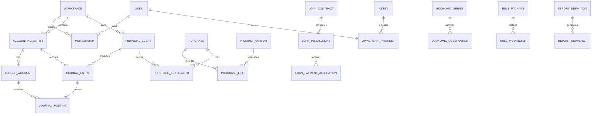

# Global Financial Operating System (GFOS)

## Super-Mega Product Requirements, Financial Domain Model, and Implementation Blueprint

**Document version:** 1.0.0  
**Status:** Comprehensive engineering baseline / proposed specification (not implemented)  
**Prepared:** 2026-10-08  
**Language of this specification:** English  
**Product working name:** Global Financial Operating System (GFOS)  
**Primary product class:** Personal, household, shared-capital, and small-employer financial management  
**Target platforms:** Responsive web and installable PWA; optional native mobile applications in later releases  
**Reference architecture:** Next.js, NestJS, TypeScript, PostgreSQL, Redis, Docker, modular monolith

> **Scope and legal notice.** This document describes a proposed product, data structures, algorithms, controls, and acceptance criteria. It does **not** assert that the product has been built, that integrations are available, or that tax/payroll/payment functions are legally compliant in any country. Worldwide access to manual recordkeeping does not equal worldwide regulatory certification. Country-specific calculations require independently maintained, tested, effective-dated country packs and qualified local review. Financial forecasts and example calculations are not financial, legal, tax, or investment advice.

---

# Table of Contents

1. [Executive vision](#1-executive-vision)
2. [Scope, market, users, and operating modes](#2-scope-market-users-and-operating-modes)
3. [System-wide product principles](#3-system-wide-product-principles)
4. [Feature classification and priority system](#4-feature-classification-and-priority-system)
5. [Identity, onboarding, and workspaces](#5-identity-onboarding-and-workspaces)
6. [Dynamic global profile, jurisdiction, and calendar](#6-dynamic-global-profile-jurisdiction-and-calendar)
7. [Core accounts, ledgers, and transactions](#7-core-accounts-ledgers-and-transactions)
8. [Multi-currency, foreign exchange, and units](#8-multi-currency-foreign-exchange-and-units)
9. [Income, receivables, and compensation](#9-income-receivables-and-compensation)
10. [Expense taxonomy and dynamic household categories](#10-expense-taxonomy-and-dynamic-household-categories)
11. [Itemized purchases, catalog, receipts, and inventory](#11-itemized-purchases-catalog-receipts-and-inventory)
12. [Food, groceries, household essentials, and nutrition-adjacent economics](#12-food-groceries-household-essentials-and-nutrition-adjacent-economics)
13. [Housing, rent, property, and utilities](#13-housing-rent-property-and-utilities)
14. [Transport, vehicles, commuting, and fuels](#14-transport-vehicles-commuting-and-fuels)
15. [Children, dependents, education, and care](#15-children-dependents-education-and-care)
16. [Healthcare, insurance, and medical financial management](#16-healthcare-insurance-and-medical-financial-management)
17. [Other living expenses and financial obligations](#17-other-living-expenses-and-financial-obligations)
18. [Budgeting, savings, goals, and sinking funds](#18-budgeting-savings-goals-and-sinking-funds)
19. [Recurring payments, subscriptions, donations, and bills](#19-recurring-payments-subscriptions-donations-and-bills)
20. [Loans, installment plans, credit, and debt](#20-loans-installment-plans-credit-and-debt)
21. [Assets, wealth, valuables, and valuations](#21-assets-wealth-valuables-and-valuations)
22. [Investments and portfolio accounting](#22-investments-and-portfolio-accounting)
23. [Cryptocurrency, blockchain, and digital assets](#23-cryptocurrency-blockchain-and-digital-assets)
24. [Shared ownership, households, and partnership capital](#24-shared-ownership-households-and-partnership-capital)
25. [Employee, contractor, and domestic-worker payroll](#25-employee-contractor-and-domestic-worker-payroll)
26. [Tax, fees, subsidies, and government benefits](#26-tax-fees-subsidies-and-government-benefits)
27. [Global economic indicators and source-data infrastructure](#27-global-economic-indicators-and-source-data-infrastructure)
28. [Inflation, purchasing power, and cost-of-living intelligence](#28-inflation-purchasing-power-and-cost-of-living-intelligence)
29. [Financial forecasting, scenarios, and financial health](#29-financial-forecasting-scenarios-and-financial-health)
30. [Report catalog, custom analytics, and evidence](#30-report-catalog-custom-analytics-and-evidence)
31. [Rules engine, country packs, and legal governance](#31-rules-engine-country-packs-and-legal-governance)
32. [Data architecture, entities, and relationships](#32-data-architecture-entities-and-relationships)
33. [Financial calculations, conventions, and mathematical invariants](#33-financial-calculations-conventions-and-mathematical-invariants)
34. [API contracts, workflows, events, and integrations](#34-api-contracts-workflows-events-and-integrations)
35. [Internationalization, accessibility, and UX](#35-internationalization-accessibility-and-ux)
36. [Security, privacy, and trust boundaries](#36-security-privacy-and-trust-boundaries)
37. [Data provenance, imports, reconciliation, and documents](#37-data-provenance-imports-reconciliation-and-documents)
38. [AI assistant and safe automation](#38-ai-assistant-and-safe-automation)
39. [Non-functional requirements and operations](#39-non-functional-requirements-and-operations)
40. [Quality engineering, golden tests, and acceptance criteria](#40-quality-engineering-golden-tests-and-acceptance-criteria)
41. [Implementation architecture and repository layout](#41-implementation-architecture-and-repository-layout)
42. [Delivery roadmap, dependencies, and release gates](#42-delivery-roadmap-dependencies-and-release-gates)
43. [Delivery roles and decision responsibilities](#43-delivery-roles-and-decision-responsibilities)
44. [Product risks, open decisions, and explicit non-goals](#44-product-risks-open-decisions-and-explicit-non-goals)
45. [Worked end-to-end financial scenarios](#45-worked-end-to-end-financial-scenarios)
46. [Requirements-to-tests traceability examples](#46-requirements-to-tests-traceability-examples)
47. [Reference standards and source links](#47-reference-standards-and-source-links)
48. [Definition of complete and final handoff](#48-definition-of-complete-and-final-handoff)

---

# 1. Executive vision

GFOS shall be a **unified financial operating environment** for individuals, families, partners, co-investors, expatriates, freelancers, and small employers. It shall record financial facts correctly, calculate obligations under explicit assumptions, analyze changes in costs and purchasing power, preserve evidentiary traces, and help users make better financial decisions.

## 1.1 Six principal questions

- **Ownership:** What assets and economic interests do I own, where, in which currency, and with what liquidity?
- **Liabilities:** Whom do I owe, what is the principal, how much interest or fees have accrued or been paid, and when must I pay?
- **Income:** How much did I earn, receive, accrue, and retain after taxes and contributions?
- **Consumption:** Exactly what did I buy or consume—bread, meat, electricity, diapers, medical care, rent, fuel—and how did quantities and unit prices change?
- **Financial condition:** Am I liquid, solvent, adequately insured, adequately diversified, and saving enough? Is my financial position improving in *real* terms?
- **Future:** What will likely happen under stated scenarios for inflation, income, FX, interest, costs of dependents, assets, and employment?

## 1.2 Differentiation

GFOS combines (a) a reliable financial ledger, (b) item-level household cost tracking, (c) configurable geographic financial rules, (d) personal inflation and purchasing-power analysis, (e) portfolio and joint-ownership accounting, and (f) explainable reporting. None of these domains should use a contradictory definition of a balance, expense, loan, or currency conversion.

## 1.3 Required product outcomes

1. **Single economic fact, multiple views:** The same grocery purchase appears correctly in cash flow, card balances, shopping history, consumption reports, budgets, and inflation analysis, without double counting.
2. **Global capability coverage is explicit:** A user can keep books in a region even where automated tax or payroll packs do not exist; unsupported legal calculations are conspicuously unavailable.
3. **Every number is explainable:** Each report shows definition, currency, source records, effective rules, observation coverage, time basis, assumptions, and data status.
4. **Historical integrity:** A later market-price update or regulation revision must not silently rewrite original transaction facts or previously issued report snapshots.
5. **Collaboration without privacy leakage:** Shared budgets, assets, or capital do not expose unrelated personal or payroll records.
6. **Simple UI, rigorous backend:** Everyday entry can be quick, but the engine supports advanced accounting and analysis.

# 2. Scope, market, users, and operating modes

## 2.1 Personas

| Persona | Typical objectives | Special concerns |
|---|---|---|
| Individual wage earner | Salary, bills, emergency fund, debt | Ease, reminders, privacy |
| Household financial manager | Groceries, family bills, children, goals | Member attribution, inflation |
| Freelancer or contractor | Multiple income sources, invoices, tax reserves | Irregular cash flow |
| Expatriate / international worker | Multi-currency income, remittances, residency | FX, multiple jurisdictions |
| Investor | Securities, cryptocurrency, metals, property | Cost basis, valuation, ownership |
| Couple / joint savers | Shared accounts and contributions | Separate rights and ownership |
| Shared-asset partnership | Contribution accounts, distributable returns | Fair allocation and settlements |
| Small employer | Daily/weekly/monthly payroll and related bills | Local payroll rules, confidentiality |
| Accountant / financial adviser | Authorized reviews and exports | Least privilege and evidence |
| Research-oriented power user | Financial ratios, forecasts, custom analyses | Methodological transparency |

## 2.2 Workspace types

- **Personal:** Private accounts, assets, liabilities, goals, reports.
- **Household:** Common living expenses, dependents, shared budgets, optional shared accounts, family-level analytics.
- **Joint capital:** Contributors, ownership shares, joint investments, contribution and distribution ledgers.
- **Employer / small organization:** Payroll, contractors, employee-related deductions, commitments, separate legal books.
- **Adviser access:** Read-only or narrowly delegated access with explicit consent and revocation; not a separate owner.

A workspace controls *collaboration*. An accounting entity controls *financial bookkeeping*. A participant's visibility, signature authority, beneficial ownership, and liability responsibility are separate concepts.

## 2.3 User modes

- **Simple mode:** quick add, account balances, budgets, loans, upcoming bills, basic reports.
- **Household mode:** product-level purchases, cost-of-living, dependents, utilities, shopping inventory.
- **Wealth mode:** investments, crypto, FX, real estate, net worth, taxes and cost basis.
- **Employer mode:** payroll, contractor pay, liability reports, employee privacy.
- **Advanced mode:** chart of accounts, journal review, reconciliation, measure definitions, assumptions, custom reports.

A user may enable multiple modes; modes hide complexity, not information from the authoritative model.

## 2.4 Regulatory operating modes

| Mode | Description | Permitted promise |
|---|---|---|
| Manual | User enters amounts, receipts, obligations | Accurate recording and formula-based analysis |
| Data-assisted | Authorized provider imports balances, rates, or records | Transparent source, coverage, and freshness |
| Verified-rule | Approved jurisdiction package with current effective rules | Calculations within pack's documented scope |
| Indicative-only | Incomplete/unreviewed rule or estimated data | Clearly labeled estimate; not compliance assertion |
| Regulated integration | Payment initiation, licensed tax filing, etc. | Only in authorized markets through approved providers |

# 3. System-wide product principles

**P-01 Ledger authority:** Monetary account balances derive from immutable posted journal entries, never UI counters or third-party last-seen figures alone.

**P-02 Economic separation:** Income, receipt, expenditure, consumption, expense recognition, borrowing, equity contribution, asset acquisition, and internal transfer are distinct event concepts.

**P-03 Temporal correctness:** Track accounting date, effective date, contractual due date, event timestamp, timezone, source publication, retrieval, and correction timestamps separately where relevant.

**P-04 Mathematical precision:** Use exact decimal/scaled integer arithmetic, designated rounding points, typed currency/quantity, and explicit valuation methods.

**P-05 Dynamic with constraints:** Categories, tariffs, financial rules, and attributes can vary by context but cannot violate core accounting invariants.

**P-06 Data provenance:** Financial records distinguish entered, imported, reconciled, calculated, inferred, and forecast values.

**P-07 Traceability:** Reports link to ledger postings, item records, economic observations, source documents, and relevant rule versions.

**P-08 No silent fallback:** Missing tax rates, prices, exchanges, jurisdictions, or cost basis trigger actionable warnings instead of invented results.

**P-09 Ownership/authorization separation:** Workspace membership does not convey property rights; legal rights and responsibilities are explicit and dated.

**P-10 Security by default:** Minimize sensitive data; enforce least privilege, encryption, auditing, and explicit connector consent.

**P-11 Localizable by design:** Language, script direction, calendar, currency, location, tax residency, and measurement unit are separate preferences.

**P-12 Accessibility:** Assistive technologies and keyboard-only workflows are first-class requirements.

**P-13 Reproducibility:** A frozen historical report can be reproduced with the original rule, economic series vintage, and calculation version.

**P-14 Human-reviewed law:** Country rules are deployed only after appropriately qualified review and tested evidence, not generated or published autonomously by an LLM.

**P-15 Safe external actions:** Automatic payment initiation, trade execution, and tax filing are disabled by default and outside first-release scope.

# 4. Feature classification and priority system

Requirement IDs use `FR-<DOMAIN>-NNN`; tests use `AT-<DOMAIN>-NNN`. Priority:

- **P0 — Foundational:** financial correctness, permissions, transaction integrity, import safety, provenance.
- **P1 — Core release:** individual/household finance, loans, detailed expenses, budget, essential reporting, 12-language UX.
- **P2 — Full personal wealth:** investments, crypto, joint capital, detailed cost-of-living intelligence, advanced household services.
- **P3 — Localized regulatory automation:** verified tax, subsidies, payroll, tariffs, filing integrations.
- **P4 — Advanced decision support:** probabilistic scenarios, advanced optimization, AI explanations, predictive analytics.

A feature marked P3 may still require P0-level correctness and security from the first release. Priorities indicate delivery order, not permission to lower quality.

# 5. Identity, onboarding, and workspaces

## 5.1 Account and authentication features

- **FR-ID-001:** Email/password where enabled, passkeys/WebAuthn, verified email, optional enterprise OIDC.
- **FR-ID-002:** MFA enrollment, secure recovery, security keys, device/session inventory, session revocation.
- **FR-ID-003:** Login anomaly alerts, brute-force throttling, recovery audit, optional trusted-device management.
- **FR-ID-004:** Individual profile: display name, preferred languages, timezone, preferred calendar, number formatting, monetary display.
- **FR-ID-005:** Independent locale settings for UI, exported reports, and notifications.
- **FR-ID-006:** Financial onboarding wizard with sample/demo data distinct from real user records.
- **FR-ID-007:** Secure deletion request, downloadable records, account deactivation, regional retention holds where applicable.

## 5.2 Workspace and access management

- **FR-WS-001:** Create personal, household, joint-capital, employer, and delegated-adviser workspaces.
- **FR-WS-002:** Invite/remove members, invitation expiration, revocation, optional approval by existing members.
- **FR-WS-003:** RBAC plus attributes: view/add/edit/approve/export/reconcile per account, record type, person, report, and document.
- **FR-WS-004:** Time-bounded grants and read-only access.
- **FR-WS-005:** Separate financial-entity owners, beneficiaries, delegates, authorized signatories, and legal co-owners.
- **FR-WS-006:** Consolidated reporting with explicit eliminations and anti-double-count rules.
- **FR-WS-007:** Record visibility inheritance: a shared expense may be visible to members without granting access to private bank transactions used to settle it.
- **FR-WS-008:** Comprehensive permission audit, access-request workflows, shared workspace dissolution and archival.

## 5.3 Onboarding sequence

1. Create user security credentials and locale.
2. Set current living location, financial reporting currency, tax residency separately; optionally skip tax-specific data.
3. Establish personal accounting entity and fiscal calendar.
4. Create cash, bank, card, crypto, or other accounts with opening balances and effective opening dates.
5. Add first salary/other income, first budget, and recurring obligations.
6. Add existing loans with original terms and outstanding principal as of opening date.
7. Optionally create household and assign authorized household members.
8. Optionally import statements or receipts; show matching and reconciliation review.
9. Display a data-quality banner until opening balances and imports are reconciled.

# 6. Dynamic global profile, jurisdiction, and calendar

## 6.1 Geographic dimensions

- Country, state/province, county, city/municipality, district, and tariff service area; maintain historical geography mappings.
- Residential location and history; tax residency periods; employment jurisdiction; income-source jurisdiction; asset/property location; merchant purchase location; provider jurisdiction; legal-book country.
- Named source jurisdictions when asset/cash flow crosses borders; relevant bilateral treaty scope determined by verified pack.
- Tax identification fields only when necessary, appropriately masked and access-restricted.
- Government holidays, banking business days, contract calendars, filing periods, billing cutoffs, and payroll cutoff dates.

## 6.2 Rule applicability

A rule must resolve from **the type of event + subject + relevant jurisdiction(s) + effective period + facts**, not merely the user's UI country. For each calculation, return applicability rationale or explicit `unresolved` / `requires_review`.

## 6.3 Date semantics

- Store canonical ISO instants (UTC) for system events and appropriate timezone-free local civil dates for due dates.
- Support Gregorian calculations, and locale-specific display/entry for Solar Hijri, Islamic, Japanese calendar conventions, and other calendar systems where implemented.
- Handle month-end recurrence rules, leap days, fiscal years, DST gaps/overlaps, and holiday adjustment conventions.
- Do not transform financial event dates when users switch display calendars.

# 7. Core accounts, ledgers, and transactions

## 7.1 Account catalog

Cash wallet; checking; savings; term deposit; e-money wallet; mobile wallet; brokerage cash; retirement cash; crypto exchange custody; self-custody wallet; credit card; revolving facility; loan liability; receivable; payable; prepaid expense; security deposit; escrow tracking; investment holding; household clearing; employer clearing; tax reserve. Distinguish **financial ledger accounts** from **institutional account connection metadata**.

## 7.2 Journal features

- **FR-LED-001:** Chart of accounts per accounting entity; predefined templates and managed subaccounts.
- **FR-LED-002:** Immutable finalized postings with transaction currency and functional-currency accounting treatment.
- **FR-LED-003:** Double-entry enforcement, unique journal IDs, debit/credit rules, multi-leg journal support.
- **FR-LED-004:** Draft, pending, posted, reversed, disputed, and reconciled states; reversal without deletion.
- **FR-LED-005:** Money transfers, multi-split purchases, refunds, partial settlements, overpayments, adjustment entries.
- **FR-LED-006:** Balance as-of date and historical trial balance; explicit opening balance treatment.
- **FR-LED-007:** Multi-currency FX conversion events including fees, rate spread, realized FX where relevant.
- **FR-LED-008:** Attach receipts/contracts, linked business documents, external event IDs, category mappings, payee, beneficiary, tags.
- **FR-LED-009:** Duplicate detection and idempotency by stable external reference and client key.
- **FR-LED-010:** Statement reconciliation, unmatched item queues, reconciliation locks, documented manual corrections.
- **FR-LED-011:** Financial period opening/closing, prior-period restatement under approval, ledger export.
- **FR-LED-012:** Cash-basis and accrual-oriented analytical views explicitly labeled; support account receivables/payables.
- **FR-LED-013:** Merchant/payee directory with aliases and privacy-aware auto-categorization.
- **FR-LED-014:** Scheduled transactions are obligations/previews until actually posted; no automatic economic recognition from reminders alone.

## 7.3 Economic event examples

| Event | Asset effect | Liability/equity effect | Income/expense treatment |
|---|---|---|---|
| Receive salary | Cash increases | Equity through income | Income recognized once according to accounting basis |
| Receive loan | Cash increases | Loan liability increases | Not earned income |
| Pay loan principal | Cash decreases | Loan liability decreases | Not an interest expense |
| Pay loan interest | Cash decreases | May settle accrued interest | Interest expense under applicable basis |
| Buy groceries on card | Consumption acquired | Credit-card payable increases | Household spending recognized once |
| Pay credit card | Cash decreases | Credit-card liability decreases | No duplicate grocery expense |
| Transfer between owned accounts | One account up, one down | None generally | Not income/expense |
| Buy investment | Cash decreases, financial asset increases | None generally | Acquisition; fees/taxes treated separately |
| Sell investment | Cash increases, asset disposed | Gain/loss may arise | Not all proceeds are investment income |
| Refund purchase | Cash/receivable increases | Depends on settlement | Reverses/reduces original classification |

# 8. Multi-currency, foreign exchange, and units

## 8.1 Currency capabilities

- **FR-FX-001:** Maintain ISO 4217 currency reference data, current and historic codes, minor units, effective dates, and special settlement behavior. Include USD, EUR, IRR, TRY, JPY, INR, GBP, and every available official fiat currency; don't assume universal two-decimal currency units.
- **FR-FX-002:** Support multiple denominations within a workspace and independently chosen functional/reporting/display currency.
- **FR-FX-003:** Distinguish official, market, provider bid/ask, central bank reference, manual, and executed transaction rates.
- **FR-FX-004:** Store source pair, inverse derivation, timestamp, market timezone, spread, commission, fee, observed-versus-effective date.
- **FR-FX-005:** Revalue open foreign-currency monetary balances without mutating historical original-currency amounts.
- **FR-FX-006:** Separate realized FX gains/losses, unrealized remeasurement effects, and transaction fees.
- **FR-FX-007:** Preserve rates selected for report generation and report-vintage reproducibility.
- **FR-FX-008:** Exchange alerts and planned conversion comparisons with limitations of price freshness.
- **FR-FX-009:** Allow rial/toman display with an explicitly declared unit factor and disallow confusing toman values with IRR ledger values.
- **FR-FX-010:** Support redenominations, historic units, deactivated currencies, and import-specific currency aliases.
- **FR-FX-011:** Support cross rates through validated rate chains; reject ambiguous or incompatible timestamps.
- **FR-FX-012:** Allow multi-currency debt, income, expense, and investment portfolio analysis.

## 8.2 Units of measure

Canonical units and conversion rules for piece, pack, gram, kilogram, milligram, troy ounce, liter, milliliter, cubic meter, kWh, MWh, GJ, kilometer, mile, hour, day, month, square meter, and custom domain units. Quantity conversions require dimension compatibility and versioned conversion factors. Package size is distinct from unit quantity; purity must be accounted for when measuring precious metals. Physical token quantity precision is independent of currency decimal scale.

# 9. Income, receivables, and compensation

## 9.1 Income taxonomy

- Employment: fixed salary, hourly/day wage, overtime, annual bonus, performance bonus, commission, sales incentives, tips, allowances, per diem, non-cash benefits, equity compensation, paid leave, severance.
- Freelance: billable hours, deliverables, retainers, milestones, royalties, consulting, platform income, affiliate commissions, digital services.
- Business: product/service revenue, partnership distributions, owner draws (do not confuse distributions with earnings), refunds/chargebacks handling.
- Property: rent, room rental, tenant fees, shared property revenue, lease compensation, asset rentals.
- Investment: bank interest, bond coupons, dividends, fund distributions, realized sale proceeds and gains recorded separately.
- Digital assets: staking/mining/reward receipts, qualifying incentives, loan interest, airdrops, swaps with jurisdiction-dependent treatment.
- Government: allowances, pensions, unemployment benefits, disability assistance, grants, refunds, regional subsidies.
- Other: intellectual-property royalties, gifts, inheritance, insurance proceeds, reimbursement, family support, sale of personal assets, irregular windfalls.

## 9.2 Functional requirements

- **FR-INC-001:** Track source, payer, client, associated contract/invoice, earned date, due date, received date, settlement account, currency, tax treatment.
- **FR-INC-002:** Gross income, withholding, contributions, reimbursement, net cash received, and benefits must be distinct components.
- **FR-INC-003:** Support hourly rates, overtime tiers, period-based wages, commission formulas, performance bonuses, variable compensation.
- **FR-INC-004:** Handle installment receivables, partial receipts, late payers, bad-debt tracking, credit notes, prepaid work.
- **FR-INC-005:** Recurring income schedules, annual raises, contract renewals, income seasonality and variability.
- **FR-INC-006:** Attach timesheets, invoices, receipts, payslips, and source contracts.
- **FR-INC-007:** Distinguish income under cash/earned bases; do not infer taxable status from transaction description alone.
- **FR-INC-008:** Forecast net receipts, identify missing expected salary, track income concentration risk.
- **FR-INC-009:** Associate each income stream with applicable employment/source jurisdiction, residence context and rate source.
- **FR-INC-010:** Produce source-level profitability, historical growth, after-tax estimates, irregular-income smoothing, real wage analysis.

# 10. Expense taxonomy and dynamic household categories

## 10.1 Classification design

The product shall maintain **three orthogonal classification axes**:

1. **Economic/accounting treatment**: consumption expense, capital acquisition, operating expense, financing principal, interest/fee, income tax, prepaid expense, transfer, receivable, payable, investment, charitable gift, other.
2. **Purpose and product/service taxonomy**: COICOP-2018-aligned where appropriate, with a customizable human-readable hierarchy.
3. **Reporting dimensions**: essential/nonessential, fixed/variable, tax deductible, reimbursable, household member, project, merchant, location, asset, life stage, and special tags.

A purchase may be tagged both *healthcare* and *emergency expense* without being posted twice. Official classification mappings are effective-dated and separately versioned; COICOP should not be used for taxes or financial acquisitions that fall outside household consumption.

## 10.2 Dynamic taxonomy operations

- **FR-CAT-001:** Create/edit/archive category hierarchies; global templates, local templates, workspace overrides.
- **FR-CAT-002:** Unlimited logical depth subject to usability/performance guardrails, stable IDs, translated labels, synonyms, aliases and locale search.
- **FR-CAT-003:** Schema-defined category attributes and constraints; numeric, money, date, enum, boolean, unit-valued, relationship, attachment; do not allow arbitrary executable calculations.
- **FR-CAT-004:** Configurable category budget, expected billing cycle, reporting permissions, default essential/discretionary classification.
- **FR-CAT-005:** Automated categorization suggestions with confidence, editable rules, merchant aliases, historical correction.
- **FR-CAT-006:** Version category mappings, allow explicit retrospective reclassification with traceability.
- **FR-CAT-007:** Country/region-specific labels and subcategories without changing ledger fundamentals.
- **FR-CAT-008:** Allow category-specific source inflation indices and custom item baskets.
- **FR-CAT-009:** Validate mutually incompatible classifications and missing required attributes.
- **FR-CAT-010:** Searchable catalog with hierarchical filtering, import/export, bulk mapping, duplicate merge and migration preview.

## 10.3 Exhaustive household expense taxonomy — initial expandable seed

The following is a **seed taxonomy**, not a finite category limit. Each row lists important subcategories; users and country packs may extend it. Category inclusion does not necessarily imply statistical consumption status or tax deductibility.

| Domain | Detailed subcategories / examples | Specialized tracking dimensions |
|---|---|---|
| Bread & bakery | Flatbread, loaves, rolls, pastries, tortillas, flour products | Type, weight, units, size, shelf price |
| Grains & starch | Rice, wheat, oats, cereal, noodles, pasta, potatoes | Kilograms, dry weight, packages |
| Meat & poultry | Beef, lamb, pork where used, chicken, turkey, processed meat | Cut, raw/cooked, weight, brand |
| Seafood | Fresh/frozen fish, shrimp, shellfish, canned seafood | Species, weight, preparation |
| Dairy & eggs | Milk, yogurt, cheese, butter, eggs, cream | Volume, fat %, count, weight |
| Vegetables | Leafy greens, legumes, roots, herbs, frozen vegetables | Weight, seasonal availability |
| Fruit & nuts | Apples, citrus, berries, dates, dried fruit, nuts | Weight, fresh/dried, grade |
| Oils & seasoning | Cooking oil, salt, pepper, spices, sauces, condiments | Volume/weight, pack |
| Beverages | Bottled water, tea, coffee, juice, soft drinks | Volume, packaging, deposit |
| Snacks & sweets | Biscuits, chocolate, candy, ice cream, packaged snacks | Pack count, unit price |
| Convenience food | Frozen meals, ready-to-eat meals, delivery groceries | Packaging, service fee, tips |
| Restaurants | Restaurant dining, cafés, canteens, takeaway, food delivery | Meal count, party, tips/tax |
| Clothing | Daily clothing, workwear, sportswear, seasonal clothing, maternity wear | Member, size, seasonal use |
| Footwear | Shoes, boots, sandals, children's shoes, orthotic footwear | Member, size, type |
| Apparel services | Tailoring, dry cleaning, laundry, repairs, shoe care | Item, service date |
| Housing rent | Apartment/house/room rent, lease fees, common charges | Property, landlord, lease, period |
| Housing ownership | Mortgage interest, homeowner dues, repairs, property expenses | Property, asset/expense split |
| Water & wastewater | Water supply, sewage, drainage, meter and fixed charges | m³, tier, period, service area |
| Electricity | kWh, fixed charges, time-of-use, demand charges, taxes | Meter, peak tariff, subsidies |
| Gas & heating | Natural gas, LPG, propane, heating oil, district heating | m³, kg, kWh, energy factor |
| Waste & municipal | Collection, recycling, sanitation, local levies, permits | Municipality, service period |
| Internet & telephone | Fiber, broadband, landline, mobile subscription, prepaid top-up, roaming | Provider, line, usage, contract |
| Household appliances | Washing machine, fridge, oven, vacuum, small devices | Warranty, life, repair/asset |
| Furniture & equipment | Beds, desks, chairs, cookware, tools, lamps, textiles | Expected life, room, ownership |
| Home repairs | Plumbing, electrical work, painting, carpentry, pest control | Service, contractor, capitalization |
| Security & maintenance | Alarm, CCTV service, locksmith, home cleaning, garden maintenance | Property, contract |
| Hygiene & cleaning | Detergents, soaps, shampoos, paper products, dental care | Unit, volume, household rate |
| Cosmetics & personal care | Barber, haircut, cosmetics, skincare, grooming, fragrances | Service, member |
| Baby hygiene | Diapers, wipes, rash care, disposable changing supplies | Child, diaper size, count |
| Baby feeding | Formula, bottles, infant food, feeding equipment, sterilizer | Child, stage, unit consumption |
| Child goods | Stroller, cot, car seat, toy, baby clothing, safety equipment | Child, useful life, replacement |
| Childcare | Nanny, day care, babysitting, preschool | Hours/days, child, provider |
| School | Tuition, school bus, meals, supplies, uniforms, materials | Child, academic year, semester |
| Higher education | University tuition, residence, books, admission, labs, exams | Student, term, grants |
| Adult learning | Courses, certification, tutoring, language instruction | Credential, tax relevance |
| Fuel | Gasoline, diesel, ethanol blends, methanol, CNG, LPG, hydrogen | Quantity, unit cost, odometer |
| EV charging | Residential, public AC/DC charging, memberships, parking | kWh, charging session, vehicle |
| Public transportation | Bus, metro, tram, ferry, rail, passes | Trips, commuter, zone |
| Taxi/rideshare | Taxi, app rides, carpool, ride-hailing tips | Route, trip, user |
| School transport | School bus, hired driver, private drop-off | Child, route, attendance |
| Road/parking | Tolls, paid parking, permits, fines, registration | Vehicle, location, period |
| Vehicle ownership | Purchase, depreciation, taxes, loan interest, insurance | Capitalized vs operating |
| Vehicle maintenance | Oil, tires, servicing, inspections, repairs, car wash | Mileage, vehicle, maintenance type |
| Medical visits | GP, specialist, consultations, urgent care | Member, copay, coverage |
| Diagnostics | Laboratory, X-ray, MRI, CT, ultrasound, screening | Service, claim, bill |
| Medication | Prescription/OTC drugs, pharmacy fees | Quantity, dispensed unit, reimbursement |
| Hospital/surgery | Procedure, facility charges, anesthesia, inpatient care | Invoice, insurer, partial settlement |
| Mental/dental/vision | Therapy, dentistry, braces, glasses, lenses | Member, coverage, recurring care |
| Medical devices | Hearing aids, prosthetics, mobility aids, monitoring devices | Asset/consumable, warranty |
| Health insurance | Premiums, add-ons, deductibles, copayments | Plan, policy year, member |
| Life/property insurance | Life, home, vehicle, travel, disability, liability | Policy, premium, benefit, coverage |
| Travel & relocation | Flights, trains, accommodations, visas, luggage, moving | Trip, travelers, FX |
| Leisure & entertainment | Cinema, gaming, sports, hobbies, memberships, events | Member, subscription/event |
| Pets | Food, supplies, vet, medication, grooming, boarding | Pet, age, care cycle |
| Banking & financing | Account/card fees, FX fees, ATM, interest and late charges | Account, transaction, obligation |
| Digital subscriptions | Streaming, SaaS, cloud storage, domain, hosting, apps | Plan, renewal, utilization |
| Social & ceremonies | Gifts, weddings, birthdays, funerals, religious celebrations | Event, recipient, budget |
| Charity & giving | NGO, nonprofit, local relief, donations, pledges | Recipient, tax eligibility, receipt |
| Family assistance | Remittances, support to relatives, child support, elder care | Beneficiary, recurring status |
| Government fees & tax | Income tax, municipal charges, licensing, property tax, vehicle tax | Jurisdiction, period, obligation |
| Professional services | Legal, accountancy, financial planning, notary, consulting | Provider, case, business/personal |
| Work-related | Equipment, remote-office, union/professional dues where relevant, travel | Employer reimbursement, tax treatment |
| Agriculture/rural | Seed, animal feed, irrigation, small farm supplies, machinery | Activity, land/asset, unit |
| Emergency costs | Emergency shelter, repair, travel, disaster replacement | Incident, source, reserve |
| Custom | User-defined recurring or irregular categories | Versioned schema and rules |

## 10.4 Categorization safeguards

- Taxes included in consumer prices versus separately paid income/property taxes must be identifiable and never double counted.
- A bank transfer for a charitable pledge is different from a liability that was merely scheduled.
- Recoverable deposits are assets, not automatically expenses.
- Home renovations, jewelry purchases, investment contributions and car purchases may create or enhance assets; purpose taxonomy must not force expense treatment.
- Fines, penalties, insurance reimbursements, gifts, medical claims, and refunds need distinct financial-event semantics.

# 11. Itemized purchases, catalog, receipts, and inventory

## 11.1 Purchase data model

A `Purchase` has purchase date, merchant, merchant location, bill/invoice, tax jurisdiction, pricing currency, subtotal, discount, charges, taxes, tips, total, beneficiary, receipt attachments and external references. Each `PurchaseLine` has product variant, original name/description, quantity, canonical unit, package size, regular price, effective unit price, discount details, tax components, warranty/expiry where relevant and classification references. `PurchaseSettlement` links payments, credit, gift cards, prepayment, store credits, refunds and chargebacks to financial events.

## 11.2 Features

- **FR-PUR-001:** Single-line rapid entry and detailed multi-line receipt mode.
- **FR-PUR-002:** Manual entry, CSV import, receipt image/document extraction with mandatory user review.
- **FR-PUR-003:** Product/brand/variant catalog with GTIN/barcode where available; private products and aliases.
- **FR-PUR-004:** Package normalization, including units per multipack and price per canonical mass/volume/count.
- **FR-PUR-005:** Line-level multi-rate tax, coupon, loyalty discount, buy-X-get-Y, return, partial refund.
- **FR-PUR-006:** Split settlement among bank, card, cash, benefit, gift card, deferred liability, shared payer.
- **FR-PUR-007:** Fraud-resistant receipt totals: lines + allocated tax/fee - discounts reconcile to settlement or explicit outstanding balance.
- **FR-PUR-008:** Merchant-specific price observations with location, date, package identity, actual discount, and reliability.
- **FR-PUR-009:** Household member/beneficiary allocation without duplication of source purchase.
- **FR-PUR-010:** Product substitution groups and quality/package-change annotations for inflation.
- **FR-PUR-011:** Purchase cancellation, exchange, chargeback, refund, warranty return lifecycles.
- **FR-PUR-012:** Reusable shopping lists; optionally merge household inventory and predicted replenishment.

## 11.3 Inventory and consumption

- Opening stock, purchases, stock adjustments, transfers, donations, spoilage, consumption, closing stock; measurement conversions.
- FIFO/weighted-average inventory valuation only if a user selects a defined method and needs valuation; not mandatory for ordinary groceries.
- Expiry/lot tracking where beneficial, never misrepresenting medical advice.
- Consumption-rate estimation from actual stock movement, not assuming every purchased good was immediately used.
- Reorder quantities and budget estimates; pantry, freezer, medicine cabinet, baby supplies, cleaning supplies.
- Household procurement comparisons and unit-cost optimization; flag quality/comparability uncertainty.

# 12. Food, groceries, household essentials, and nutrition-adjacent economics

## 12.1 Grocery monitoring

- Market basket builder with quantities, accepted equivalents, price baseline, locality, preferred merchants and desired quality level.
- Item-level alerts for unit-price increase, category price pressure, discounts and package downsizing (shrinkflation).
- Basket comparison across merchants, dates, stores, neighborhoods and currencies with explicit transport/time exclusions or adjustments.
- Price decomposition into unit price and quantity, and optional product-mix / substitution effects.
- Spending per household member, per meal (when meal attribution is available), per week, and per standardized portion where appropriate.
- Seasonality and household holidays; grocery wastage costs; recurring meal expense planning.
- Differentiate grocery acquisition from prepared-food service, restaurant spending and inventory use.

## 12.2 Baby and child consumables

- Diapers by unit count, size, package and consumption; formula by amount/pack, feeding-related supplies, wipes, clothing replacement and hygiene products.
- Historical use rates and user-provided age/life-stage budget scenarios; do not infer medical consumption recommendations.
- Cost forecasts for school transport, day care, vaccination copays, school fees and equipment over time.

## 12.3 Ethical limits

- No claims of nutritional adequacy, medical dosing, safe infant feeding, or clinical diagnosis from financial purchase data.
- Price comparison should not implicitly recommend unsafe product substitution, counterfeit medicine, or compromised essential services.

# 13. Housing, rent, property, and utilities

## 13.1 Property portfolio and occupancy

- **FR-HOU-001:** Property type, location, floors/area, ownership interest, occupancy dates, tenant or landlord, service providers.
- **FR-HOU-002:** Lease start/end, rent frequency, notice periods, security deposit, rent indexation, caps, utilities included/excluded.
- **FR-HOU-003:** Mortgage linkage, amortization, servicing, insurance, tax, homeowner association, renovations, rental yield and vacancy.
- **FR-HOU-004:** Tenant bills and arrears; landlord collections; refund of recoverable deposits; room-share cost allocation.
- **FR-HOU-005:** Rent versus buy comparison with maintenance, interest, opportunity cost, taxes, inflation, transaction costs and assumptions.
- **FR-HOU-006:** Housing-to-income, all-in occupancy cost, cost/m², affordability stress tests.

## 13.2 Utility account model

Common fields: service point, property, meter/contract ID, supplier, billing currency, billing period, read dates, start/end readings, usage unit, rate plan, tier structure, fixed charges, network/distribution, demand/capacity components, levies, discounts, subsidy eligibility, tax, deposits, arrears, credits, payment status and due date.

### Electricity

- Single-rate, block-tier marginal, time-of-use, dynamic hourly/spot-linked, demand pricing, fixed fees and minimums.
- Multiple meters, smart-meter data, estimated/actual readings, net metering, rooftop solar feed-in, battery storage, EV charging allocation.
- Energy (kWh), power demand (kW), power factor where used, seasonal tariffs, price caps, subsidies, VAT, tax and final invoice reconciliation.
- Detect anomalous consumption and compare weather-normalized usage when climate series are available.

### Water and sewerage

- m³ usage, tiered water rates, wastewater/disposal components, rainfall or property components where applicable, leakage indicators, meter replacement, supply subsidies.
- Per-resident or per-area intensity metrics, with occupancy dates and missing-data notes.

### Natural gas, heat, cooking fuel

- m³, kg, liter, therm, kWh or other billing units; volume-to-energy conversion using supplied calorific factor where applicable.
- Storage tank/refill purchases, district heating, biomass/pellets, heating oil, propane and LPG.
- Seasonal consumption, heating degree days, delivery fee, meter tariff, fixed service charge, credit/prepaid balances.

### Telecom and broadband

- Landline, fixed internet, mobile subscriptions, prepaid credit, add-on data bundles, roaming, phone installments, family bundles, overage charges, call tariffs, device insurance.
- Contract expiration, fair-use caps, usage trends, duplicate subscription detection, location-specific coverage metadata where authorized.

## 13.3 Utility calculation contract

Inputs: property/service account, provider tariff version, reading period, validated measured usage, applicable rate schedule, charges/allowances, applicable tax jurisdiction, rounding policy. Outputs: consumption charges by tier/time window, fixed/network/other charges, tax, subsidy, total due, assumptions, source and discrepancy versus invoice. Tier treatment **must** specify marginal versus all-units bracket behavior.

# 14. Transport, vehicles, commuting, and fuels

## 14.1 Fleet/vehicle master data

Each vehicle: owner, vehicle type, fuel/energy type, acquisition method/cost, registration jurisdiction, odometer unit, purchase/finance/insurance, mileage, efficiency baseline, servicing, tax, depreciation/valuation, parking permits, resale estimate, emissions fields where useful.

## 14.2 Trip and fuel features

- **FR-MOB-001:** Fuel and charge purchases by unit (L/gal/kg/kWh), fuel grade/type (gasoline, diesel, ethanol blend, methanol when applicable, CNG, LPG, hydrogen, EV charging).
- **FR-MOB-002:** Odometer/route/distance, efficiency (L/100km, mpg, kWh/100km) with unit conversions.
- **FR-MOB-003:** Toll, parking, permit, congestion charge, traffic fine, vehicle tax, inspection, maintenance, tires, repairs, cleaning.
- **FR-MOB-004:** Travel mode by commute, school transport, public transit, taxi/rideshare, rail, bicycle, ferries and other modes.
- **FR-MOB-005:** Allocate trips to household member, vehicle, employer reimbursement, project, business/personal purpose.
- **FR-MOB-006:** Compute operating cost per km/mi, total cost of ownership, commute cost, cost per passenger, energy-cost trend.
- **FR-MOB-007:** EV-versus-fuel, public-transit-versus-car, vehicle-replacement scenario with capital, maintenance, insurance, energy and resale assumptions.
- **FR-MOB-008:** Seasonal fuel consumption and fuel price inflation; manual or provider-authorized mileage import.

# 15. Children, dependents, education, and care

## 15.1 Dependent financial profile

Dependents may be adults, children, older relatives, or persons requiring care. Store only necessary age/education eligibility and household association; sensitive health attributes are optional and protected.

## 15.2 Features

- **FR-DEP-001:** Child age band, schooling stage, academic calendar, school fee agreements and tuition installments.
- **FR-DEP-002:** Diapers, formula, clothes, consumables, child healthcare expenses and reimbursements.
- **FR-DEP-003:** Childcare hours, babysitter/nanny payments, nursery, preschool, family leave and financial opportunity-cost scenarios.
- **FR-DEP-004:** School uniforms, meals, transport, equipment, textbooks, tutoring, extra classes, sporting and cultural activities.
- **FR-DEP-005:** Higher education, scholarships, grants, education savings goals, tuition/fees and inflation-adjusted projections.
- **FR-DEP-006:** Shared guardian contributions, child support commitments, dependent allowance, benefits and eligibility estimates.
- **FR-DEP-007:** Elder care support, caregiver payments, recurring medications/out-of-pocket costs, housing support, pensions received.
- **FR-DEP-008:** Expense comparisons across life stages with clear changes in household composition and confounding effects.

# 16. Healthcare, insurance, and medical financial management

## 16.1 Claims and financial flows

- **FR-HEA-001:** Register provider, service, date, billed amount, insurer negotiated adjustment, insurer payment, member payment, reimbursement and outstanding balance independently.
- **FR-HEA-002:** Track medical premiums, deductible accumulation, co-insurance, copays, annual out-of-pocket thresholds, network limitations where supported.
- **FR-HEA-003:** Link multiple invoices/claims to one episode without requiring sensitive diagnosis to record expense.
- **FR-HEA-004:** Medical loan/installment plan, upcoming surgery expense estimates and contingency reserve.
- **FR-HEA-005:** Separate paid reimbursements from pending reimbursement receivables.
- **FR-HEA-006:** Healthcare category inflation and real after-insurance cost trends.
- **FR-HEA-007:** Dental, vision, pharmacy, surgery, emergency treatment, diagnostic tests, therapies, rehabilitation, devices, travel to receive care.

## 16.2 Insurance catalog

Health, dental, vision, life, disability, long-term care, vehicle, home, property, liability, travel, income protection, pet and business-related policies. Model premium payment schedule, policy term, insurer, eligible beneficiaries, covered assets, exclusions, deductible, sum insured, renewal, claim status and insurance receivables. Compare premium/coverage scenarios with disclosed assumptions; do not infer medical suitability or guaranteed claim coverage.

## 16.3 Privacy

Prefer financial treatment codes to health diagnoses. Support field-level visibility and encryption, separate employee records, consent/retention constraints, and anonymized cost reporting where appropriate. Avoid exposing medical claims in shared household dashboards without authorization.

# 17. Other living expenses and financial obligations

Additional modules must cover: clothing/shoes seasonal replacement, household furnishing and repairs, digital device purchases/financing, pets and veterinary care, hobbies and clubs, subscriptions and SaaS, communication plans, entertainment, tourism, air/rail travel, immigration and relocation fees, social/family events, donations, legal/accounting services, elder support, rural/agricultural activities, emergencies and disaster costs, religious/cultural giving, fines and statutory/municipal payments. Each inherits common expense fields plus specialized schema/version where financially material.

- Clothing/footwear: member, size, season, warranty, alteration, repair, resale or donation.
- Digital equipment: capitalized asset versus consumable, warranty, device financing, subscription bundle.
- Travel: itinerary, traveler, local currency, cash/card spend, reimbursement, cancellation, deposits, exchange-rate effect.
- Pet: animal association, recurring food, vet claims, insurance, boarding and medication spending.
- Charity: recipient identity, campaign, recurring pledge, payment, receipt, jurisdiction-specific tax-eligibility state.
- Municipal: payment authority, permit/tax type, zone, effective regulation, deadlines, installments and disputes.
- Social: event, gift receiver, co-contribution, event budget and savings schedule.
- Emergency: event/incident, insurance recovery, estimated replacement value and depleted reserves.

# 18. Budgeting, savings, goals, and sinking funds

## 18.1 Budgets

- **FR-BUD-001:** Category, envelope, zero-based, pay-period, household, dependent, project, annual and custom-period budgets.
- **FR-BUD-002:** Fixed and variable spending limits, rollover rules, negative-envelope treatment, earmarked reserved cash.
- **FR-BUD-003:** Planned/actual/committed/forecast values separately; cash-versus-accrual option labeled.
- **FR-BUD-004:** Shared budget approvals, contribution plans, individual cap, alert thresholds, override audit.
- **FR-BUD-005:** Inflation-linked budget proposal with selectable official/category/personal index; never auto-raise budget without user consent.
- **FR-BUD-006:** Priority ranking for essential/discretionary, needs/wants, savings, contractual obligations.
- **FR-BUD-007:** Budget comparison across fiscal/calendar periods, household size and currency; explain changes due to exchange and price effects.
- **FR-BUD-008:** Unspent commitment carry-forward, annual one-off expense sinking funds, holiday reserves.

## 18.2 Goals

Emergency fund, debt payoff, house deposit, wedding, education, car, travel, retirement, healthcare buffer, charitable target, business capital, family relocation. Each has owner(s), target currency, nominal/real goal, target date, contributions, linked reserves, permissible withdrawals, risk assumptions and expected/funding shortfall.

## 18.3 Goal analytics

Required periodic contribution; goal completion probability only under justified statistical assumptions; estimated real target value; savings rate and reserve adequacy; competing-priority allocation; interest/return assumptions; cash-flow constraints; early withdrawal/reallocation effects. Never promise goal attainment based on an assumed market return.

# 19. Recurring payments, subscriptions, donations, and bills

## 19.1 Unified obligations engine

- **FR-OBL-001:** Daily, weekly, biweekly, semimonthly, monthly, quarterly, annual, fiscal, milestone and custom recurrence.
- **FR-OBL-002:** Fixed, usage-based, tiered, indexed, variable/estimated and rule-derived payment amounts.
- **FR-OBL-003:** Payee directory with personal, governmental, charity, NGO, nonprofit and corporate recipients.
- **FR-OBL-004:** Due date, grace period, planned payment, actual settlement, arrears, partial payment, penalty/fee and disputes.
- **FR-OBL-005:** Pause/resume, seasonal skip, end conditions, holiday adjustments, schedule versioning.
- **FR-OBL-006:** Per-obligation owner, beneficiary, funding account, budget category, approver, proof documents.
- **FR-OBL-007:** Configurable reminders via in-app, email, push and optional consented third-party channels.
- **FR-OBL-008:** Subscription renewal, free-trial expiry, auto-renew notice, price change, termination period, vendor contact.
- **FR-OBL-009:** Detect duplicate subscriptions and unused commitments when sufficient permitted evidence exists.
- **FR-OBL-010:** Charity pledge separate from settlement; donation receipts and local tax classification only where verified.
- **FR-OBL-011:** Forecast payment coverage and cash shortfalls; never treat scheduled obligations as already paid.
- **FR-OBL-012:** Optional approval queue for shared accounts and employer obligations.

## 19.2 Calendar

A combined financial calendar lists salary events, expected income, installments, utility bills, tuition, subscriptions, payroll dates, tax deadlines, insurer renewals, property fees and goals. Filters by member/account/entity, time zone, urgency and status. Calendar entries must link to authoritative records and reflect schedule updates idempotently.

# 20. Loans, installment plans, credit, and debt

## 20.1 Financial products

Personal loan, mortgage, education loan, car loan, credit card, overdraft, revolving credit, buy-now-pay-later, seller finance, informal loan, peer-to-peer loan, zero-interest installment, asset-backed agreement, lease-like financing, short-term advance, co-borrowed loan, money loaned to others (receivable). Alternative contractual structures must be mapped to their actual obligations rather than assuming all charges are interest.

## 20.2 Contract schema

Borrower(s), lender, guarantor, collateral, original principal, disbursed amount, currency, start/end dates, rate type, nominal rate, effective rate/APR where defined, benchmark/spread, day-count convention, interest accrual, compounding, frequency, scheduled installment convention, origination/service fees, insurance, grace period, penalty/late fees, amortization method, payment allocation priority, deferral, rate reset, prepayment conditions, refinancing and documentation.

## 20.3 Calculation and workflow

- **FR-LOAN-001:** Equal-payment amortization, equal-principal, interest-only, balloon, bullet, step-up, custom and other documented methods.
- **FR-LOAN-002:** Flexible calendar: daily, weekly, every two weeks, semimonthly, monthly, quarterly, annual, custom dates.
- **FR-LOAN-003:** Fixed, variable, capped/floored, zero and index-linked rates with explicit methodology.
- **FR-LOAN-004:** Separate accrued interest, interest billed, interest paid, principal outstanding, principal due, fees and overdue status.
- **FR-LOAN-005:** Allocate partial payments by contractually configured priority; record payment journal and allocation atomically.
- **FR-LOAN-006:** Early payments, overpayments, accelerated schedule, recast, refinancing, consolidation, restructuring, deferment, rate reset.
- **FR-LOAN-007:** Installment calendar, expected cash-flow requirement, missed payment escalation, borrower/lender views.
- **FR-LOAN-008:** Debt snowball, avalanche, debt-to-income, payment-to-income, maturity ladder, stress tests, weighted average cost.
- **FR-LOAN-009:** Liability/asset treatment for the creditor and borrower; support multiple loans and co-borrower shares.
- **FR-LOAN-010:** Foreign-currency debt and FX-driven affordability projections without changing contractual principal.
- **FR-LOAN-011:** Verify schedules against independent golden vectors; final installment rounding adjustment and amortization total reconciliation.
- **FR-LOAN-012:** Disclose contract assumptions and jurisdiction pack limitations; never infer legal late fees from generic defaults.

## 20.4 Example loan conventions

For a loan with principal `P`, nominal annual rate `i`, `m` equal periodic payments a year, `N` periods, and periodic rate `r=i/m` (only if contract actually specifies this convention), equal payment `A = P*r/(1-(1+r)^(-N))`. For `r=0`, `A=P/N`. Use exact rounding contracts; variable rate and irregular periods need alternative algorithms. APR/IRR is not interchangeable with nominal contract rate and fee schedules.

# 21. Assets, wealth, valuables, and valuations

## 21.1 Asset categories

Fiat cash, bank deposits, receivables, stocks, ETFs, mutual funds, bonds, precious metals, crypto, tokenized interests, properties, land, vehicles, machinery, equipment, art, collectibles, antiques, intellectual property, business equity, private loans receivable, pensions and insurance cash values where appropriate. Some assets require specialized legal/valuation classification.

## 21.2 Common asset features

- **FR-AST-001:** Owner and ownership interests, custodian, location, acquisition date, original cost, transaction currency.
- **FR-AST-002:** Asset-specific quantity, units, quality/purity, serial/reference IDs, authenticity documents where available.
- **FR-AST-003:** Market valuation, appraisal, cost basis, carrying value, insured value, replacement estimate and liquidation estimate as distinct figures.
- **FR-AST-004:** Valuation source, timestamp, stale-price flag, bid/ask spread, marketability discount assumptions.
- **FR-AST-005:** Maintenance, storage, premiums, rent/dividend/interest income and associated recurring expenses.
- **FR-AST-006:** Asset transfers, partial disposal, gifting, inherited property, ownership changes and related supporting documents.
- **FR-AST-007:** Debt/security linkage, liens and obligations; avoid reporting pledged assets as unrestricted liquid cash.
- **FR-AST-008:** Net worth by entity, member, ownership, location, asset class and nominal/real reporting basis.
- **FR-AST-009:** Physical asset depreciation or estimated resale changes under explicit method; no blanket depreciation assumption for all assets.
- **FR-AST-010:** Insurance schedules and beneficiary details subject to permission policy.

## 21.3 Precious metal specifications

Gold, silver, platinum, palladium; bullion bars, coins, jewelry, allocated/unallocated custodial claims where supported. Quantity in grams, kilograms or troy ounces; gross weight, fine content, purity/fineness, acquisition premium, mint/dealer, storage, insurance, spot price and liquidation spread. Formula for fine metal quantity: gross metal weight × purity fraction, subject to form and contract details. Distinguish collectibles numismatic value from metal melt value.

# 22. Investments and portfolio accounting

## 22.1 Supported instruments

Listed equities, ETFs, mutual funds, money-market funds, government/corporate bonds, fixed income, derivatives (recording and reporting only where appropriate), private funds, direct private equity, retirement plans, employer shares, real-estate funds and other supported instruments. The initial release may limit instrument types but must have an extensible instrument model.

## 22.2 Capabilities

- **FR-INV-001:** Brokers, custodians, accounts, cash/holding separation, portfolio grouping.
- **FR-INV-002:** Trades, execution legs, settlement dates, contract notes, instrument identifiers, transaction fees, taxes.
- **FR-INV-003:** Tax lots, acquisition cost, adjusted cost, disposal lot matching methods as permitted by rule pack.
- **FR-INV-004:** Splits, reverse splits, mergers, spinoffs, tender offers, reinvestments, conversions, cash distributions.
- **FR-INV-005:** Dividends, interest, bond coupon schedules, withholding, reinvested distributions.
- **FR-INV-006:** Realized/unrealized gains, cost-basis coverage, open versus closed positions.
- **FR-INV-007:** Time-weighted return, money-weighted return/XIRR, total return with fees/distributions, benchmark comparisons; disclose methodological differences.
- **FR-INV-008:** Allocation by currency, region, issuer, asset class, instrument, sector; concentration and liquidity risk.
- **FR-INV-009:** Corporate-action audit with corrections and position reconciliation.
- **FR-INV-010:** Nominal and appropriately inflation-adjusted returns; fees and taxes identified.
- **FR-INV-011:** Rebalancing scenario suggestions requiring manual approval; no automatic trade execution in baseline product.
- **FR-INV-012:** Price data freshness, market-closed handling, unavailable instruments, delisted and illiquid assets.

# 23. Cryptocurrency, blockchain, and digital assets

## 23.1 Identity and custody

Tokens identified by blockchain/network plus validated token contract (where applicable), not just ticker; track BTC, ETH, USDT, USDC, and extensible assets. Distinguish an exchange balance from read-only external wallet data. Never require private keys, seed phrases, or signing permission to manage holdings.

## 23.2 Digital asset features

- **FR-CRY-001:** Wallets/accounts by network, token balance, units and decimals, transaction provenance.
- **FR-CRY-002:** Buy, sell, convert, swap, bridge, transfer, receive, send, pay network fees, custody fees.
- **FR-CRY-003:** Transfer matching avoids classifying self-transfer as income or disposal without jurisdictional rationale.
- **FR-CRY-004:** Staking, rewards, mining, airdrops, LP tokens, DeFi lending/borrowing and other supported activity types.
- **FR-CRY-005:** Smart-contract and token identity metadata with spoofing-risk indicators.
- **FR-CRY-006:** Historical crypto prices by specific asset/network and timestamp, source, exchange, spread, stale/unknown status.
- **FR-CRY-007:** Cost-basis lots, realized disposal gains, unrealized value, fee accounting, missing basis warnings.
- **FR-CRY-008:** Stablecoin peg deviation and custodian/concentration reporting; never assume 1 USDT equals 1 USD.
- **FR-CRY-009:** Tax-event classification through verified jurisdiction packs, not generic global assumptions.
- **FR-CRY-010:** Read-only chain integration where permitted, duplicate detection, reorg/confirmation states, on-chain versus imported custody reconciliation.
- **FR-CRY-011:** Protocol risk, smart-contract concentration, liquidity warnings without false guarantees.
- **FR-CRY-012:** Separate P&L, transfers, rewards, fees, impairment/unknown valuation, and market movements.

# 24. Shared ownership, households, and partnership capital

## 24.1 Shared structures

Spouse/partner households, roommates, informal savings groups, friends, co-investors, jointly owned property, shared vehicles, pooled goals, investment partnerships and shared debt. This module records economic interests and authorized activity; it does not create a legal partnership by itself.

## 24.2 Functional requirements

- **FR-SHR-001:** Add multiple participants with permission grants, ownership agreements, effective dates and supporting contracts.
- **FR-SHR-002:** Record capital contributions by cash or assets, withdrawals, distributions, reimbursements and internal settlements.
- **FR-SHR-003:** Distinguish contractual equity share, contribution ratio, profit allocation, loss allocation, liability responsibility and approval power.
- **FR-SHR-004:** Reconcile shared physical/financial asset values and allocate net ownership interests without duplicating household totals.
- **FR-SHR-005:** Contributions can be unequal; ownership percentages need not automatically follow contribution amounts.
- **FR-SHR-006:** Different splitting methods: fixed percentage, equal, proportional to income, itemized beneficiary, custom approved split.
- **FR-SHR-007:** Shared expenses versus personally paid expenses; create receivables/payables as appropriate for reimbursements.
- **FR-SHR-008:** Multiple approvals and spending limits for designated shared funds.
- **FR-SHR-009:** Contribution history, member statements, individual entitlement, shared gains/losses and distributions.
- **FR-SHR-010:** Member departure and dissolution with an agreed valuation date, settlement statement, unresolved liabilities and archive.
- **FR-SHR-011:** Permission changes do not erase member financial history; past access changes are auditable.
- **FR-SHR-012:** Private bank accounts may fund shared expenses without revealing unrelated private transactions.

# 25. Employee, contractor, and domestic-worker payroll

## 25.1 Workforce and contract types

Regular employees, hourly employees, day workers, part-time, seasonal, shift workers, contractors, domestic workers, caregivers, babysitters, drivers and relevant local employment categories. Distinguish employee and contractor status only through explicit legally supported classification; do not automatically infer legal status from a payment cadence.

## 25.2 Payroll features

- **FR-PAY-001:** Employee/private profile, employment agreement, tax/payroll jurisdiction, effective-dated compensation.
- **FR-PAY-002:** Hourly, daily, weekly, biweekly, semimonthly, monthly, piece-rate, commission, milestone, mixed compensation.
- **FR-PAY-003:** Attendance, shift schedules, overtime, bonuses, allowances, reimbursements, deductions, leave.
- **FR-PAY-004:** Gross pay, statutory/voluntary deductions, withholding, employer costs, benefits, advances, net pay.
- **FR-PAY-005:** Tax and social contributions calculated only through verified country pack; unsupported countries allow manual recording with a clearly labeled legal limitation.
- **FR-PAY-006:** Configurable cutoff, payroll period, payment due date, holidays and funding accounts.
- **FR-PAY-007:** Draft > validated > approved > finalized > paid/reconciled lifecycle; prevent post-finalization silent edits.
- **FR-PAY-008:** Payslips with applicable local presentation, export, secure distribution and employee access.
- **FR-PAY-009:** Retroactive adjustments, off-cycle pay, correction, termination/settlement and accrual treatment.
- **FR-PAY-010:** Employer liabilities, future payroll cash-flow, pay changes, overtime cost forecasting.
- **FR-PAY-011:** Contractor invoicing and payment histories separated from employment payroll calculations.
- **FR-PAY-012:** Financial confidentiality, restricted role access, data minimization and retention controls.

# 26. Tax, fees, subsidies, and government benefits

## 26.1 Supported tax domains

Personal income, employment withholding, social contributions, dividend/interest taxes, capital gains, real estate, property and vehicle taxes, applicable inheritance/gift/wealth obligations, VAT/GST/sales taxes embedded in purchases, local/municipal levies, charitable deduction treatment, crypto tax events, relevant withholding and foreign tax credits. Country-specific differences must be represented through validated rules, not hardcoded assumed global law.

## 26.2 Tax features

- **FR-TAX-001:** Tax-residence history, filing status/household, tax year/fiscal period, source jurisdiction, tax identification if needed.
- **FR-TAX-002:** Income classification, taxable income base, progressive scales, thresholds, deductions, credits, exemptions.
- **FR-TAX-003:** Estimate tax liabilities, withholding payments, advance payments, settlements, refunds, carryforwards where applicable.
- **FR-TAX-004:** Capital gain calculations with tax lots, cost basis, applicable holding periods, recognized expenses and asset rules.
- **FR-TAX-005:** Multi-jurisdiction/treaty information with qualified review and explicit ambiguity state.
- **FR-TAX-006:** Filing calendar and document checklist for verified country pack; filing through external service only when authorized.
- **FR-TAX-007:** Municipal/local taxes, permits, tolls, utility levies, excises, property charges with locality and period.
- **FR-TAX-008:** Versioned official source references, rule approval trace, effective and publication dates.
- **FR-TAX-009:** Variance report: estimated versus assessed/paid, and restatement on amended source rules.
- **FR-TAX-010:** Distinguish legal obligation recorded, proposed estimate, current assessment and paid amount.

## 26.3 Benefits and subsidies

Child/family benefits, housing and utility assistance, pension benefits, unemployment compensation, disability-related financial support, education grants, health subsidies, transportation concessions, disaster relief, income-tested programs and regional cost-of-living assistance. Model eligibility facts, household composition, income/assets thresholds, benefit period, application, granted amount, received amount and appeals. An estimated eligibility result is never an official government determination.

# 27. Global economic indicators and source-data infrastructure

## 27.1 Indicator catalog

| Group | Indicator families | Scope/frequency considerations |
|---|---|---|
| General prices | Headline CPI, core CPI, household consumption indices | Country/region; monthly/quarterly/annual |
| Category prices | Food, rent, energy, healthcare, education, transport | Regional coverage may be sparse |
| Employment | Unemployment, minimum wage, median wage, real wage changes | Definitions differ by jurisdiction |
| Currency | Official/market/bank exchange rates, currency indices | Date/time and source critical |
| Monetary | Policy rates, benchmark lending rates, deposit rates, yield curves | Rates not automatically offered to consumers |
| Economy | GDP, industrial activity, household income/expenditure | May be lagged or revised |
| Housing | Rent index, property prices, mortgage rates | Often city-specific and incomplete |
| Commodities | Oil, natural gas, grains, metals | Global prices not equal retail household prices |
| Energy | Fuel, residential electricity, gas and heating tariffs | Supplier/geography-specific |
| Demography | Household size, dependency, age groups | Official statistical benchmarks |
| Purchasing power | PPP conversion factors, price levels, real consumption | Concepts different from market FX |
| Weather/season | Heating/cooling degree days, weather normals | Optional normalization for energy use |
| Public support | Tax parameters, government benefits and cost-of-living relief | Must be legal-source verified |

## 27.2 Data provider architecture

- **FR-ECO-001:** Maintain provider registry with source name, license, API method, geographic coverage, revision policy, service limits and reliability.
- **FR-ECO-002:** Economic series identity: indicator, subject geography, frequency, seasonal adjustment, measure/unit, reference base and method.
- **FR-ECO-003:** Each observation includes measured period, value, release/publication time, retrieval time, revision identifier and confidence/status.
- **FR-ECO-004:** Handle provisional, final, corrected, estimated, suppressed, unavailable and missing data.
- **FR-ECO-005:** Adapters for statistical providers and central banks; SDMX-compatible data models where appropriate.
- **FR-ECO-006:** Establish freshness SLAs, stale data warnings, provider failover under consistent methodology, and no fabricated fallback.
- **FR-ECO-007:** Store data-source licenses and intended use; avoid redistribution when prohibited.
- **FR-ECO-008:** Data validation: units, reference period, outliers, duplicate observations, non-monotonic vintages, missing periods.
- **FR-ECO-009:** Geographic fallback hierarchy requires explicit labeling and suitability review.
- **FR-ECO-010:** Report economic data snapshot/vintage, so historical graphs remain reproducible after revisions.

## 27.3 Source hierarchy

Prefer national statistical agencies, central banks, tax authorities and directly responsible regulators for local facts; international official datasets for comparable indicators; contracted market-data providers for timely asset prices; licensed third-party aggregators for account balances; user-entered numbers when no service exists. A market price or national statistic must not be silently presented as an exact local price.

# 28. Inflation, purchasing power, and cost-of-living intelligence

## 28.1 Distinct statistical concepts

1. **Published official inflation:** A change in a documented official CPI or other supported index over compatible periods.
2. **Personal basket inflation:** Price movement of a user-defined fixed basket of comparable goods/services, with stable quantities and transparent imputation/substitution rules.
3. **Category inflation:** Price movement for specific expense categories and products, with defined weights/coverage.
4. **Observed spending growth:** Change in amount spent, combining price, quantity, product mix, household size, new expenses and timing.
5. **Real income/wealth:** Appropriately deflated nominal values; real asset wealth may require asset and liabilities treatment plus a relevant deflator.
6. **PPP-based comparison:** Cross-economy comparison using a compatible purchasing power parity, distinct from FX exchange conversion.

## 28.2 Functional requirements

- **FR-INF-001:** Official CPI index retrieval with source, geography, component, calendar, base year/reference and revision.
- **FR-INF-002:** Personal basket definition, reference quantities, comparable product specification, provider-price observations and reporting periods.
- **FR-INF-003:** Laspeyres-style fixed-basket indices, optional Paasche/Fisher/chain-linked methods with stated prerequisites.
- **FR-INF-004:** Transparent price substitution, missing-item treatment, reweighting, quality and package-size changes.
- **FR-INF-005:** Price/quantity decomposition for matched products; track new/retired categories separately.
- **FR-INF-006:** Show national versus local versus household experience without claiming statistical equivalence.
- **FR-INF-007:** Real income/wage/savings return calculations using a deliberately selected deflator, not a hidden default.
- **FR-INF-008:** Category inflation and personal inflation contribution, with valid weights and controlled missing-data assumptions.
- **FR-INF-009:** Nominal versus real budget, retirement, debt burden, housing and future consumption scenarios.
- **FR-INF-010:** International purchasing-power comparison using applicable PPP, not just exchange rates; disclose coverage limits.
- **FR-INF-011:** Capture inflation shocks, rate changes and household substitution effects separately in simulations.
- **FR-INF-012:** Price-level index historical rebasing that preserves comparable growth rates.

## 28.3 Core mathematical definitions

For a published price index `CPI_t`, percentage inflation from `0` to `t`:

\[
\pi_{0,t}=\frac{CPI_t}{CPI_0}-1.
\]

A fixed-basket Laspeyres-style household price index:

\[
L_{0,t}=\frac{\sum_i p_{i,t}q_{i,0}}{\sum_i p_{i,0}q_{i,0}}\times 100.
\]

Real growth for compatible nominal rate `g` and price change `π`:

\[
g_{real}=\frac{1+g}{1+\pi}-1.
\]

Single-item expenditure decomposition, reference-quantity price effect and current-price quantity effect:

\[
p_1q_1-p_0q_0=(p_1-p_0)q_0+p_1(q_1-q_0).
\]

**Example:** price 2→2.50 and quantity 10→12 yields €20→€30 spending; €5 of change is price effect, €5 is quantity effect using the indicated decomposition. Do not generalize this identity into a full official CPI without sampling, product matching, weights and quality adjustment.

## 28.4 Purchasing-power parity and migration comparisons

- Compare equivalent baskets in two locations using observed local prices where licensed and available.
- Display net salary assumptions and necessary deductions separately from gross salary.
- Compare housing, utilities, healthcare, education, transport and child care by living arrangement.
- PPP conversion factors are for general statistical comparison and do not substitute for city-specific product price surveys or live transaction FX rates.
- Cross-border transfer costs include provider spread, transfer fees, limits and payment arrival timing.
- A city or specific-neighborhood estimate should be identified as modeled if only national figures exist.

# 29. Financial forecasting, scenarios, and financial health

## 29.1 Forecast objects

`Forecast` references a target financial entity, horizon, granularity, known future obligations, expected flows, economic inputs, parameter set, methodology, data vintage, confidence approach, generated timestamp and version. `Scenario` contains explicit overrides for wages, employment, inflation path, FX path, rates, rent, energy, child costs, healthcare, investment returns and one-off shocks.

## 29.2 Forecasting features

- **FR-FOR-001:** 7/30/90/365-day cash balance forecast; longer-range 1–30-year scenarios with rising uncertainty.
- **FR-FOR-002:** Classify future flows as contractual, scheduled, user-estimated, inferred or statistical.
- **FR-FOR-003:** Income shock, job loss, new dependent, rent increase, medical emergency, mortgage reset and relocation scenarios.
- **FR-FOR-004:** Economic paths may be fixed, time-varying or simulation distributions with documented calibration.
- **FR-FOR-005:** Debt payoff strategy comparisons, refinancing and early payment with fee and contractual treatment.
- **FR-FOR-006:** Retirement accumulation/withdrawal planning with inflation, investment risk, longevity assumptions and taxation as supported.
- **FR-FOR-007:** Savings-goal feasibility and spending-cut scenarios subject to liquidity and essential needs.
- **FR-FOR-008:** Sensitivity analysis for income, inflation, interest rates, exchange rates, fuel and utilities.
- **FR-FOR-009:** Explainable scenario delta by driver; avoid presenting forecasts as guaranteed results.
- **FR-FOR-010:** Monte Carlo or stochastic models only when distributions and dependencies can be justified and tested.
- **FR-FOR-011:** Provide scenario data export, versioning, comparison, notes and approval workflow for shared scenarios.

## 29.3 Financial condition dimensions

| Dimension | Example measures | Important caveat |
|---|---|---|
| Liquidity | Unrestricted cash, emergency months, shortfall horizon | Locked/illiquid assets not cash |
| Cash generation | Free cash after obligations, income volatility | Cash versus accrual is different |
| Solvency | Net worth, debt-to-asset ratio | Asset valuation uncertainty |
| Debt service | Contractual payments / selected income | Denominator and timing explicit |
| Household affordability | Essential cost share, housing burden | Household demographics matter |
| Savings | Savings ratio, real savings progress | Definition must be explicit |
| Diversification | Income/asset/currency concentration | Risk not captured by a single score |
| Inflation vulnerability | Exposure to essential rising-price categories | Uses chosen index and basket |
| Investment risk | Drawdown, volatility, liquidity concentration | Model assumptions and market data |
| Insurance resilience | Premium and coverage gaps | Coverage suitability not automatically established |
| Dependents | Cost burden, funded future obligations | Sensitive data minimization |
| Administrative risk | Overdue obligations, unfiled returns, unresolved data | Not a guarantee of legal compliance |

Scores must provide metric-level breakdown, weight selection, limitations and reproducible classification. Avoid ranking people unfairly based on location or demographic traits without validation and consent.

# 30. Report catalog, custom analytics, and evidence

## 30.1 Report infrastructure

- **FR-RPT-001:** Metric registry with canonical ID, definition version, return type, allowed dimensions, denominator, unit, aggregation rule and quality threshold.
- **FR-RPT-002:** Query by accounting entity, workspace, member, asset, product, merchant, jurisdiction, currency, time, economic basis and status.
- **FR-RPT-003:** Filters support joint ownership and consolidated entities without duplicating source values.
- **FR-RPT-004:** Report snapshots record inputs, versioned formulas, FX rates, economic data vintage and rule versions.
- **FR-RPT-005:** Drill-down to ledger, purchase lines, prices, contract terms, bill readings, tax parameter source and calculation trace.
- **FR-RPT-006:** Period comparison, rolling averages, category trends, scenario overlay and optional benchmarks.
- **FR-RPT-007:** CSV/XLSX/PDF exports with privacy redaction, permissions and provenance notes.
- **FR-RPT-008:** Saved/custom reports, organization, sharing, scheduled delivery, safe parameterized query builder.
- **FR-RPT-009:** Data quality and coverage badges: verified, recorded, estimated, scenario, stale and incomplete.
- **FR-RPT-010:** Avoid summing incompatible measures or currencies or blindly averaging ratios; validate metric type and aggregation rules.
- **FR-RPT-011:** Caching/materialized views may accelerate reports but must reconcile with authoritative source and correct invalidation.
- **FR-RPT-012:** User-viewable formulas, glossary, assumptions and methodology descriptions.

## 30.2 Complete initial catalog — 120 report definitions

The following names are proposed **report definitions**, not claimed implemented screens. Each uses authoritative metric IDs and shared dimensions.

### A. Income and earnings (10)

| ID | Report | Required measures |
|---|---|---|
| R-A01 | Income summary | Gross, net, earned, received by period |
| R-A02 | Income by source | Employment, freelance, property, portfolio, assistance |
| R-A03 | Gross-to-net bridge | Deductions, taxes, contributions, reimbursements |
| R-A04 | Salary history | Base pay, bonuses, raises, effective dates |
| R-A05 | Variable income profile | Variance, seasonality, missing/late payments |
| R-A06 | Freelance profitability | Income, direct costs, relevant time and receivables |
| R-A07 | Passive income | Dividends, interest, royalties, rental net |
| R-A08 | Income concentration | Largest sources, contribution percentages |
| R-A09 | Income forecast variance | Planned/expected versus actual |
| R-A10 | Real wage and income | Nominal and deflated change with index ID |

### B. Household consumption and items (12)

| ID | Report | Required measures |
|---|---|---|
| R-B01 | Household spending summary | Period/category/person totals |
| R-B02 | Essential versus discretionary | Amount/share under declared classification |
| R-B03 | Item-level purchase ledger | SKU/variant, quantity, unit price, merchant |
| R-B04 | Grocery basket history | Comparable basket value, basket coverage |
| R-B05 | Merchant comparison | Comparable quantity-normalized total prices |
| R-B06 | Food subgroup analysis | Bread, meat, dairy, fruit, vegetables, etc. |
| R-B07 | Child consumables | Diapers, formula, other supplies by child |
| R-B08 | Price-quantity decomposition | Separate price and volume/purchase-mix effects |
| R-B09 | Package-size and shrinkflation | Comparable effective unit price |
| R-B10 | Household inventory and waste | Opening, bought, consumed, wasted, closing |
| R-B11 | Spending by location | Store/city/region and consistent reporting FX |
| R-B12 | Reimbursed versus net spending | Claims, refund, out-of-pocket figures |

### C. Inflation and purchasing power (12)

| ID | Report | Required measures |
|---|---|---|
| R-C01 | Official CPI trend | Series, index levels, year-on-year change |
| R-C02 | Personal basket inflation | Reference basket, weights, prices, missing items |
| R-C03 | Official versus personal | Matched periods and explicit methodology difference |
| R-C04 | Food inflation | Category/component price indices |
| R-C05 | Rent/housing inflation | Rent and housing indices, actual lease terms |
| R-C06 | Utilities inflation | Tariff versus volume and usage cost effects |
| R-C07 | Healthcare inflation | Comparable services and out-of-pocket effects |
| R-C08 | Transport inflation | Fuel fares and personal vehicle costs |
| R-C09 | Real income/expense | Deflated values with base period |
| R-C10 | Inflation contributions | Category contributions under a defined index |
| R-C11 | Purchasing-power erosion | Constant-basket buying capacity over time |
| R-C12 | Cross-country cost of living | Observed comparable baskets and/or PPP caveats |

### D. Cash flow, liquidity and budget (12)

| ID | Report | Required measures |
|---|---|---|
| R-D01 | Cash flow statement | Cash inflows/outflows reconciled to accounts |
| R-D02 | Account balances | By institution, type and as-of date |
| R-D03 | Cash commitments calendar | Due versus paid obligations |
| R-D04 | Budget variance | Actual, committed, budget, variance |
| R-D05 | Spending trend | Category trends, normalization context |
| R-D06 | Savings rate | Numerator and income denominator definitions |
| R-D07 | Emergency fund coverage | Eligible liquidity / essential monthly expense |
| R-D08 | Shortfall forecast | Funding deficits with known/estimated cash flows |
| R-D09 | Sinking-fund adequacy | Target, funded, contributions and date |
| R-D10 | Recurring versus irregular | Amount, share, volatility |
| R-D11 | Subscriptions review | Contracts, price changes, cancellations |
| R-D12 | Budget effectiveness | Overspend incidence and trend |

### E. Debt and credit (10)

| ID | Report | Required measures |
|---|---|---|
| R-E01 | Debt snapshot | Principal, interest accrued, fees, liability |
| R-E02 | Full amortization | Scheduled principal/interest/date/ending balance |
| R-E03 | Interest paid history | Paid interest distinct from accrued |
| R-E04 | Remaining cost of borrowing | Expected future interest/fees assumptions |
| R-E05 | Debt maturity ladder | Scheduled obligations by due period |
| R-E06 | Debt-to-income | Declared numerator and gross/net income basis |
| R-E07 | Credit card liability | Statement balance, interest, limits, utilization |
| R-E08 | Early payment comparison | Time saved, interest saved, penalties |
| R-E09 | Rate-reset stress | Floating rates and affordability |
| R-E10 | Multi-currency debt exposure | Currency denomination and FX scenarios |

### F. Wealth and investing (12)

| ID | Report | Required measures |
|---|---|---|
| R-F01 | Net worth statement | Assets less liabilities by entity |
| R-F02 | Historical net worth | Change and driver attribution |
| R-F03 | Asset allocation | Asset class and custody/location |
| R-F04 | Currency exposure | FX-denominated net exposures |
| R-F05 | Portfolio performance | Time-/money-weighted results |
| R-F06 | Realized capital gains | Disposal proceeds, costs, fees, lots |
| R-F07 | Unrealized valuations | Open lot cost and market observation |
| R-F08 | Investment income | Dividends, interest, distributions |
| R-F09 | Precious metals | Metal/purity/weight/cost/valuation |
| R-F10 | Cryptocurrency | Network/token, quantities, prices, realized P&L |
| R-F11 | Property wealth | Equity, liens, valuations, rental yield |
| R-F12 | Asset liquidity and concentration | Restricted, illiquid and concentrated holdings |

### G. Housing and utilities (10)

| ID | Report | Required measures |
|---|---|---|
| R-G01 | Total housing cost | Rent/finance/maintenance/tax/insurance/utilities |
| R-G02 | Housing affordability | Housing expense to income and stress scenarios |
| R-G03 | Rent history | Increases, indexation, deposit effects |
| R-G04 | Water consumption and cost | m³, price tiers, fixed charges |
| R-G05 | Electricity bill breakdown | Meter usage, tier, time-of-use, levies |
| R-G06 | Gas and heating | Energy conversion, weather, tariffs |
| R-G07 | Household energy efficiency | Energy/occupant or area with assumptions |
| R-G08 | Utilities payment calendar | Due/paid/arrears/credits |
| R-G09 | Maintenance and renovation | Expense vs capital improvement |
| R-G10 | Rent versus buy | Net present value with explicit scenario terms |

### H. Transport and mobility (8)

| ID | Report | Required measures |
|---|---|---|
| R-H01 | Fuel spending | Volume, unit prices, fuel type, vehicle |
| R-H02 | Vehicle cost per distance | Fuel/energy, service, depreciation as chosen |
| R-H03 | Commute affordability | By mode/route/worker |
| R-H04 | School transport costs | By student and route |
| R-H05 | Parking and road charges | Place, frequency, vehicle |
| R-H06 | Vehicle maintenance | Services, lifecycle, replacement forecasts |
| R-H07 | Public transit versus car | Cost assumptions and opportunity cost |
| R-H08 | Transport inflation | Fare and fuel price trends, personal use |

### I. Dependents, healthcare and education (10)

| ID | Report | Required measures |
|---|---|---|
| R-I01 | Dependent cost summary | Allocated monthly/annual costs |
| R-I02 | Baby supplies | Formula, diapers, care items by unit |
| R-I03 | Childcare affordability | Tuition, care, benefits and net costs |
| R-I04 | School education budget | Fee/semester/transport/supplies |
| R-I05 | Higher education projection | Tuition inflation and savings adequacy |
| R-I06 | Healthcare spending | Gross, insurer, reimbursement, out-of-pocket |
| R-I07 | Insurance utilization | Deductibles, claims and premiums |
| R-I08 | Elder/dependent support | Regular and extraordinary obligations |
| R-I09 | Household member spending | Spending allocation with privacy conditions |
| R-I10 | Family lifecycle forecast | Cost shifts based on user scenarios |

### J. Tax, payroll and benefits (10)

| ID | Report | Required measures |
|---|---|---|
| R-J01 | Estimated personal income tax | Rule version, taxable base and brackets |
| R-J02 | Tax withheld versus due | Estimated, assessed, paid and outstanding |
| R-J03 | Capital gains tax schedule | Gains by tax lots, jurisdiction and year |
| R-J04 | Municipal/tax commitments | Amount, authority, due, status |
| R-J05 | Tax deductions/credits | Eligibility, evidence, limitations |
| R-J06 | Benefit and subsidy receipts | Eligible/approved/received states |
| R-J07 | Payroll gross-to-net | Period and component details |
| R-J08 | Employer payroll obligations | Wages, taxes, contributions, payables |
| R-J09 | Employee remuneration history | Effective compensation and corrections |
| R-J10 | Local rule coverage and status | Verified, stale, unsupported calculations |

### K. Shared finance and giving (8)

| ID | Report | Required measures |
|---|---|---|
| R-K01 | Joint capital statement | Member contributions, equity and distributions |
| R-K02 | Joint ownership statement | Beneficial interest and asset net equity |
| R-K03 | Shared expenses | Settlements and payable balances |
| R-K04 | Household joint budget | Shared planned versus actual |
| R-K05 | Member contribution fairness | Declared formula, actual contributions |
| R-K06 | Joint investment return | Allocations and valuation basis |
| R-K07 | Charity/NGO payments | Pledges, paid amounts, receipts |
| R-K08 | Shared finance exit statement | Allocations, outstanding liabilities, settlement |

### L. Risk, planning and sustainability (8)

| ID | Report | Required measures |
|---|---|---|
| R-L01 | Financial health profile | Underlying indicators and weights |
| R-L02 | Liquidity stress | Reserves and cash deficits under scenarios |
| R-L03 | Income disruption | Months of obligations covered |
| R-L04 | Inflation vulnerability | Category weights and price sensitivity |
| R-L05 | FX and rate shock | Real/nominal value and payment effects |
| R-L06 | Retirement adequacy | Assumptions, projected contributions/withdrawals |
| R-L07 | Goal planning | Targets, required funding, shortfalls |
| R-L08 | Long-term sustainability | Scenario cash flow and solvency indicators |

**Total: 10+12+12+12+10+12+10+8+10+10+8+8 = 122 named reports.** This catalog expands the earlier 110-report concept and is a product target, not a claim of implementation. The engine should reuse canonical financial measures instead of 122 independent formula implementations.

## 30.3 Custom report builder

User selects measure(s), permitted dimensions, account/entity context, date ranges, currency, nominal/real basis, price index, comparison method, chart, sorting, grouping, coverage threshold and export format. Save/view/share by scoped permissions; schedule generation; make filters serializable and versioned. Prevent unauthorized cross-workspace joins, dangerous expression execution and aggregation errors.

## 30.4 Every reported value includes

1. Report ID, definition version and metric IDs.
2. Period and timezone/calendar interpretation.
3. Financial entity and consolidation scope.
4. Account/transaction/asset and product sources.
5. Currency and FX rate source/date.
6. Applicable jurisdiction, rule ID, effective version and source.
7. Valuation date, quality, method and staleness.
8. Inflation index and base/reference period if adjusted.
9. Data completeness, missing values, reconciliation status.
10. Formula derivation and intermediate values.
11. Calculation engine version, report generation time and output checksum.
12. User-facing limitations and assumptions.

**Quality states:** Verified/reconciled, recorded/unreconciled, estimated, projected/scenario, stale, unavailable, requires legal review. The state is per value/source when possible rather than a misleading single report-wide sticker.

# 31. Rules engine, country packs, and legal governance

## 31.1 Foundational policy

**No universal rule set guarantees worldwide compliance.** GFOS must make global bookkeeping generally available, while limiting automated regulatory calculations to explicitly verified, maintained packs. Bank aggregation, payment initiation, custodian operations, investment advice, tax filing and payroll remittance may be regulated independently of ordinary bookkeeping; each requires a separate jurisdiction-specific legal assessment.

## 31.2 Rules engine functional requirements

- **FR-RUL-001:** Evaluate jurisdiction applicability from subject, financial event, source/transaction/property/employment location, residence history and relevant dates.
- **FR-RUL-002:** Rule package identifies jurisdiction, subject matter, effective period, publication period, validity, source citation, reviewer, version, dependency, approval state.
- **FR-RUL-003:** Tiered tax, deductions, withholding, statutory contributions, fee thresholds, benefits eligibility, utility tariffs, rent indexation and other deterministic formulas.
- **FR-RUL-004:** Typed parameters: money, ratio, integer, date, date range, enum, boolean, quantity and table/tier; no unvalidated dynamic JavaScript.
- **FR-RUL-005:** Explicit precedence and conflict/ambiguity detection; never assume a more local rule always overrides national law.
- **FR-RUL-006:** Bitemporal history: when rule is legally valid versus when GFOS recorded/published it.
- **FR-RUL-007:** Rule dependencies and change impact to identify reports/calculations affected by updates.
- **FR-RUL-008:** Human approval, version-signing/checksums, official source link, test vectors and documented scope.
- **FR-RUL-009:** Sandbox evaluation, diff against prior version, edge cases, zero/threshold/maximum tests and rollbacks.
- **FR-RUL-010:** Errors and coverage indicators: `unsupported`, `ambiguous`, `missing-input`, `stale`, `verified`, `estimated`.
- **FR-RUL-011:** Avoid auto-updating historical filed returns or approved payroll; issue a proposed recomputation with audit trail.
- **FR-RUL-012:** Distinguish law interpretation, contract clauses, statistical assumptions and user preferences—different precedence mechanisms.

## 31.3 Country pack package contract

```yaml
pack_id: hypothetical.tax.income.sample
jurisdiction: SAMPLE-COUNTRY
scope: personal_income_tax
version: 1.0.0
valid_from: 2026-01-01
valid_to: null
published_at: 2026-02-01T00:00:00Z
status: example-only
required_context:
  - tax_residency
  - tax_year
  - filing_status
  - taxable_income
parameters:
  zero_bracket:
    type: money
    amount: "10000.00"
    currency: "USD"
calculation_method: progressive_brackets
source_references: []
review:
  legal_reviewed_by: null
  approved_by: null
test_vectors: []
```

**The above is illustrative only** and must never be treated as a real tax rate or released as a verified package. Rules in production require independent authoritative evidence.

## 31.4 Change-control pipeline

1. Detect proposed legal or tariff source change.
2. Resolve authoritative text, geographic and legal scope.
3. Prepare diff of parameter and formula changes with effective dates.
4. Obtain qualified domain/regulatory review and machine-readable approval evidence.
5. Run golden examples, boundary tests, regression comparison and independent calculation spot-checks.
6. Publish a signed version with rollout controls and rollback strategy.
7. Identify affected estimates and ask before amending filed/approved records.
8. Preserve both prior report snapshots and recomputed report variants.

## 31.5 Country coverage registry

For each jurisdiction/domain expose `manual_entry`, `official_data_available`, `rule_pack_verified`, `rule_pack_effective_until`, `provider_available`, `filing_supported`, `payment_supported`, `last_reviewed`, `limitations`, `review_owner`. Display support at **feature-level granularity**, e.g., VAT bill estimation might be verified while payroll remains unsupported.

# 32. Data architecture, entities, and relationships

## 32.1 Bounded contexts

| Context | Aggregate roots | Critical invariants |
|---|---|---|
| Identity | User, AuthenticationProfile | Only authorized security changes |
| Workspace | Workspace, Membership, AccountingEntity | Tenant isolation, role != ownership |
| Ledger | JournalEntry, LedgerAccount, AccountingPeriod | Balanced immutable posted entries |
| Transaction | FinancialEvent, Settlement | Exactly-once financial effect; state machine |
| Consumption | Purchase, PurchaseLine | Line totals reconcile with purchase/invoice |
| Catalog | Product, ProductVariant, CategorySchema | Valid units and active schema version |
| Inventory | InventoryLocation, InventoryMovement | Quantity reconciliation |
| Income | IncomeAgreement, Invoice, Receivable | No duplicate income recognition |
| Debt | LoanContract, Installment, PaymentAllocation | Contract and amortization reconcile |
| Obligations | RecurringObligation | Schedule not synonymous with settlement |
| Assets | Asset, Valuation, Encumbrance | Distinct valuation bases |
| Investments | Instrument, Position, InvestmentLot | Quantity and cost basis consistent |
| Crypto | NetworkAsset, WalletConnection | Token/network identity preserved |
| Ownership | OwnershipAgreement, OwnershipInterest | Effective shares, no accidental over-allocation |
| Payroll | EmploymentAgreement, PayrollRun | Finalized payroll immutable absent corrections |
| Tax & Benefits | TaxEvent, TaxAssessment, BenefitApplication | Verified scope for automated rules |
| Jurisdiction | Jurisdiction, ResidencyPeriod | Time-specific legal applicability |
| Economic Data | EconomicSeries, ObservationVintage | Provider/source revision intact |
| Rules | RulePackage, RuleParameter, RuleApproval | Verified version, explicit precedence |
| Reporting | MetricDefinition, ReportDefinition, ReportSnapshot | Reproducible calculations |
| Forecasting | Scenario, ForecastRun | Assumptions never rewrite facts |
| Documents | Document, DocumentLink | ACL and provenance |
| Notifications | ReminderRule, DeliveryAttempt | Consent and deduplicated delivery |

## 32.2 Canonical base fields

Common persisted entities should generally contain: `id` (UUID/ULID), `created_at`, `updated_at`, `created_by`, `workspace_id` where tenant-scoped, `version`, `status`, `source_id`, `audit_correlation_id`. Time-effective objects add `valid_from`, `valid_to`, `recorded_at`, `superseded_at` as required. Soft deletion must not remove required journal/evidence history; privacy erasure must use lawful retention and pseudonymization strategies.

## 32.3 Relational entity sketch



Some associations are simplified. Real schema must model multiple owners beyond users (legal entities, trusts where supported), multi-leg inter-entity settlements and document link tables.

## 32.4 Suggested relational tables

### Identity/workspace

`users`, `auth_identities`, `passkey_credentials`, `mfa_factors`, `sessions`, `workspaces`, `workspace_memberships`, `roles`, `permission_grants`, `accounting_entities`, `financial_parties`, `party_addresses`, `residency_periods`, `entity_settings`, `member_data_sharing_consents`.

### Core accounting

`ledger_accounts`, `account_aliases`, `account_connections`, `accounting_periods`, `financial_events`, `journal_entries`, `journal_postings`, `postings_foreign_amounts`, `reversal_links`, `settlements`, `reconciliation_sessions`, `reconciliation_matches`, `balance_projections`, `idempotency_keys`, `transaction_tags`, `transaction_attachments`.

### Consumption

`expense_categories`, `category_translations`, `category_schemas`, `category_mappings`, `products`, `product_variants`, `product_unit_mappings`, `merchants`, `merchant_locations`, `purchases`, `purchase_lines`, `purchase_taxes`, `purchase_discounts`, `purchase_settlements`, `purchase_refunds`, `price_observations`, `inventory_locations`, `inventory_lots`, `inventory_movements`, `shopping_lists`.

### Living services

`properties`, `leases`, `property_memberships`, `utility_service_accounts`, `meters`, `meter_readings`, `tariff_plans`, `tariff_tiers`, `utility_invoices`, `utility_invoice_components`, `vehicles`, `trip_logs`, `fuel_transactions`, `vehicle_service_records`, `dependents`, `school_agreements`, `care_contracts`, `insurance_policies`, `insurance_claims`, `medical_bills`, `medical_reimbursements`.

### Income, debt and wealth

`income_agreements`, `invoices`, `invoice_lines`, `receivables`, `loan_contracts`, `loan_rate_periods`, `loan_installments`, `loan_payment_allocations`, `debt_collaterals`, `assets`, `asset_valuations`, `asset_encumbrances`, `instruments`, `investment_trades`, `investment_lots`, `corporate_actions`, `dividend_events`, `crypto_networks`, `crypto_assets`, `wallet_links`, `chain_transactions`, `ownership_agreements`, `ownership_interests`, `capital_contributions`, `capital_distributions`.

### Obligations, payroll and tax

`recurring_obligations`, `recurrence_rules`, `obligation_instances`, `obligation_settlements`, `employees`, `employment_contracts`, `timesheets`, `leave_records`, `payroll_runs`, `payroll_run_lines`, `payroll_deductions`, `payslips`, `tax_events`, `tax_assessments`, `tax_payments`, `benefit_programs`, `benefit_applications`, `benefit_receipts`.

### Rules, economic data, reports and operations

`jurisdictions`, `jurisdiction_relationships`, `rule_packages`, `rule_parameters`, `rule_dependencies`, `rule_tests`, `rule_reviews`, `economic_providers`, `economic_series`, `economic_observations`, `economic_data_revisions`, `exchange_rate_observations`, `market_price_observations`, `metric_definitions`, `report_definitions`, `report_snapshots`, `report_value_traces`, `scenarios`, `scenario_assumptions`, `forecast_runs`, `documents`, `document_links`, `notifications`, `notification_deliveries`, `audit_events`, `integration_connections`, `import_batches`, `import_rows`, `outbox_events`.

## 32.5 Database constraints and isolation

- Composite foreign keys or tenancy-aware access must prevent account records crossing accounting entities unintentionally.
- `journal_postings` must reference committed journal entries and active accounts with compatible accounting entity/currency semantics.
- Posted journal totals balanced **transactionally**; database trigger or constrained posting service plus deferred check, not an easily bypassed UI validation.
- Amounts and exchange rates typed as high-precision decimals/integers; no money floats.
- Financial external IDs unique within appropriate provider/account/event namespace; idempotency unique keys scoped by requesting principal/operation.
- Prevent overlapping effective intervals when exclusivity is required (tax packs, contract terms, ownership arrangements under a single agreement).
- Partial settlement totals cannot exceed obligation beyond permitted credit/overpayment treatment; ambiguous state not silently clamped.
- Documents have per-owner access checks independent of URL possession; signed URLs short-lived and scoped.
- Use PostgreSQL constraints, transactions, row-level security as optional defense-in-depth, and immutable audit records.
- Reconciliation and reporting projections are rebuildable, with checksums and source cursor tracking.

## 32.6 Data lifecycle and migrations

All schema changes should be backward compatible across deploys where possible; version data migrations; provide dry-run statistics, rollback or compensating plans, backup verification, and post-migration ledger reconciliation. High-volume economic observations and audit logs need partition/retention strategies without losing regulatory/report reproducibility evidence.

# 33. Financial calculations, conventions, and mathematical invariants

## 33.1 Typed input/output contracts

```typescript
export type DecimalString = string;
export type ISODate = string;
export type CurrencyCode = string;

export interface Money {
  amount: DecimalString;
  currency: CurrencyCode;
}

export interface Quantity {
  value: DecimalString;
  unit: string;
}

export interface CalculationEvidence {
  methodId: string;
  methodVersion: string;
  inputHash: string;
  sources: string[];
  ruleVersions: string[];
  assumptions: Record<string, string>;
  intermediateValues: Record<string, string>;
  roundingRuleId: string;
  calculatedAt: ISODate;
}

export interface CalculatedValue<T> {
  value: T | null;
  status: 'verified' | 'recorded' | 'estimated' |
          'scenario' | 'unavailable' | 'requires_review';
  evidence: CalculationEvidence;
}
```

Production contracts require precise date types, validation schemas, timezone representation and persisted evidence storage; the sample above is a conceptual API design, not ready-to-compile full code.

## 33.2 Money and rounding policy

- Exact internal values, explicit scale per quantity/asset and currency.
- Round at domain-approved points (e.g., invoice line, invoice total, contract installment), never indiscriminately at every arithmetic operation.
- Preserve rounding remainder and allocate under a defined deterministic rule.
- Percentage and interest rate scale independent of display formatting.
- Rates must have declared denominator: percent, basis points, annual versus per period.
- Cash rounding rules can differ from electronic/accounting rounding rules.
- Exchange conversion must record chosen quoted rate, fee and applied rounding, rather than only an approximate result.

## 33.3 Ledger invariants

For every posted journal in functional currency:

\[
\sum \mathrm{Debits} = \sum \mathrm{Credits}.
\]

Within a suitable balance-sheet scope at a stated instant:

\[
\mathrm{Assets}=\mathrm{Liabilities}+\mathrm{Equity}.
\]

Financial-event lifecycles and ledger posting must be idempotent. A finalized entry changes through reversal/correction, not in-place edits. Currency and owner contexts matter in consolidating balances.

## 33.4 Core KPIs and their definitions

| Metric | Proposed definition | Pitfall to prevent |
|---|---|---|
| Net worth | Valued economic assets minus liabilities for chosen ownership scope | Double-counting shared accounts or valuation errors |
| Cash surplus | Period cash inflows less outflows under selected scope | Mistaking loan receipts for earned income |
| Operating surplus | Recognized operating income less operating expenses | Cash-versus-accrual confusion |
| Savings rate | Defined savings flow divided by defined income basis | Undisclosed pension or principal handling |
| Essential expense ratio | Qualifying essential spend / selected disposable income | Inconsistent household denominator |
| Debt payment ratio | Scheduled debt service / period income basis | Gross vs net and irregular income |
| Emergency months | Eligible available liquidity / sustainable monthly essentials | Counting restricted assets |
| Asset allocation | Asset-class value / appropriate portfolio total | Missing valuations and stale FX |
| FX exposure | Net currency-sensitive position / selected portfolio total | Derivative/hedge treatment omitted |
| Gross-to-net pay | Gross + eligible additions − deductions | Mixing employee and employer contributions |
| Real growth | `(1 + nominal growth)/(1 + selected inflation) - 1` | Deflator incompatibility |
| Savings goal funding | Current earmarked balance versus required target | Asset restrictions and FX variability |
| Investment total return | Ending value + distributions − beginning value adjusted for contributions/withdrawals | Mistaking price return for total return |
| Out-of-pocket medical | Patient liability net of eligible paid adjustments/reimbursements | Counting pending claims as paid |

## 33.5 Loan amortization calculation contract

Inputs: disbursement schedule, original principal, nominal/effective rate convention, day count, installment dates, accrual/compounding terms, service fees, rate changes, payment allocation priority, rounding regime. Outputs per installment: opening principal, rate reference, days, accrued interest, interest due, fees, principal due, total due, payments allocated, ending principal, overdue components, evidence.

For equal periodic payment using nominal annual `i` and exactly `m` equal contractual periods/year (assuming rate `r = i/m`, no fees, level annuity, equal periods), with `N` installments:

\[
A=\begin{cases}
\frac{P r}{1-(1+r)^{-N}}, & r\ne 0 \\
\frac{P}{N}, & r=0
\end{cases}
\]

Actual schedules must support non-equal periods, variable rates, fees and country-specific contract conventions. Never apply the simple equation when the contract contradicts its assumptions.

## 33.6 Utility marginal bracket formula

For bracket boundaries `b_0=0, b_1,...,b_K` and associated rates `r_k`, consumption `q`, with all values in the same compatible units:

\[
\mathrm{VariableCharge}(q)=\sum_{k=1}^{K}r_k\max\left(0,\min(q,b_k)-b_{k-1}\right).
\]

Invoice due = variable charge + correctly configured fixed/demand/network/other fees + applicable tax − documented credits/subsidies + arrears adjustments. Tax base and rounding are jurisdiction-/provider-specific; the simple formula alone is not a legal tariff.

## 33.7 Purchase line reconciliation

Under a documented inclusive/exclusive tax convention:

`purchase_total = sum(line net amounts) + taxes + attributable fees + tips − allocated discounts − credits`

And settlement reconciliation:

`paid_amount + valid outstanding payable = purchase_total − settled refunds` (with consistent sign conventions). Split tender must map to separate settlement events; incomplete/rounding discrepancies create visible exception cases.

## 33.8 Ownership allocation

Allocate according to **effective-dated actual agreement**, not simply all contribution shares. Net shared equity is selected jointly owned asset value less attributable liabilities; allocation to member must account for agreement-specific asset rights, debt responsibility, and unpaid contributions. Disputed/incomplete arrangements must not yield a silently definitive split.

## 33.9 Investment returns

Money-weighted return solves the dated cash-flow internal rate-of-return equation, subject to possible multiple/no mathematical roots. Time-weighted return links subperiod returns that neutralize external cash flows. Report fees, taxes, reinvestment and exchange effects distinctly and identify whether the measure is net/gross.

## 33.10 Precision acceptance

- Exhaustive golden vectors for zero/negative/very large/small amounts, unusual currencies, fractional tokens, overflow, rounding half-values, rate changes, leap years, and DST boundary recurrence.
- Cross-check finance calculations with an independent reference implementation or competent manual worked examples.
- Persist method and test-vector version IDs.
- If inputs are missing/ambiguous, return a structured error with explanation or explicitly labeled estimate rather than false precision.

# 34. API contracts, workflows, events, and integrations

## 34.1 API versioning and safety

Proposed interface: REST/JSON over HTTPS with OpenAPI specifications, schema-validated commands, resource-level authorization, pagination, stable filters, explicit locale/timezone, idempotency keys and correlation IDs. Use authenticated async jobs for large imports/reports; events/outbox for module synchronization. Avoid exposing unrestricted ad-hoc SQL or rule execution to users.

| Endpoint | Operations | Mandatory guard |
|---|---|---|
| `/api/v1/workspaces` | create, invite, role grants, switch | Tenant/member policy |
| `/api/v1/accounts` | list, create, balance, reconcile | Entity/account permissions |
| `/api/v1/transactions` | draft, validate, post, reverse | Double-entry and idempotency |
| `/api/v1/purchases` | create receipt/lines/refund/settlements | Totals and settlement reconciliation |
| `/api/v1/catalog` | products, variants, units, aliases | Schema and tenant access |
| `/api/v1/inventory` | locations, movements, consumption | Stock movement validity |
| `/api/v1/income` | agreements, invoices, receivables | Source/date/currency classification |
| `/api/v1/loans` | contracts, schedules, payments | Contract version and exact math |
| `/api/v1/obligations` | recurrence, bill, payment state | Duplicate prevention, schedules |
| `/api/v1/assets` | holdings, valuations, liens | Valuation status, ownership |
| `/api/v1/investments` | trades, lots, distributions | Reconciliation and cost basis |
| `/api/v1/crypto` | token registries, read-only wallets, transfers | Network identity, safe permissions |
| `/api/v1/ownership` | agreements, interests, allocations | Authorization vs ownership split |
| `/api/v1/payroll` | employee, period, calculate, finalize | Restricted employee PII |
| `/api/v1/tax` | events, estimates, payments | Verified jurisdiction scope |
| `/api/v1/economic-data` | series, observations, vintages | Licensing and provenance |
| `/api/v1/rules` | resolve, calculate, review, publish | Restricted admin workflow |
| `/api/v1/reports` | define, generate, explain, export | Source row-level permission |
| `/api/v1/scenarios` | define, evaluate, compare | Immutable historical facts |
| `/api/v1/documents` | upload, link, signed retrieval | Strict ACL, scanning |
| `/api/v1/integrations` | consent, connect, sync, revoke | Least scope and credentials |
| `/api/v1/notifications` | rules, preferences, delivery history | User opt-in and privacy |

## 34.2 Sample transaction posting command

```json
{
  "idempotencyKey": "client-generated-uuid",
  "accountingEntityId": "entity-uuid",
  "effectiveDate": "2026-10-08",
  "financialEventType": "loan.installment.payment",
  "sourceReference": "installment-uuid",
  "money": {"amount": "400.00", "currency": "EUR"},
  "paymentAccountId": "account-uuid",
  "allocation": {
    "principal": "300.00",
    "interest": "100.00",
    "fees": "0.00"
  },
  "expectedContractVersion": 3
}
```

The server must revalidate authorization, contract terms, principal/interest allocation and journal balancing; client-provided allocations are not trusted as authoritative merely because they add to the amount.

## 34.3 Financial state machines

**Financial event:** `draft → validated → posted → reversed` (with `rejected` and `disputed` paths, and clear immutability after posting).  
**Obligation:** `scheduled → issued → due → partially_paid/paid/overdue/cancelled`.  
**Payroll:** `draft → calculated → reviewed → approved → finalized → paid/reconciled`, with correction via dedicated adjustment pay run.  
**Report:** `queued → gathering → calculated → validated → published`, with `failed` and `superseded` states.  
**Rule pack:** `draft → researched → tested → legal_review → approved → active → superseded/withdrawn`.

## 34.4 Domain events

`financial_event.posted`, `journal_entry.reversed`, `account.reconciled`, `purchase.recorded`, `purchase.refunded`, `inventory.movement_recorded`, `loan.installment_due`, `loan.payment_posted`, `obligation.changed`, `asset.valuation_updated`, `ownership.changed`, `payroll.finalized`, `economic_observation.revised`, `rule_pack.activated`, `report.snapshot_created`, `notification.sent`.

Each event includes unique event ID, aggregate ID, aggregate version, occurrence and publication timestamps, tenant/entity scope, correlation/causation IDs and minimal non-sensitive payload. Consumers must be idempotent; sensitive objects fetched through authorized service APIs rather than embedded in broad events.

## 34.5 Transactional outbox pattern

Persist authoritative financial posting and outbox record in one database transaction. Background delivery publishes at least once; consumers deduplicate and reconcile derived projections. Never rely on a best-effort queue message to be the only record of a finalized cash event.

## 34.6 Integrations

- **Banks/open banking:** Scoped read-only import initially; consent expiry, reconnect, sync cursors, transaction/balance reconciliation and regional availability.
- **Statements:** CSV, OFX, QFX, QIF where feasible; provider-specific exports with robust mapping and parsing.
- **Market feeds:** FX, instruments, cryptocurrency, precious metals, real-estate valuations from licensed/authorized sources.
- **Government/economic feeds:** National statistical office, central bank, data agency, SDMX-compatible where provided.
- **Payroll:** Timesheet and payroll provider integrations; payment execution and filing only if regulated scope is addressed.
- **Notifications:** Email, push, optional SMS/messaging; avoid exposing balances unless user permits.
- **Document services:** Receipt scanning/OCR with human confirmation and secure file lifecycle.
- **Calendar:** Optional export of financial reminders as read-only events; never disclose private details by default.
- **Accounting tools:** Controlled import/export mapping with ledger balancing and audit evidence.

Connector failures must not erase data, duplicate imported transactions or silently corrupt balances.

# 35. Internationalization, accessibility, and UX

## 35.1 Required language matrix

| Language | Locale(s) | Direction | Notes |
|---|---|---|---|
| English | `en`, optionally `en-US`, `en-GB` | LTR | Regional financial wording |
| Persian | `fa`, optionally `fa-IR` | RTL | Solar Hijri display, digits, rial/toman distinction |
| Turkish | `tr`, optionally `tr-TR` | LTR | Locale-aware punctuation and case |
| French | `fr`, regional variants | LTR | Currency spacing and decimal separator |
| Hindi | `hi`, optionally `hi-IN` | LTR | Indic grouping preferences |
| Chinese | `zh-Hans`, `zh-Hant` | LTR | Simplified/traditional separately |
| Japanese | `ja`, optionally `ja-JP` | LTR | Currency minor unit, era/date when applicable |
| Spanish | `es`, regional variants | LTR | Region-specific currency formatting |
| Portuguese | `pt-BR`, `pt-PT` | LTR | Separate translations and conventions |
| German | `de`, regional variants | LTR | Finance terminology and number formatting |
| Armenian | `hy`, optionally `hy-AM` | LTR | Localized terminology, script coverage |
| Arabic | `ar`, regional variants | RTL | Proper bidirectional text and digit preferences |

The specification requires 12 language families; locale variants are additional translation/configuration units. Never assume language equals country, tax residence or currency. Localize error states, dates, notifications, generated reports, emailed documents and dashboard interactions.

## 35.2 Calendar and bidirectionality

- Canonical dates for computation; locale-dependent formatting.
- Gregorian supported from baseline; extensible Solar Hijri, Islamic and other calendars for display/entry.
- Week start, numbering system, digits, financial/fiscal year and holidays are configurable.
- Mixed Persian/English or Arabic/English labels are directional-isolated per field to avoid scrambled punctuation or symbols.
- Charts and tables adapt to RTL layouts without reversing mathematical meaning of chronology or axes incorrectly.

## 35.3 Accessibility baseline

Aim for WCAG 2.2 AA accessibility as a product requirement: semantic controls, keyboard workflows, visible focus, usable labels, contrast, appropriate hit targets, readable number announcements, accessible chart data tables, error recovery and no color-only financial meaning. Verify in each supported writing direction and with screen readers.

## 35.4 Main IA/navigation

`Home / Overview`; `Accounts`; `Income`; `Expenses`; `Purchases & Groceries`; `Bills & Calendar`; `Loans`; `Budgets & Goals`; `Assets & Investments`; `Crypto`; `Precious Metals`; `Household & Joint`; `Payroll`; `Taxes & Benefits`; `Inflation & Cost of Living`; `Reports`; `Scenarios`; `Documents`; `Integrations`; `Settings`.

The menu is persona-dependent; do not show employer payroll to a purely personal workspace unless enabled.

## 35.5 UX features

- Quick-add transaction, itemized receipt and advanced journal workflows.
- Search everything with safe access checks; saved filters; templates and favorites.
- Onboarding tours, explainable labels, tooltips defining interest/principal/real income etc.
- Custom dashboard layouts, responsive and mobile-friendly financial tables.
- Transaction lists with keyboard interaction, bulk edits gated by posting state, undo via explicit reversal.
- Large accessible calendar, financial reminders, status indicators.
- Data-quality center, reconciliation action queue, missing price/cost-basis warnings.
- Permission clarity and share-preview before inviting users or exporting reports.
- Simple visualizations accompanied by exact numeric tables and accessible explanations.

# 36. Security, privacy, and trust boundaries

## 36.1 Threat model

Threats include credential stuffing, session hijacking, cross-tenant record leakage, insecure direct object references, malicious import files, payment impersonation, forged bank callbacks, crypto token spoofing, over-privileged connectors, incorrect financial approvals, data manipulation, privacy leaks via notifications/reports, prompt injection through receipts/documents, and insider misuse.

## 36.2 Controls

- **FR-SEC-001:** Passkeys/WebAuthn, strong MFA, phishing-resistant options, secure recovery and session invalidation.
- **FR-SEC-002:** Per-object and per-field authorization; workspace checks on every list, read, mutation, attachment and export.
- **FR-SEC-003:** TLS, encryption at rest, secret vault/KMS, per-environment key separation, rotation.
- **FR-SEC-004:** Read-only financial connectors wherever possible; limited scopes, explicit consent, reconnection and revocation.
- **FR-SEC-005:** No private cryptocurrency seed phrase or custody credentials stored as a requirement of asset tracking.
- **FR-SEC-006:** Tamper-evident, access-controlled financial audit trails; segregated audit privileges.
- **FR-SEC-007:** Input validation, request limits, anti-automation, malicious file scanning, secure uploads.
- **FR-SEC-008:** CSRF/XSS/SSRF/SQL-injection defenses, signed webhooks, strong API authentication, dependency/SBOM scanning.
- **FR-SEC-009:** Sensitive payroll, health-related payment and dependent data segmented by roles; report-level privacy controls.
- **FR-SEC-010:** Export/backup encryption, retention policy, lawful erasure/pseudonymization workflows, breach handling.
- **FR-SEC-011:** Signed/sandboxed country packs; rule approval separation from rule author.
- **FR-SEC-012:** SAST, DAST, penetration tests, security regression, independent financial API privilege testing.
- **FR-SEC-013:** Optional security notifications for new device, sharing changes, external connection and large financial mutations.
- **FR-SEC-014:** No claim of GDPR or other regulatory compliance without actual assessment, documented controls and jurisdiction coverage.

Use OWASP ASVS 5.0.0 as a stable verification reference (as of this document's preparation) and update when a newer stable version is adopted.

## 36.3 Privacy and data governance

- Collect only necessary data with explicit purpose and access visibility.
- Support regional data processing/residency where actual legal requirements and operations support it.
- Retention is determined by data category, lawful purpose and preservation obligations; blanket delete-on-demand cannot destroy records subject to retention mandates.
- Keep income, health-billing metadata, household member attributes and tax IDs in logically appropriate protected scopes.
- Obtain transparent user consent for data training or third-party analytics where applicable; private financial data must not be fed to general AI training by default.

# 37. Data provenance, imports, reconciliation, and documents

## 37.1 Ingestion provenance

Each record includes origin class (`manual`, `statement`, `api`, `receipt_extraction`, `calculated`, `revised`, `estimated`, `scenario`), provider, external reference, import batch, raw file checksum, normalization method, confidence and review state. OCR or AI-extracted receipt values remain unverified until validated against totals and user/authorized review.

## 37.2 Import workflow

1. Upload/connect with consent and security scan.
2. Parse in isolated staging; validate schema, encoding, units, date and currency.
3. Present preview and field mapping, including locale-specific decimal separators.
4. Match against existing records using exact IDs plus controlled probabilistic suggestions.
5. Identify duplicates, transfers, refunds, fee components, pending/posted variations.
6. Ask user to confirm ambiguous matches and classification.
7. Commit import in resumable chunks with idempotent reference keys.
8. Reconcile against statement opening/closing balances; show unmatched exceptions.
9. Retain provenance and source file under retention/access policy.

## 37.3 Documents and evidence

Receipt, bill, invoice, payslip, contract, insurance policy, bank statement, proof of ownership, valuation certificate, tax notice, municipal fee document, payroll filing evidence and donation certificate. Support document links to multiple transactions/objects without duplicate storage, versioning, virus scanning, retention, metadata classification, text search where permitted and encrypted download.

## 37.4 Reconciliation rules

Do not overwrite a manually posted transaction simply because an imported transaction resembles it. Match, link and preserve provenance. Differences in amount/date/currency create review tasks. Institution balance is an observation; the ledger balance is computed from posted entries. Reconciliation resolves differences through verified matches or explicit corrections, not hidden balancing postings.

# 38. AI assistant and safe automation

## 38.1 Allowed assistance

- Expense classification suggestions, merchant aliases, receipt field extraction with review.
- Natural-language financial report requests translated into validated report definitions.
- Explanation of budget variance, unusual expenses, inflation drivers, forecasts, loan amortization and verified tax calculation evidence.
- Search over user's authorized records; cite underlying transaction IDs and source documents within the application.
- Reminders, explanation of missed income or unusual billing under transparent heuristics.
- Compare scenarios such as increased repayments or inflation shocks using the deterministic engine.

## 38.2 Explicitly restricted actions

- An LLM must **not** directly write journal entries, change statutory rates, finalize payroll, initiate trades, submit tax returns or send money autonomously.
- AI output is non-authoritative for arithmetic, tax law and investment promises; route exact calculations to versioned calculation services.
- Require explicit user confirmation for proposed editable entries, category reclassification and significant settings changes.
- Treat imported content, email, PDFs and receipts as untrusted data; never execute embedded instructions from them.
- Explain uncertainty and missing data; refuse to turn an unsupported jurisdiction into a fabricated legal assessment.
- Audit AI-suggested changes and provide a human-review workflow.

# 39. Non-functional requirements and operations

## 39.1 Performance targets (proposed, to validate)

| Quality attribute | Proposed target | Acceptance condition |
|---|---|---|
| Transaction posting latency | p95 < 500ms for ordinary calls excluding external providers | Load test plus DB reconciliation |
| Cached account summary | p95 < 300ms under target workload | Correct projection and invalidation |
| Standard monthly report | p95 < 3 seconds | Metric accuracy and data provenance |
| Large historical/custom report | Asynchronous generation | Progress state and resumability |
| Job processing | No duplicated financial effect on retry | Idempotent reprocessing test |
| Accounting correctness | Zero unexplained journal imbalance | Reconciliation checks |
| Supported currencies | Exact arithmetic | Golden precision suite |
| Financial privacy | No cross-tenant data leakage | Automated authorization and pentest suite |
| Backups | Encrypted and periodically restored | Recovery verification |
| Availability | Set SLA after capacity/operational design | SLO/error budget and incident process |
| Localization | All 12 language families tested in core flows | L10n/RTL/accessibility QA |

These are design targets, not results from any deployed system. Set specific RPO/RTO after infrastructure and business requirements are agreed.

## 39.2 Operability

OpenTelemetry tracing and metrics, structured logs with sensitive-field redaction, job/dead-letter queue monitoring, financial reconciliation dashboards, economic source freshness monitors, rule expiry notices, error budgets, backups, restore rehearsals, incident response and audit evidence. Separate financial data from logs; never log credentials, seed phrases, full sensitive health details or complete bank access tokens.

## 39.3 Scalability

Start with PostgreSQL transactional storage and analytically optimized read models/materialized views; partition time-series observations and large transaction/audit datasets as warranted. Extract reporting to a separate read replica/warehouse only after correctness, data lineage and real workload justify complexity.

## 39.4 Deployment and supply chain

Docker development/test/production parity, immutable container releases, pinned dependencies, secret injection, migrations with rollout gates, SBOM/dependency review, automated test gates, staged deployment, feature flags, rollback plan, backup before risky migrations and post-release ledger checks.

# 40. Quality engineering, golden tests, and acceptance criteria

## 40.1 Test layers

1. **Pure financial math:** decimal, rates, index, amortization, tax brackets, pricing, ownership.
2. **Domain:** event lifecycles, categories, obligations, asset/loan accounting.
3. **Database:** constraints, isolation, immutable posting, transaction atomicity.
4. **API:** authz, validation, idempotency, pagination, error states.
5. **Integration:** financial provider imports, external data revision and webhook safety.
6. **UI/E2E:** onboarding, rapid purchase, bill, loan, reports, approvals, localized workflows.
7. **Property-based:** balances, reversals, conservation of amount, monotonic assumptions where applicable.
8. **Security:** tenancy, role escalation, upload attacks, prompt-injection isolation, export access.
9. **Performance/recovery:** concurrency, backpressure, data restore, replay, outbox duplicate.
10. **Regulatory pack:** official worked examples and local reviewer sign-off.

## 40.2 Non-negotiable golden cases

| Test ID | Case | Expected result |
|---|---|---|
| AT-LED-001 | Salary €3,000 received | Cash +€3,000; income +€3,000 exactly once |
| AT-LED-002 | Loan €10,000 disbursed | Cash +€10,000; loan liability +€10,000; earned income unchanged |
| AT-LED-003 | Loan payment €400, €300 principal + €100 interest | Cash −€400; liability −€300; interest expense +€100 |
| AT-LED-004 | Grocery card purchase €80, card later repaid €80 | Grocery expense recognized once; card liability settled |
| AT-LED-005 | Transfer €500 between same-owner accounts | Cash locations change; combined value unchanged before fee/FX |
| AT-LED-006 | Refund €20 with reversal linkage | Correct original expense adjustment, not false new salary |
| AT-LED-007 | Retry same idempotency key 10 times | One posted financial effect |
| AT-LED-008 | Reverse posted entry | Exact reversal and retained original audit trail |
| AT-FX-001 | Reporting currencies USD/EUR/IRR | Original amount preserved; appropriate sourced conversion applied |
| AT-FX-002 | Missing FX observation | Explicit unavailable/estimate state; no arbitrary 1:1 conversion |
| AT-PUR-001 | 5 receipt lines and split tender | Sum of lines/fees/tax/discounts reconciles to settlements |
| AT-PUR-002 | Multibuy promotion and returns | Correct effective unit prices and refund allocations |
| AT-PUR-003 | 2kg package vs 500g package | Normalized comparable unit prices |
| AT-CAT-001 | One purchase maps to multiple reports | Same underlying monetary expense not duplicated |
| AT-INF-001 | CPI 100 to 115 | Inflation +15%, with periods and method shown |
| AT-INF-002 | Salary +10%, CPI +15% | Real growth approx −4.347826% before display rounding |
| AT-INF-003 | Bread €2×10 to €2.50×12 | €5 price and €5 quantity effects for specified convention |
| AT-INF-004 | Missing product prices in personal basket | Coverage disclosure and no falsely complete CPI |
| AT-UTL-001 | Marginal tariff 100 at 0.12, next 100 at 0.18, rest at 0.25; 260 kWh | Variable $45.00, before fixed fees/taxes |
| AT-UTL-002 | Supplier changes effective rate mid-billing period | Correct provider-specified proration/split or review required |
| AT-LOAN-001 | Zero-interest 12-month loan | Principal amortizes to zero with rounding residual handled |
| AT-LOAN-002 | Early principal repayment | Principal reduces; future schedule adjusted under contract terms |
| AT-LOAN-003 | Variable benchmark reset | New effective rate applied only on proper period |
| AT-INV-001 | Stock split 2-for-1 | Quantity doubles, aggregate cost basis unchanged absent other events |
| AT-INV-002 | Unrealized gain on rising price | No cash income inferred |
| AT-CRY-001 | Self-transfer with network fee | Transfer matched; fee recorded; tax classification explicitly resolved |
| AT-OWN-001 | Joint asset $50,000, 60% eligible interest | Owner's gross attributed value $30,000 before debt treatment |
| AT-OWN-002 | Shareholder contributes more without share amendment | Contribution changes, legal ownership unchanged |
| AT-PAY-001 | Finalized payroll re-run | No duplicate wage/payment; correction via authorized adjustment |
| AT-TAX-001 | Rule corrected retroactively | Existing report preserved; new calculation explains change |
| AT-TAX-002 | Unverified tax jurisdiction | No unsupported legal tax amount portrayed as verified |
| AT-SEC-001 | Member requests unrelated private account | Access denied including via report/export/document |
| AT-SEC-002 | Stolen report snapshot URL | Authorization still required |
| AT-RPT-001 | Account-level report grand total | Reconciles to selected ledger source under declared basis |
| AT-RPT-002 | Average two percentages | Denominator-aware aggregation, not unweighted mean by default |
| AT-RPT-003 | Change source economic observation | Prior snapshot reproducible; revised output available separately |
| AT-I18N-001 | Persian RTL receipt with USD and English product name | Correct direction, ordering, numbers, accessibility |
| AT-I18N-002 | Locale switches calendar type | Canonical financial dates unchanged |

**Arithmetic check for utility example:** 100×0.12 + 100×0.18 + 60×0.25 = 12 + 18 + 15 = **$45.00** before fixed fees and taxes.

## 40.3 Exit criteria

No release without passing automated accounting invariants; critical security vulnerabilities resolved; documented jurisdiction scope; source data/provenance accuracy; successfully tested backup/restore; accessible core workflows; financial calculation examples independently reviewed; reproducible report evidence; no fabricated economic/legal facts.

# 41. Implementation architecture and repository layout

## 41.1 Technology

- Next.js + TypeScript: responsive web and PWA UI.
- NestJS + TypeScript: API, application/domain modules, authorization and workers.
- PostgreSQL: transactional accounting source of truth with explicit financial constraints.
- Redis: scoped caching, distributed coordination and durable-queue backing; never the only source of financial truth.
- BullMQ or comparable queue: scheduled notifications, ingestion, report generation.
- S3-compatible storage: encrypted documents with access controls and retention.
- Exact decimal library and domain-specific types: money, quantity, rate, functional currency.
- ICU/CLDR-based locale libraries and time/calendar handling.
- Recharts or Apache ECharts with accessible data-table alternatives.
- OpenTelemetry for observability; Docker Compose for reproducible development.

Optional later: specialized Python statistical service for calibrated simulations and complex economic modeling, only if operationally justified. Technology versions must be pinned and security-updated at implementation time rather than assumed fixed by this specification.

## 41.2 Modular-monolith dependency rule

Domain modules cannot import unrelated modules' ORM repositories directly. Cross-domain operations go through application services/contracts; posting occurs exclusively in ledger services. Shared libraries contain pure data types/math, not ad-hoc financial business rules. Events communicate completed facts; command handlers validate authorization and execute workflows.

## 41.3 Proposed monorepo

```text
gfos/
├── apps/
│   ├── web/                     # Next.js UI/PWA
│   ├── api/                     # NestJS REST API
│   ├── worker/                  # Background jobs
│   └── admin/                   # Optional secured operations UI
├── packages/
│   ├── contracts/               # OpenAPI schemas, DTOs, event contracts
│   ├── financial-math/          # Exact decimal, rates, loan arithmetic
│   ├── accounting-kernel/       # Domain primitives and constraints
│   ├── economic-methods/        # Inflation/PPP/scenario formulas
│   ├── rule-engine/             # Typed rules, applicability and versions
│   ├── money-units/             # Currencies and units
│   ├── localization/            # ICU strings, calendar and direction
│   ├── ui/                      # Component system
│   └── test-fixtures/           # Golden finance vectors
├── modules/
│   ├── identity/
│   ├── workspaces/
│   ├── ledger/
│   ├── transactions/
│   ├── income/
│   ├── consumption/
│   ├── catalog/
│   ├── inventory/
│   ├── household-services/
│   ├── transport/
│   ├── dependents/
│   ├── healthcare-finance/
│   ├── debt/
│   ├── obligations/
│   ├── budgets/
│   ├── assets/
│   ├── investments/
│   ├── crypto/
│   ├── ownership/
│   ├── payroll/
│   ├── taxes-benefits/
│   ├── jurisdictions/
│   ├── rules/
│   ├── economic-data/
│   ├── forecasting/
│   ├── metrics/
│   ├── reporting/
│   ├── documents/
│   ├── integrations/
│   ├── notifications/
│   └── audit/
├── country-packs/               # Each has verification and tests
├── classification-packs/
├── infrastructure/
│   ├── docker/
│   ├── database/
│   ├── observability/
│   └── deployment/
├── docs/
├── tests/
│   ├── golden-financial/
│   ├── property-based/
│   ├── integration/
│   ├── end-to-end/
│   ├── security/
│   └── performance/
├── docker-compose.yml
├── package.json
└── README.md
```

## 41.4 Versioning and dependency management

Version app, API, data schema, financial method, rule package, metric definition and report separately where necessary. Establish clear migration compatibility and roll-forward/rollback rules. Financial method changes require historical regression test and report vintage strategy.

# 42. Delivery roadmap, dependencies, and release gates

**The full vision is a multi-release program.** A system with global tax, payroll, financial accounts, economic series, hundreds of configurable expense categories and sophisticated reporting cannot responsibly become legally verified worldwide in one release. Prioritize complete vertical slices with quality gates; never promise full worldwide legal automation without local validation.

## 42.1 Stage 0 — Discovery, financial specification and governance

**Deliverables:** canonical glossary; event taxonomy; entity/ownership map; country coverage matrix; accounting policy; money precision policy; detailed threat model; test strategy; first UX journeys; migration architecture; reviewed sample journal entries; sample economic/rule data packages.

**Gate:** Accountant and architect approve balanced posting behavior; product owner approves explicit non-goals; legal reviewer approves country pack release process; security reviewer approves sensitive-data boundaries.

## 42.2 Stage 1 — Correct financial core and personal finance

**Scope:** identity, personal workspace, accounts, journal, transfers, salary/other income, basic expense entry, dynamic categories, receipts, loans/installments, obligations, payment calendar, budgets, basic metrics/reports, core locale and RTL infrastructure, manual/CSV imports, backup/reconciliation.

**Gate:** all money/ledger golden tests pass; no cross-tenant leakage; loan calculation vectors pass; opening balances reconcile; dashboard sums match ledger; PWA responsive core flows verified in all 12 supported language families.

## 42.3 Stage 2 — Item-level household economics

**Scope:** groceries and goods/service catalog, receipt line matching, product/package attributes, inventory, transport/vehicle costs, utility accounts/meters/tariffs, property/lease, healthcare financial claims, dependent spending, expanded living-expense templates.

**Gate:** purchase lines reconcile with payment; unit normalization correct; utility billing tests pass; product price comparisons explain comparability and coverage; member visibility correctly enforced.

## 42.4 Stage 3 — Wealth and shared finance

**Scope:** investment accounts, lots and cost basis, assets and valuations, precious metals, cryptocurrency read-only tracking, ownership agreements, contributions and distributions, shared budgets, non-duplication of net worth, retirement/insurance planning.

**Gate:** corporate actions, lot adjustment, ownership and consolidation golden tests; stale valuation handling; external wallet import cannot lead to custody or irreversible transactions.

## 42.5 Stage 4 — Economic indicators, inflation and analytics

**Scope:** official economic providers, price series vintages, personal basket, category inflation, deflated incomes, PPP comparison, comprehensive metric registry, ~122 defined reports, report trace, custom dashboards and exports.

**Gate:** official-series period comparisons reproducible, missing values explicitly disclosed, source licensing reviewed, reports reconcile to source, report computation available with method ID and source lineage.

## 42.6 Stage 5 — Verified country packs and payroll

**Scope:** selected country income tax, municipal charges, payroll, benefits, utility tariffs and regulatory documents; manual fallback for unverified jurisdictions; provider-based permitted payroll/filing interfaces where feasible.

**Gate:** each jurisdiction capability independently validated by qualified specialist, legal-source evidence attached, source tests and approval logged, valid-time and record-time history tested, support matrix published.

## 42.7 Stage 6 — Forecasting, intelligent assistance and integrations

**Scope:** scenario engine, stress tests, calibrated statistical forecasts where justified, AI explanation interface, additional bank feeds, advanced price comparisons, alerts, read-only and regulated integrations gated by country.

**Gate:** forecast method evaluation, explicit uncertainty, robust prompt-injection defense, no AI write authority, external integration resilience, permissions review.

## 42.8 Release gate checklist

- No unbalanced finalized journal entries.
- No unexplained discrepancy between balances and accepted reconciled statements.
- No double counting of expenses, liabilities or joint interests.
- All user-visible numerical metrics have clear calculation definitions.
- No unverified local law presented as verified calculation.
- Report snapshots reproducible and permissions audited.
- Core task completion accessible on desktop/mobile and across RTL/LTR.
- Security tests, backups, and monitoring meet release policy.
- Support/limitations documented in the country coverage matrix.

# 43. Delivery roles and decision responsibilities

| Role | Key responsibility | Sign-off domain |
|---|---|---|
| Product Owner/Manager | Outcomes, prioritization, scope and product coherence | Backlog, UX acceptance |
| Business/Requirements Analyst | User journeys, traceability, edge cases | Requirements quality |
| Financial Accountant / Controller | Chart of accounts, journal semantics, accrual, reconciliation | Ledger correctness |
| Financial Economist | Inflation, nominal/real and regional price analysis | Economic methodology |
| Price Index Statistician | Basket samples, matching, weighting, missing prices | Personal index models |
| Tax Specialist (by country) | Income/asset taxes, deductions, filing conditions | Tax pack verification |
| Labor/Payroll Specialist (by country) | Wages, deductions, benefits, termination | Payroll pack verification |
| Compliance and Privacy Counsel | Service classification, privacy, applicable local obligations | Regulatory scope |
| Financial Risk/Investment Analyst | Asset returns, stress indicators, portfolio definitions | Wealth analytics |
| Software Architect | Context boundaries, contracts, events, technical decisions | Architecture |
| Backend Engineering Lead | NestJS modules, posting services, rule/data engines | Service correctness |
| Frontend Engineering Lead | Next.js UX, responsive workflows, dashboard/report UI | UI technical quality |
| Database Engineer | Constraints, migrations, performance, recovery | Database integrity |
| Data Engineer | Source adapters, time-series vintages, reconciliation | Data lineage |
| Security Engineer | Threat modeling, privacy, secure delivery | Security release gate |
| QA/Test Architect | Golden vectors, property tests, E2E, acceptance | Test evidence |
| DevOps/SRE | Docker, observability, backups, incident process | Operational readiness |
| UI/UX Research and Design | Information architecture, usability, readability | Experience quality |
| Localization/Accessibility Specialist | 12 languages, RTL/LTR, WCAG and terminology | L10n and accessibility |
| Technical Writer | Calculation notes, user docs, integration guidance | Documentation |
| Prompt/AI Engineer (optional) | Guardrailed explanations and natural-language query | AI safety and accuracy |

## 43.1 Decision rights

- Financial model: accounting specialist + software architect approval.
- Economic/statistical model: financial economist/statistician approval.
- Country-specific law: qualified local expert approval, not solely development lead.
- Security and retention: security/privacy authority approval.
- Product scope/UI: product owner and design review.
- Release readiness: QA, security, finance and operations gates jointly required.

## 43.2 Recommended workflows

Design RFC → domain model → calculation examples → API/schema contract → golden tests → implementation → accounting/security review → UX/l10n test → integration and load tests → staged rollout → post-release reconciliation. Each significant finance rule change must include a method/documentation version bump and impact analysis.

# 44. Product risks, open decisions, and explicit non-goals

## 44.1 Major risks and mitigations

| Risk | Impact | Mitigation |
|---|---|---|
| False worldwide compliance claim | Legal exposure, user harm | Explicit coverage matrix, reviewed packs, conspicuous unsupported state |
| Inaccurate accounts | Misleading net worth and balances | Immutable double-entry, exact decimals, reconciliation, golden suite |
| Cross-workspace data leakage | High privacy and security harm | Tenant authorization, field ACL, security tests |
| Incorrect inflation | Misleading salary/expense conclusions | Distinct CPI vs personal basket vs spending; source metadata |
| Stale market or regulatory data | Incorrect valuations/tax estimates | Freshness, data vintage, versioned packs, alerts |
| Under-specified multi-currency | Incorrect gains and value comparisons | Explicit functional/reporting/transaction currency semantics |
| Shared asset double count | Inflated consolidated wealth | Ownership model, consolidation eliminations |
| Wrong tax liability | User under/overpayment | Verified local rules, explicit review, no implicit auto-filing |
| Payroll legal misclassification | Compliance failures | Country specialists and manual fallback |
| AI hallucinations | False reports or unsafe action | Deterministic computation, read-only AI, cited evidence |
| Receipt extraction errors | Wrong prices/tax amounts | Review, line reconciliation and confidence fields |
| Provider outages | Missing balances/prices | Resilient imports, no silent zero/default values |
| Feature scope explosion | Delayed/inconsistent releases | Vertical slices, strict priorities, versioned specs |
| Data breach | Financial/privacy harm | Encryption, identity controls, privacy minimization, audits |
| Backups not restorable | Irrecoverable financial records | Regular recovery drills and reconciliation |

## 44.2 Decisions requiring project governance

1. **Legal service perimeter:** Is GFOS bookkeeping-only or will it later initiate payments, broker investments, hold assets, issue official tax filings or provide regulated advice?
2. **Initial supported jurisdictions:** Manual bookkeeping may be worldwide; which first countries get verified tax/payroll/tariff packs?
3. **Primary accounting basis:** Cash-friendly personal views versus accrual; mapping and report semantics for each.
4. **Default entity/ownership model:** How private, joint and employer books consolidate.
5. **Default expense taxonomy:** Official COICOP alignment and practical user categories without incompatible mappings.
6. **Bank connectors:** Initial provider coverage and consent/legal limitations.
7. **Price data:** Licensed source availability at city/product level and required minimum coverage for personal inflation.
8. **Personal health financial records:** Data minimization and region-specific legal handling.
9. **Forecast governance:** Approved economic assumptions and limits of predictive claims.
10. **Monetization:** Subscription tiers versus free/open-source deployment and privacy expectations.
11. **Deployment:** Hosted SaaS, self-hosted, on-premises employer edition, or combination.
12. **Country-pack marketplace:** Who may write/approve/maintain regional packs, and who is accountable?
13. **Data retention:** Per-jurisdiction schedules and user portability workflows.
14. **Native mobile:** Native versus PWA scope and offline financial entry reconciliation.
15. **Language variants:** Region-specific translations beyond base language-family requirements.

## 44.3 Explicit baseline non-goals

Until separately authorized/scoped:

- No custody of fiat money, cryptocurrency private keys or customer securities.
- No irreversible payment, bank transfer, trade execution or automated loan origination.
- No guarantee of exact tax liability or legal eligibility worldwide.
- No unreviewed official payroll filing or tax return submission.
- No automatically inferred medical diagnosis or health advice from expenses.
- No autonomous AI modifications of immutable financial history or official financial reports.
- No claim of universally real-time item pricing or city-level CPI coverage.
- No unsupported claim of verified retirement, insurance or investment suitability.

# 45. Worked end-to-end financial scenarios

## 45.1 Scenario A — Salary, groceries, budget and inflation

**Illustrative input:** User receives €3,000 net monthly salary into Bank A. Buys bread (2×€1.50), beef (1.5 kg×€14.00), apples (3kg×€2.40), milk (4L×€1.30) and diapers (2 packs×€12.50) for **€61.40** inclusive of all applicable charges under this hypothetical receipt.

**Flow:**

1. Salary event posts €3,000 to cash and salary income under the chosen bookkeeping basis.
2. Purchase creates five lines with exact quantities, normalized unit prices, and food/baby categories.
3. Bank payment posts cash decrease €61.40 and household expense recognition €61.40 once.
4. Budget views show the individual category costs without reposting money.
5. Price-history records reference merchant, date and comparable product attributes.
6. Personal basket inflation may later compare equivalent goods in another period, but only if matched price observations exist.
7. UI shows the €61.40 actual and breakdown, source receipt, economic category, data status and report period.

**Acceptance:** purchase lines sum exactly to €61.40; report includes no duplicate purchase; bank balance decreases correctly; no personal inflation percentage appears until sufficient comparable reference/current prices exist.

## 45.2 Scenario B — Loan installment and debt health

**Illustrative input:** Contractual installment €400: €300 principal, €100 interest, no fees; original loan liability exists.

**Flow:** Validate loan version and payment allocation; post debit Loan Liability €300, debit Interest Expense €100, credit Bank €400; update loan subledger; record paid installment; schedule next reminder; refresh expense/cash-flow/debt report.

**Acceptance:** remaining principal decreases €300; lifetime interest paid increases €100; cash decreases €400; an income-and-expense report does not count the €300 principal as interest expense; loan payment cash flow retains full €400.

## 45.3 Scenario C — Utility provider changes rates

**Illustrative input:** Electricity 260 kWh; tiered marginal rates first 100 at $0.12/kWh, next 100 at $0.18, remainder at $0.25, fixed $8, example tax 10% applied to subtotal.

Variable charge: 100×0.12 + 100×0.18 + 60×0.25 = $45.00. Subtotal $45.00 + $8.00 = $53.00. Example tax $5.30. **Estimated total = $58.30.**

**Acceptance:** bill components sum to $58.30; invoice comparison visible; source is labeled hypothetical; applicable real tariff would require provider, region, effective dates, rate and tax base confirmation. On a tariff change, a past published bill remains reproducible using the old tariff.

## 45.4 Scenario D — Shared investment with differing capital contributions

**Illustrative input:** Joint portfolio with current gross assets $50,000; contractual ownership Partner A 60%, Partner B 40%. Contributions A $20,000 and B $30,000 have not resulted in an ownership amendment.

**Output:** Gross interests by agreement A $30,000 and B $20,000 before attributable liabilities; contribution history separately shows A $20,000 and B $30,000. Do not silently change ownership to 40/60 based on paid capital. Joint total $50,000; consolidated household net worth should not add both $50,000 gross asset and the separate attributed values again.

## 45.5 Scenario E — Real salary growth

**Illustrative input:** Previous salary index = 1.00; nominal income growth = 10%; selected relevant price index increased 15%.

`real growth = 1.10/1.15 - 1 = -0.04347826...` = **−4.35%** after display rounding. Clearly label which inflation index, dates and tax/net assumptions were used; do not interpret a national CPI as the exact personal cost-of-living experience.

## 45.6 Scenario F — Mixed-jurisdiction international worker

**Illustrative input:** Person resides in Country A, works for employer in Country B, paid USD, buys goods in Country A's local currency, maintains EUR savings and a property in Country C.

**Required engine outcome:** Ledger preserves exact USD salary and receiving account; purchases retain local currency; currency conversion uses sourced rates; tax calculations request tax residency, source and treaty/legal-specific facts; property rules resolve to Country C; reports can show original currency, functional and reporting currency and cite applicable rate vintages. If legal residency/treaty rules are unverified, tax result is `requires_review` rather than invented.

## 45.7 Scenario G — Partial medical reimbursement

**Illustrative input:** Hospital bill €1,000; adjustment €200; insurer pays €600; patient responsibility €200. Patient pays €150 immediately and owes €50. **No assumption of other claim components.**

**Expected:** Gross provider invoice €1,000, adjustment €200, insurer settlement €600, patient responsibility €200, patient cash paid €150, patient outstanding payable €50. Medical affordability report distinguishes bill, insurer/adjustment, out-of-pocket payments and remaining liability; insurer amount is not invented cash income to patient.

## 45.8 Scenario H — Crypto transfer without duplicate income

**Illustrative input:** User moves 0.5 BTC from own Exchange Wallet X to self-custody Wallet Y, pays 0.0001 BTC network fee.

**Expected:** Custody positions and fee reconcile; transfer between owned accounts is not treated as earned income or realized market gain by default. Tax status remains jurisdiction-/fact-dependent. No private key required. If token/chain data is ambiguous, mark unreconciled rather than guessing.

# 46. Requirements-to-tests traceability examples

| Requirement | Acceptance test(s) | Owner | Evidence |
|---|---|---|---|
| FR-LED-002/003 | AT-LED-003, AT-LED-007/008 | Accounting Lead | Ledger journal and retry replay |
| FR-CAT-008 | AT-INF-004, AT-CAT-001 | Economist/Product | Basket coverage and mapping audit |
| FR-PUR-005/007 | AT-PUR-001/002 | QA/Finance | Receipt and settlement trace |
| FR-LOAN-004/011 | AT-LOAN-001/002/003 | Financial Math Lead | Amortization golden vectors |
| FR-RUL-002/008 | AT-TAX-001/002 | Tax/Rules Lead | Signed pack approval and tests |
| FR-INV-004 | AT-INV-001 | Investment SME | Lot-level capital action replay |
| FR-SHR-003/004 | AT-OWN-001/002 | Ownership/Accounting | Contribution and ownership statement |
| FR-SEC-002 | AT-SEC-001/002 | Security | Multi-tenant abuse test |
| FR-RPT-004/005 | AT-RPT-001/003 | Analytics Lead | Report calculation lineage |
| FR-FX-004/007 | AT-FX-001/002 | Ledger/Data Lead | Valuation and rate-vintage proof |
| FR-PAY-007 | AT-PAY-001 | Payroll Lead | Payroll correction/audit workflow |
| FR-DEP-002 | AT-PUR-003 | Household Lead | Baby goods package normalization |

The full implementation should establish bidirectional traceability: requirement → design contract → source module → automated test → release evidence. Each complex feature needs happy-path, edge-case, security/permission, mathematical, historical-revision, and localization tests.

# 47. Reference standards and source links

These are authoritative starting points for engineering and statistical methodology; they do not substitute for real-time jurisdiction-specific legal analysis. Links were checked while preparing this document in October 2026.

| Reference | Application in GFOS | Source |
|---|---|---|
| UN COICOP 2018 | Standard household consumption taxonomy and crosswalks | https://unstats.un.org/unsd/classifications/coicop |
| IMF Consumer Price Index Manual 2020 | CPI definitions, weights, missing prices, quality changes and index methods | https://www.imf.org/en/data/statistics/cpi-manual |
| ISO 4217 | Official currency codes, historical designations, minor units | https://www.iso.org/iso-4217-currency-codes.html |
| SIX / ISO currency maintenance agency | Current currency-code maintenance | https://www.six-group.com/en/products-services/financial-information/market-reference-data/data-standards.html |
| SDMX technical specifications 3.1 | Statistical data/metadata exchange conventions | https://sdmx.org/standards-2/ |
| OpenFisca concepts and parameters | Inspiration for effective-dated jurisdictional calculation rules | https://openfisca.org/doc/key-concepts/parameters.html |
| OpenFisca guidance | How tax-benefit legislation can be represented and tested | https://openfisca.org/doc/ |
| OECD Model Tax Convention (2025 full version, published 2026) | Cross-border tax treaty methodology context; not self-executing law | https://www.oecd.org/en/publications/model-tax-convention-on-income-and-on-capital-2025-full-version_db32e18b-en.html |
| OWASP ASVS 5.0.0 | Application security verification requirements | https://github.com/OWASP/ASVS |
| W3C WCAG 2.2 | Accessibility requirements and audits | https://www.w3.org/TR/WCAG22/ |
| Unicode CLDR | Number, date, currency and locale formatting | https://cldr.unicode.org/ |
| World Bank data indicators | International economic/statistical comparison inputs | https://data.worldbank.org/ |
| International Monetary Fund Data | Economic series and statistical publications | https://www.imf.org/en/data |

**Normative versus informative:** GFOS's own approved accounting policy, formula definitions, security policy, country pack acceptance and test vectors are normative *for this product*. External references provide methodological or regulatory context, but they do not establish compliance for a specific deployment without applicability review. Some standards (such as ISO publications) may require licenses for full normative text.

# 48. Definition of complete and final handoff

## 48.1 What this specification establishes

- A complete conceptual product vision and major personas/workspace models.
- Detailed personal finance, income, expense, product, household utility, transport, dependent, healthcare, loan, asset, investment, cryptocurrency, shared capital, payroll, tax, benefits, inflation and forecasting feature families.
- Location- and effective-date-aware regulatory and price/tariff architecture.
- Financial domain boundaries, entities, suggested tables, contracts, invariants and event flows.
- 122 named analytical report definitions, reproducibility criteria, and custom analytics behavior.
- Cross-cutting requirements for privacy, accessibility, 12 languages, precision and data quality.
- Technical stack, modular-monolith recommendation, services/interfaces, APIs, tests, release stages, roles, risks, and worked examples.

## 48.2 What must be produced next before full production implementation

The following separate, version-controlled engineering artifacts should be derived from this specification:

1. `GLOSSARY_AND_FINANCIAL_POLICY.md`: definitions for cash versus accrual, income and expenditure, valuation, ownership, reserve, source-of-truth.
2. `FULL_ERD_AND_POSTGRESQL_SCHEMA.sql`: complete DDL, keys, constraints, indexes, partition and tenancy strategy.
3. `STATE_MACHINES_AND_EVENT_CONTRACTS.md`: state transition matrices, outbox and error/retry semantics.
4. `FINANCIAL_MATH_SPEC.md`: exact precision/rounding, loans, FX, tax, payroll, inflation, investment returns and edge cases.
5. `RULE_PACKAGE_JSON_SCHEMAS/`: restricted, signed and reviewed rules DSL and example jurisdiction packs.
6. `METRIC_DICTIONARY.md`: 122 reports' underlying metrics and precise SQL/query and methodological contracts.
7. `API_OPENAPI.yaml`: typed resources, authorization, idempotency, validation and error model.
8. `UX_FLOWS_AND_DESIGN_SYSTEM.md`: wireframes, responsive flows, RTL variants, financial chart conventions.
9. `I18N_TRANSLATION_GLOSSARY.md`: base and regional translations plus LTR/RTL QA plan.
10. `INTEGRATION_PROVIDER_MATRIX.md`: licensing, country support, allowed scopes, data freshness and limits.
11. `COMPLIANCE_COUNTRY_COVERAGE.md`: supported features, evidence, law review, effective dates, limitations.
12. `GOLDEN_FINANCIAL_TESTS/`: datasets, expected decimal calculations and source references.
13. `SECURITY_THREAT_MODEL.md`: sensitive assets, trust boundaries, access matrix, attack simulations, privacy retention.
14. `RELEASE_READINESS_CHECKLIST.md`: reproducibility, quality, financial reconciliations, backup recovery and operations.

## 48.3 Authoritative quality statement

A complete GFOS product is not measured solely by number of features. Completion requires **correct financial postings, accurate computation, transparent assumptions, verified scope, preserved historical evidence, safe collaboration, and consistently accessible presentation**. The product must acknowledge uncertainty instead of fabricating precision. A comprehensive feature remains unfinished until its data model, calculations, permission controls, error cases, user interface and automated acceptance tests are implemented and verified.

---

**End of Master Specification — GFOS 1.0.0**  
*Prepared as a standalone Markdown product and engineering baseline. Product functionality and regulatory packages described herein are proposed requirements, not a statement of implemented features or legally verified worldwide availability.*
